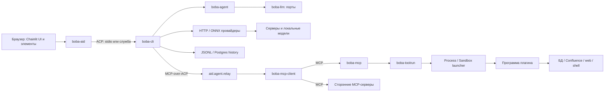
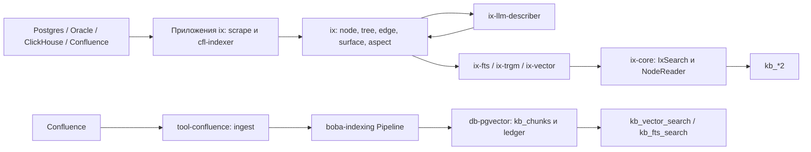
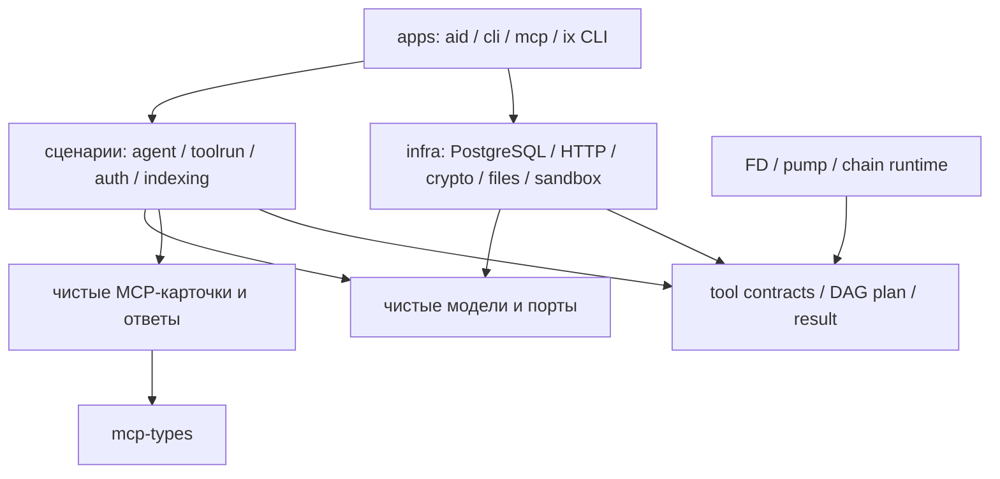
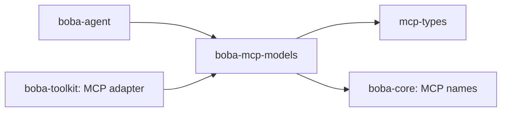
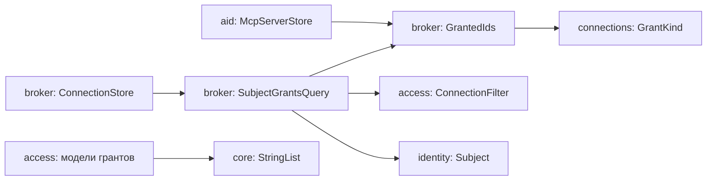
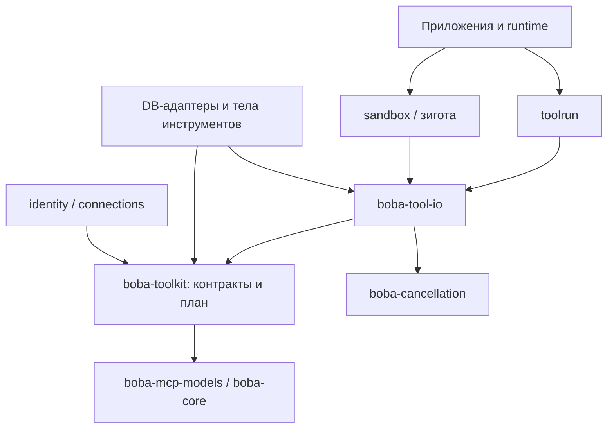
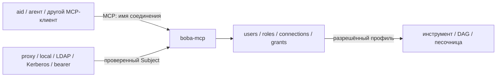
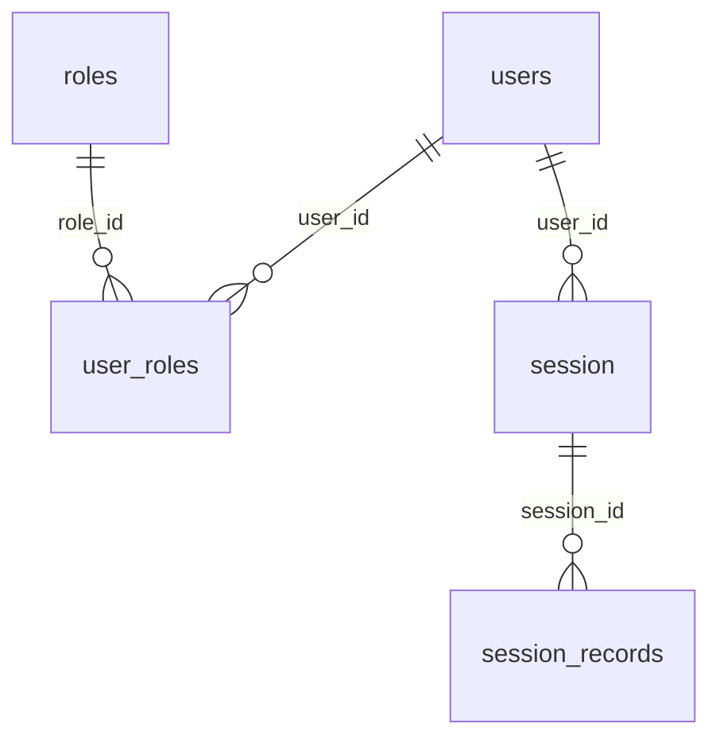
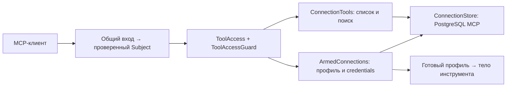
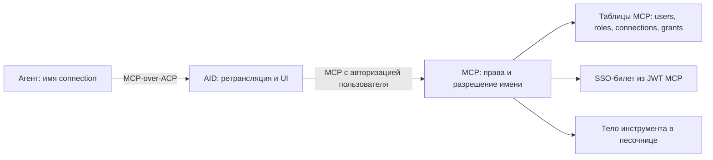

# Карта кодовой базы и основания для сокращения

Дата: 2026-11-01. Срез: `6c84d728f`, рабочее дерево до анализа было чистым.
Разделы 1–13 описывают исходный срез и план рефакторинга; рекомендации
уточнены с учётом решений пользователя. Оба KB-контура сохраняются (§22).
Дополнение от 2026-11-02: анализ внешних и транзитивных зависимостей, extras и
состава поставки — **§13**. Реализованные изменения, повторные измерения и
результаты тестирования от 2026-11-02 — **§14**; они уточняют исходный аудит.
Security-проверки, реальная Make-сборка и прототип отключения трассировки —
**§15**. Результат прототипа отделён от изменений рабочего lock.
Внедрение патча LiteralAI, сокращение внешних зависимостей поставки
**232 → 171** и проверки чата — **§16**. Исправление охвата SCA и обновление
уязвимого pypdf в shell-песочнице — **§17**. Production Python сокращён
**156 653 → 156 386 строк**; цель >2× остаётся открытой. После §31 было
156 191; исправление ACP в §32 добавило 172 строки production, первый шаг
конфигурации в §34 — ещё 23. Python и SQL
учитываются отдельно: §27 убрал 157 строк SQL, добавив 20 строк
общего выбора файлов; §28 убрал ещё 10 строк Python, §29 — 7 строк.
Разделение контрактов и исполнения в §30 добавило 82 строки адаптеров и
границ; это архитектурное изменение, не сокращение реализации.
Общий владелец пайпов и стандартный откат ресурсов в §31 убрали 53 строки.
Удаление неиспользуемых пакетов каталога и поиск визуальных эталонов — **§19**.
8151 строка исходников каталога учитывается отдельно: этот контур уже был
исключён из базы production-метрики.
Общие модели MCP и устранение дублей `agent`/`toolkit` — **§20**.
Устранение конфликта Chainlit/MCP локальным патчем — **§21**;
границы общего кода двух сохраняемых KB-контуров — **§22**.
FastMCP без ветки keyring, **232 → 161** внешняя зависимость поставки — **§23**;
устранение зависимости OAuth от runtime и завершённые проверки этих шагов —
**§24**. Независимое исправление удаления ссылок ix и проверки обоих KB — **§25**.
Прямые зависимости без исключения для чужих extras и библиотечный разбор
requirements — **§26**. Общие SQL-ресурсы PostgreSQL/Greenplum — **§27**.
Чистые правила доступа и SQL выдачи в брокере, минимальная установка
`boba-access` **18 → 7 пакетов** — **§28**.
Модели соединений без криптоадаптеров и сокращение состава песочниц
документов/БД — **§29**.
Контракты toolkit без Linux/FD и общий пакет исполнения `boba-tool-io` —
**§30**, полный цикл проверок завершён.
Общее владение пайпами process/zygote и исправление утечки FD — **§31**;
полный цикл проверок этого шага завершён.
По уточнению пользователя разработка решения для насосов на AnyIO выделена
в отдельный этап **после основной работы по сокращению и улучшению кода** —
**§10.2**. Перед продолжением рефакторинга завершены сверка и полный прогон
всех предусмотренных категорий тестов с разбором падений — **§32**:
**12 376 passed, 12 прежних xfailed**, все 12 388 сценариев охвачены.
Новое решение пользователя: владельцем connections, их каталога и проверки
грантов становится `boba-mcp`; модель передаёт имя, клиентское запечатывание
устраняется. Этап реализации **R16 / §33** выполняется после исправления
текущих тестов; в последовательности основной работы это этап **3а**.
Уточнение пользователя: AID сохраняет users/roles/grants и способы входа,
но не ограничивает tools. Правила входа, определения личности и прав общие
у AID и MCP; доступ к tools и connections проверяет MCP. Корпоративные
входы связываются по явным правилам, local остаётся отдельной личностью.
Дополнительный аудит конфигурации aid/boba/mcp — **R17 / §34**. По решению
пользователя **OmegaConf и TOML сохраняются**, переход на `pydantic-settings`
не выполняется. Упрощаются обязательные поля, сборка секций и настройки
выбранного режима; это дополняет перенос connections и предшествует AnyIO.
Реализованы defaults, разделение local/image storage, сокращение
Compose-конфигов, автоматическая сборка `[app]`, разделение process/service
в AID и общий формат server/paths/tls; результаты и остающаяся
работа — **§34.5–34.9**.
Требования к каждому шагу рефакторинга: итеративная проверка существующими
тестами и постоянный пересмотр границ общих компонентов — **§11.1–11.3**.
Дополнительные требования: `sec.sh`, работоспособность Make-сборки,
человекочитаемость и согласование существенных развилок — **§11.4–11.6**.
Целевой масштаб сокращения — **более чем вдвое**; правила оценки внешних
компонентов и измерения результата — **§8.1 и §10.1**. Уточнение выбора между
собственным кодом и библиотекой, включая пример psycopg/ADBC, — **§8.2**.

Цель — сократить объём сопровождаемого кода, число независимых реализаций одной
возможности и состав сторонних компонентов поставки, сохранив требуемое
поведение. Стоимость проверок ИБ и обновлений зависимостей — отдельный критерий.
Перемещение классов между файлами и
создание новых пакетов сами по себе сокращением не считаются.

## 1. Выводы для выбора направления

1. Общую основу нужно проверять у двух систем индексации: прежней
   `Confluence → Pipeline → kb_chunks` и новой `источники → ix → fts/trgm/vector`.
   Старые инструменты **по-прежнему зарегистрированы**. Их нельзя удалить только
   по слову «старый» в docstring. По решению пользователя оба контура остаются:
   сокращать нужно общие повторяющиеся механизмы, сохраняя их отдельные функции.
   REST/пагинация и HTML backend уже общие (§22.1); размер обоих контуров не
   является оценкой возможного сокращения.
2. На исходном срезе `boba-catalog` и `boba-catalog-service` исключены из
   workspace, pytest, Ruff и Pyright. После подтверждения пользователем
   неиспользования их 8 151 строка `src` удалена (§19). В активной системе эти строки уже не дают
   выигрыша по времени исполнения; их удаление сокращает дерево сопровождения.
3. Есть буквальные дубли: MCP-карточки и представление ответов в `agent`/`toolkit`,
   циклы FTS/TRGM, операции таблиц PostgreSQL в двух путях загрузки, валидация
   адресов БД. Для них возможны небольшие независимые изменения с понятным итогом.
4. Граф прямых статических импортов между пакетами ацикличен; импортов из пакетов
   `core` в пакеты `services/apps/infra` не найдено. Но границы ответственности
   размыты **внутри** нижних пакетов: `toolkit` содержит Linux I/O и исполнение,
   на исходном срезе `access` содержал SQL (исправлено в §28),
   криптоадаптеры `connections` перенесены в broker (§29),
   `core` по-прежнему содержит сборку Nuitka.
5. Сильнейшая общая зависимость — `boba-toolkit`: 14 220 строк, 42 других пакета
   импортируют его непосредственно. Дробить его нужно по контрактам и исполнению,
   а не по одному классу на пакет. Это прежде всего условие последующего удаления
   дублей, а не самостоятельная экономия строк.
6. Для собственного DI, HTTP-отдачи файлов и PostgreSQL↔Arrow сравнить упрощение
   текущей реализации с использованием библиотек. Сначала оценивать возможности
   уже используемых SDK, драйверов и форматных библиотек (§8.1–8.2).
7. Сокращение сторонних зависимостей требует работы с их транзитивным графом,
   а не только с прямыми imports. В семи основных сборочных профилях найдено
   232 внешних Python-дистрибутива. Крупнейший исследованный резерв aid —
   интеграция LiteralAI/Traceloop; небольшие первые шаги — зависимости runtime
   от FastAPI/aiofiles и extra uvicorn. Расчёты, ограничения и 11 направлений
   сокращения приведены в §13.

## 2. Методика, объём и границы достоверности

Проанализированы все 73 отслеживаемых `packages/**/pyproject.toml`, Python AST
всех 576 отслеживаемых файлов `src/**/*.py`, декларации extras и entry points,
точки сборки приложений, наиболее связанные и крупные модули, SQL-дерево,
фронтенд, сборка и существующие тесты. Проверены тела функций на точные совпадения
AST без docstring и координат; абстрактные заглушки не считались дублированием
функциональности. Функциональное дублирование проверялось чтением связанных
реализаций, регистраций и потребителей.

Числа ниже — **физические строки**, включая комментарии и пустые строки, а не
SLOC. Они воспроизводятся через `git ls-files`, `Path.read_text().splitlines()`.
Сторонние исходники в `build/src`, `.venv`, `node_modules`, результаты сборки,
локальные `runtime`/`.dev` и секреты экземпляров в базу подсчёта не входят.

| Категория `packages` | Пакеты | Python-файлы в `src` | Строки Python в `src` |
|---|---:|---:|---:|
| apps | 12 | 97 | 39 648 |
| core | 15 | 134 | 45 378 |
| infra | 24 | 155 | 44 009 |
| services | 8 | 73 | 26 816 |
| testing | 3 | 68 | 28 405 |
| tools | 11 | 49 | 10 649 |
| Всего | 73 | 576 | 194 905 |

В этой сумме есть исключённый каталог (8 151), исследовательский
`boba-prompt-assembly` (14 354) и тестовые стенды. `boba-stand-core` находится в
`core`, но его 1 696 строк относятся к тестовой инфраструктуре. После исключения
двух пакетов каталога, всей категории `testing` и `stand-core` остаётся 156 653
строки `src` — полезная отдельная база для оценки производственного кода.

Во всём отслеживаемом дереве: 1 006 Python-файлов / 349 007 строк; 387 SQL-файлов /
122 266 строк. Из SQL **99 714 строк** — справочные версии запросов
[`docs/psql-queries`](psql-queries), а не исполняемая бизнес-логика.
Фронтенд `aid/web`: 32 файла JS/TS/TSX / 5 004 строки; пользовательские элементы
`assets/public/elements`: 7 JSX-файлов / 4 232 строки. Копии компонентов Chainlit
в overlay входят в эти числа; при измерении экономии их стоит выделять отдельно.

Ограничения исследования:

- Статический импорт включает импорты внутри функций и `TYPE_CHECKING`; это
  зависимость исходников, а не доказательство загрузки модуля при каждом запуске.
- Граф пакетов строился по абсолютным `import`/`from` с разрешением до наиболее
  конкретного модуля-владельца. Динамические загрузки, entry points, запуск
  subprocess и SQL-связи проверялись отдельно; отсутствие импорта не доказывает
  неиспользование плагина. Внутримодульные и межмодульные циклы внутри одного
  дистрибутива этим результатом об ацикличности не покрываются.
- Проектные планы в `docs` не принимались за текущее устройство. Часть локальных
  планов не отслеживается Git; основание выводов — исходники текущего среза.
- Не выполнялись запуск сервисов, обращение к рабочим БД, нагрузочные измерения,
  полный тестовый прогон или удаление кода. Это архитектурный аудит, а не
  подтверждение корректности всех исполняемых веток.
- Для рекомендаций библиотек проверена публичная документация; совместимость с
  закреплёнными версиями, Linux-окружением и Nuitka требует отдельного прототипа.
- «Подтверждено» означает наличие связи/повтора в исходниках; оценка объёма
  будущего удаления и эксплуатационной востребованности остаётся гипотезой.

## 3. Карта исполнения и владельцы данных

### 3.1. Основной пользовательский путь



Стрелки здесь означают взаимодействие, не только Python-импорт. В текущем
`cli/acp_server.py:McpServerSpecs` агент принимает только MCP-over-ACP;
записи прямых HTTP/stdio MCP-серверов отвергаются. Соединениями с этими серверами
владеет клиент агента — в показанном пути это aid и его relay.
`boba-aid` не импортирует `boba-agent`: процессы разделены ACP и
схемой настроек. Тела инструментов выполняются программами плагинов; MCP-сервис
собирает их по манифестам, а не должен импортировать все тела инструментов.

Основные точки для чтения:

- [`aid/infra/bootstrap.py`](../packages/apps/boba-aid/src/boba/aid/infra/bootstrap.py),
  [`aid/agent/chat.py`](../packages/apps/boba-aid/src/boba/aid/agent/chat.py),
  [`aid/agent/relay.py`](../packages/apps/boba-aid/src/boba/aid/agent/relay.py).
- [`cli/app.py`](../packages/apps/boba-cli/src/boba/cli/app.py),
  [`cli/acp_server.py`](../packages/apps/boba-cli/src/boba/cli/acp_server.py),
  [`cli/serve.py`](../packages/apps/boba-cli/src/boba/cli/serve.py).
- [`mcp_server/app.py`](../packages/apps/boba-mcp/src/boba/mcp_server/app.py),
  [`runtime/plugins.py`](../packages/services/boba-runtime/src/boba/runtime/plugins.py),
  [`toolrun/registry.py`](../packages/services/boba-toolrun/src/boba/toolrun/registry.py).

### 3.2. Поиск и индексация



Новый контур индексирует адресуемые объекты и аспекты нескольких источников.
Старый — коллекции чанков документов с собственными хешами, ledger,
фильтрацией и очисткой. Это пересекающиеся возможности, но разные модели данных;
оба контура сохраняются. Общие HTTP, Confluence, текстовые и модельные
компоненты можно переиспользовать без объединения индексов и их данных.

### 3.3. Данные и ответственность

| Данные / состояние | Контракт / владелец | Реализация и потребители |
|---|---|---|
| Записи разговора, восстановление, сжатие | `agent/history.py`, `records.py`, `writer.py` | `history-jsonl`, `history-postgres`, memory; агент пишет, ACP передаёт представление чату |
| Метаданные тредов и feedback | `boba-chat` | `runtime/threads.py`, `elements.py`; `aid/data/data_layer.py` адаптирует Chainlit |
| Пользователи, логин, роли, контекст | `identity`, `auth`, `access` | `runtime/users.py`, LDAP/Kerberos, HTTP-входы aid/mcp/agent |
| Соединения и выдачи | `connections/stored.py` | `connection-broker/store.py`; broker готовит соединения на вызов и запечатывает их |
| MCP-серверы пользователя и OAuth-токены | `aid/mcp_servers` | таблицы server/grant, шифрованное OAuth-хранилище; `mcp-client` выполняет подключения |
| Живые события, команды и блокировки | `messaging`, `identity/locks.py` | `runtime/bus.py`, `payloads.py`, `locks.py`; вкладки и держатели запусков |
| Файлы workspace, журналы потоков | `canvas/storage.py`, `journal.py` | `runtime/storage.py`, `journal.py`; MCP отдаёт файлы, aid использует remote storage |
| Индексы объектов | `ix-core` и SQL поверхностей | scrape/index workers; `tool-knowledge` и search-lab читают |
| Старые документы/чанки | `indexing` | `db-pgvector`; ingest пишет, старые KB-инструменты читают |
| Старые процессы и версии снимков каталога | `catalog`, `catalog-service` | исключены из активного workspace; отдельный предметный контур |

Две таблицы/модели со словом `thread`, `history`, `connection` или `node` ещё не
дубли: важно, кто владеет записью, жизненным циклом и API. Например, история
агента и метаданные треда UI нужны одновременно; `canvas` как UI-панель и
workspace storage — связанные, но разные обязанности.

## 4. Реестр компонентов

Ниже перечислены **все 73 пакета**. «Связи» — прямые фактические внутренние
импорты из `src`, без внешних библиотек. Для компактности префикс `boba-` у
зависимостей опущен. Пустой список означает отсутствие внутренних статических
импортов, а не отсутствие внешних зависимостей. Динамические связи описаны в §5.

### 4.1. Приложения и workers

| Пакет / исходники | Python LOC | Назначение | Связи: импортирует |
|---|---:|---|---|
| [boba-aid](../packages/apps/boba-aid/src) | 23 453 | Веб-приложение Chainlit: login, треды, ACP-клиент агента, MCP relay, каталог MCP-серверов, canvas и удалённые файлы. `agent`, `rendering`, `infra`, `data`, `mcp_servers` — главные подсистемы. | `access`, `auth`, `cancellation`, `canvas`, `chat`, `config`, `connection-broker`, `connections`, `core`, `db-postgres`, `identity`, `kerberos`, `mcp-adapter`, `mcp-client`, `messaging`, `runtime`, `sandbox`, `toolkit`, `toolrun`, `transport-acp`, `transport-http` |
| [boba-cli](../packages/apps/boba-cli/src) | 8 670 | Программа агента: сборка `Agent`, настройки, ACP stdio/server, служба WebSocket, история и управление потоками сессий. Владелец composition root агента. | `access`, `agent`, `auth`, `cancellation`, `config`, `core`, `db-postgres`, `history-jsonl`, `history-postgres`, `identity`, `ldap`, `llm`, `llm-http`, `llm-onnx`, `oauth`, `runtime`, `transport-acp` |
| [boba-mcp](../packages/apps/boba-mcp/src) | 2 699 | MCP-сервис инструментов: OAuth, роли, endpoint/prompts, file/journal API, сборка runtime и исполнителей. | `access`, `auth`, `cancellation`, `canvas`, `config`, `connection-broker`, `connections`, `core`, `identity`, `mcp-adapter`, `oauth`, `runtime`, `sandbox`, `toolkit`, `toolrun` |
| [boba-cfl-indexer](../packages/apps/ix/cfl-indexer/src) | 1 678 | Обход Confluence по спейсам, страницы/вложения/comments/links, извлечение документов и запись в поверхности ix; отдельный worker/CLI. | `cancellation`, `confluence`, `db-postgres`, `doc`, `ix-core`, `krb`, `llm`, `transport-http` |
| [boba-ch-meta-scraper](../packages/apps/ix/ch-meta-scraper/src) | 239 | Снятие системных метаданных ClickHouse; реализация источника для общего scrape runner и собственные SQL/layout. | `cancellation`, `db-clickhouse`, `ix-core` |
| [boba-ix-fts](../packages/apps/ix/ix-fts/src) | 281 | Пакетный upsert/prune полнотекстового индекса аспектов ix, веса FTS, SQL и CLI. | `cancellation`, `config`, `db-postgres`, `ix-core` |
| [boba-ix-llm-describer](../packages/apps/ix/ix-llm-describer/src) | 681 | Очередь объектов ix → текст аспектов → описание LLM → запись результата; ограничение и свёртка контекста. | `cancellation`, `config`, `db-postgres`, `ix-core`, `llm` |
| [boba-ix-search-lab](../packages/apps/ix/ix-search-lab/src) | 335 | Отдельный HTTP-стенд сравнения FTS/TRGM/vector выдачи; диагностическое приложение. | `cancellation`, `config`, `db-postgres`, `ix-core`, `llm` |
| [boba-ix-trgm](../packages/apps/ix/ix-trgm/src) | 235 | Пакетный upsert/prune триграммного индекса аспектов ix; собственные SQL и CLI. | `cancellation`, `config`, `db-postgres`, `ix-core` |
| [boba-ix-vector](../packages/apps/ix/ix-vector/src) | 522 | Чанкирование аспектов по токенам, embeddings, запись и очистка векторного индекса ix. | `cancellation`, `config`, `db-postgres`, `ix-core`, `llm` |
| [boba-ora-meta-scraper](../packages/apps/ix/ora-meta-scraper/src) | 227 | Источник метаданных Oracle для общего scrape runner; SQL системных каталогов и layout поверхности. | `cancellation`, `db-oracle`, `ix-core` |
| [boba-pg-meta-scraper](../packages/apps/ix/pg-meta-scraper/src) | 628 | Источник PostgreSQL/Greenplum: определение версии, выбор SQL вариантов, общий scrape runner и layout поверхности. | `cancellation`, `db-postgres`, `ix-core`, `kerberos` |

### 4.2. Доменные и общие пакеты

| Пакет / исходники | Python LOC | Назначение | Связи: импортирует |
|---|---:|---|---|
| [boba-access](../packages/core/boba-access/src) | 537 | Решения по tool grants/профилям/ролям; также SQL получения выданных соединений (`grants.py`, D02). | `connections`, `identity`, `toolkit` |
| [boba-agent](../packages/core/boba-agent/src) | 12 575 | Ядро разговора: `Agent`, очередь, turn loop, tools/permissions, сборка запроса, compaction, records, history ports, replay, skills. Не зависит от UI или DB-реализации. | `cancellation`, `core`, `llm` |
| [boba-cancellation](../packages/core/boba-cancellation/src) | 218 | Контекст и сигнал отмены, причины остановки, прерыватели и завершение процесса; без сторонних зависимостей. | — |
| [boba-canvas](../packages/core/boba-canvas/src) | 2 214 | Контракты файлов/workspace, ключи, панели и watchers, stream journals, transfer headers и Mermaid-описания. | `core`, `identity`, `toolkit` |
| `boba-catalog` (удалён, §19) | 2 408 | Исключённый домен редактора процессов: snapshots, nodes/flows/groups, операции, diff, source diff и staleness. | — |
| [boba-chat](../packages/core/boba-chat/src) | 557 | Контракты хранения тредов/feedback и выбор chat-профиля по ролям; не реализация agent loop. | `access`, `identity`, `llm` |
| [boba-connections](../packages/core/boba-connections/src) | 1 441 | Профили и записи соединений, registry типов/адресов, credential ports, whitelist; также JWE-печать и шифрование секретов. | `core`, `identity`, `kerberos`, `toolkit` |
| [boba-core](../packages/core/boba-core/src) | 1 006 | Общие имена MCP, команды и аргументы, безопасный текст validation, сериализация secrets; также Nuitka package-data survey/self-check. | — |
| [boba-identity](../packages/core/boba-identity/src) | 2 743 | Subject/Scope, вход/SSO/token/session/directory ports, доменные ошибки, реестр запусков и контракты live locks. | `cancellation`, `core`, `toolkit` |
| [boba-indexing](../packages/core/boba-indexing/src) | 3 458 | Старый универсальный document pipeline: requests/transports/readers/chunkers, sections, hashes, filters, source ledger, store ports, run events. | `llm` |
| [boba-kerberos](../packages/core/boba-kerberos/src) | 547 | Модели и порты Kerberos без gssapi: профили аутентификации/делегирования, sign-in и типы ошибок. | `core` |
| [boba-llm](../packages/core/boba-llm/src) | 790 | Контракты chat/embedding, запросы/ответы, capabilities и registry провайдеров; независимая граница модели. | — |
| [boba-messaging](../packages/core/boba-messaging/src) | 968 | Контракты событий, команд, подписок и тел сообщений между процессами; Postgres-реализация в runtime. | `identity` |
| [boba-stand-core](../packages/core/boba-stand-core/src) | 1 696 | Общие тестовые примитивы, контексты и probes; собственный AST-аудитор зависимостей `deps.py` (891 строка). pytest-зависимость, несмотря на размещение в core. | `cancellation`, `core`, `identity`, `toolkit` |
| [boba-toolkit](../packages/core/boba-toolkit/src) | 14 220 | SDK инструментов: manifest/schema/result/MCP, facade/entry, ports/frames, DAG/chain, transfer и SQL helpers; одновременно контракты и I/O-исполнение (D01). | `cancellation`, `core` |

### 4.3. Инфраструктурные адаптеры

| Пакет / исходники | Python LOC | Назначение | Связи: импортирует |
|---|---:|---|---|
| [boba-krb](../packages/infra/auth/boba-krb/src) | 1 724 | Реализации Kerberos через gssapi/krb5: tickets, SPNEGO, workspace, sealed credentials; потребители — auth и адаптеры соединений. | `kerberos`, `toolkit` |
| [boba-ldap](../packages/infra/auth/boba-ldap/src) | 165 | Адаптер каталога пользователей на ldap3 для контрактов identity; поиск и проверка учётных данных. | `identity` |
| [boba-config](../packages/infra/config/boba-config/src) | 214 | Чтение и композиция TOML-конфигурации с OmegaConf; входная граница настроек. | — |
| [boba-db-clickhouse](../packages/infra/db/boba-db-clickhouse/src) | 6 531 | Профиль/auth/address, query builder, payload driver, описание типов, trace, wire formats, Arrow и transfer стороны ClickHouse. | `connections`, `core`, `kerberos`, `krb`, `toolkit` |
| [boba-db-oracle](../packages/infra/db/boba-db-oracle/src) | 2 865 | Профиль/auth/address, query builder, thin payload, trace, Arrow source/sink и отображение типов Oracle. | `connections`, `core`, `toolkit` |
| [boba-db-pgvector](../packages/infra/db/boba-db-pgvector/src) | 1 415 | Старое KB-хранилище: chunks/collections/source ledger, DSL→SQL, schema/migrations и vector/FTS операции. | `db-postgres`, `indexing`, `toolkit` |
| [boba-db-postgres](../packages/infra/db/boba-db-postgres/src) | 6 119 | Профиль libpq/auth, async pool/cancellation, SQL builder/schema/table, address, payload, trace, describe, COPY/Arrow/transfer. | `cancellation`, `connections`, `core`, `kerberos`, `krb`, `toolkit` |
| [boba-confluence](../packages/infra/format/boba-confluence/src) | 2 733 | Общий REST builder/paginator, DTO, адреса, JSON и HTML разбор Confluence; часть моделей связана со старым indexing. | `connections`, `doc`, `indexing`, `toolkit`, `transport-http` |
| [boba-doc](../packages/infra/format/boba-doc/src) | 2 212 | Маршрутизатор форматов, документ/страницы/окна/поиск, PDF/Office/text/image readers, OCR и async-byte bridge; уже поверх готовых parser-библиотек. | `llm` |
| [boba-kbdoc](../packages/infra/format/boba-kbdoc/src) | 353 | Адаптер документа базы знаний к section/reader моделям старого indexing. | `indexing` |
| [boba-text](../packages/infra/format/boba-text/src) | 893 | PlainTextReader, символьный и структурный chunker, grep с окнами/лимитами; часть API зависит от indexing. | `indexing` |
| [boba-history-jsonl](../packages/infra/history/boba-history-jsonl/src) | 516 | Файловая реализация HistoryStore: JSONL, запись/чтение, владение и восстановление истории агента. | `agent` |
| [boba-history-postgres](../packages/infra/history/boba-history-postgres/src) | 997 | Postgres-реализация HistoryStore: хранение записей и владение сессией; используется сборкой агента. | `agent`, `db-postgres` |
| [boba-ix-core](../packages/infra/ix/ix-core/src) | 2 730 | Общие ix schema upgrade, surface/aspect/index registry, URL templates, NodeReader/IxSearch и scrape runner. Несмотря на имя core — инфраструктура PostgreSQL. | `config`, `db-postgres`, `krb`, `toolkit` |
| [boba-llm-fastembed](../packages/infra/llm/boba-llm-fastembed/src) | 248 | Локальный embedding backend FastEmbed; регистрируется как LLM provider, тяжёлая реализация подключается extra. | `llm`, `toolkit` |
| [boba-llm-http](../packages/infra/llm/boba-llm-http/src) | 1 512 | OpenAI-compatible SSE chat/embeddings и Ollama NDJSON; wire DTO, chunk assembly и mapping ошибок поверх общего HTTP. | `llm`, `toolkit`, `transport-http` |
| [boba-llm-onnx](../packages/infra/llm/boba-llm-onnx/src) | 815 | Локальный chat backend ONNX Runtime GenAI, генерация/отмена и provider manifest; модели вне исходников. | `llm`, `toolkit` |
| [boba-sandbox](../packages/infra/sandbox/boba-sandbox/src) | 8 071 | Программа plugin SDK, manifest/setup/call, guest/zygote, warmup, cgroups, mounts/rootfs/workspace и изолированный launcher. | `cancellation`, `core`, `toolkit` |
| [boba-stream-ch-to-ch](../packages/infra/stream/boba-stream-ch-to-ch/src) | 174 | Специализированный transfer ClickHouse→ClickHouse, регистрируемая стратегия приёмника. | `db-clickhouse`, `toolkit` |
| [boba-stream-ch-to-pg](../packages/infra/stream/boba-stream-ch-to-pg/src) | 291 | Специализированный transfer ClickHouse→PostgreSQL; связывает контракты двух DB-адаптеров. | `db-clickhouse`, `db-postgres`, `toolkit` |
| [boba-stream-pg-to-ch](../packages/infra/stream/boba-stream-pg-to-ch/src) | 359 | Специализированный transfer PostgreSQL→ClickHouse; регистрируемая стратегия и преобразование потока. | `db-clickhouse`, `db-postgres`, `toolkit` |
| [boba-stream-pg-to-pg](../packages/infra/stream/boba-stream-pg-to-pg/src) | 233 | Специализированный transfer PostgreSQL→PostgreSQL через COPY; регистрируемая стратегия. | `db-postgres`, `toolkit` |
| [boba-transport-acp](../packages/infra/transport/boba-transport-acp/src) | 877 | Общие расширения/модели транспорта ACP поверх agent-client-protocol, включая MCP-over-ACP; без внутренней зависимости от agent. | — |
| [boba-transport-http](../packages/infra/transport/boba-transport-http/src) | 1 962 | HttpConnection/auth, request/response stream, retries, cancellation, сетевые настройки и регистрация web connection. | `cancellation`, `connections`, `kerberos`, `krb` |

### 4.4. Сервисы и сборка

| Пакет / исходники | Python LOC | Назначение | Связи: импортирует |
|---|---:|---|---|
| [boba-auth](../packages/services/boba-auth/src) | 2 479 | Общий сервис входа: local/LDAP/Kerberos/proxy, роли и профили, JWT сессии, credential source для вызовов. | `connections`, `identity`, `kerberos`, `krb`, `toolkit` |
| `boba-catalog-service` (удалён, §19) | 5 743 | Исключённый сервис версий процессов/черновиков, Postgres stores, снимки подключений, sync runner и публикация событий. | `cancellation`, `catalog`, `db-postgres`, `identity`, `messaging`, `toolkit`, `toolrun` |
| [boba-connection-broker](../packages/services/boba-connection-broker/src) | 1 648 | Хранилище connections/roles/grants, подготовка credentials, sealed params на обеих сторонах, connection_list/search. | `access`, `connections`, `core`, `db-postgres`, `identity`, `kerberos`, `toolkit`, `toolrun` |
| [boba-mcp-adapter](../packages/services/boba-mcp-adapter/src) | 302 | Адаптирует ToolServer/tool-result к FastMCP provider/tools; фильтрация по вызывающему и URI журналов. | `toolkit` |
| [boba-mcp-client](../packages/services/boba-mcp-client/src) | 3 366 | HTTP/stdio подключения MCP, auth, sessions/dispatch, tool/resource/prompt каталог, cache/subscriptions, файлы/журналы и запуск команды. | `auth`, `canvas`, `connections`, `core`, `sandbox`, `toolkit` |
| [boba-oauth](../packages/services/boba-oauth/src) | 1 187 | OAuth-сервер служб на FastMCP: login pages, access/refresh/resource tokens, клиенты и коды; общее auth ядро, HTTP SSO из runtime. | `auth`, `identity`, `runtime` |
| [boba-runtime](../packages/services/boba-runtime/src) | 7 949 | Общий composition/config/DI слой, providers и plugins; одновременно Postgres bus/locks/chat tables, storage/journal, HTTP и launcher assembly. | `access`, `auth`, `cancellation`, `canvas`, `chat`, `config`, `connection-broker`, `connections`, `db-postgres`, `identity`, `krb`, `ldap`, `messaging`, `sandbox`, `toolkit`, `toolrun` |
| [boba-toolrun](../packages/services/boba-toolrun/src) | 4 142 | Сервис исполнения инструментов: registry/hosting, injected config/context, access/cancel/error/log wrappers, DAG, streams и process launcher. | `access`, `cancellation`, `canvas`, `identity`, `toolkit` |

### 4.5. Плагины инструментов

| Пакет / исходники | Python LOC | Назначение | Связи: импортирует |
|---|---:|---|---|
| [boba-tool-canvas](../packages/tools/boba-tool-canvas/src) | 216 | Plugin canvas: открыть/отправить workspace-файл, сохранить Mermaid; использует canvas-контракты. | `canvas`, `identity`, `toolkit` |
| [boba-tool-clickhouse](../packages/tools/boba-tool-clickhouse/src) | 1 632 | Plugin ch: query, описания объектов и адресов, потоковый export/import и sync; работает через DB-адаптер. | `core`, `db-clickhouse`, `toolkit` |
| [boba-tool-confluence](../packages/tools/boba-tool-confluence/src) | 2 769 | Два plugin id: чтение/search Confluence и старый ingest страниц/спейсов в chunk KB с OCR/embedding/progress. | `confluence`, `core`, `db-pgvector`, `doc`, `indexing`, `llm`, `text`, `toolkit`, `transport-http` |
| [boba-tool-describer](../packages/tools/boba-tool-describer/src) | 1 267 | Plugin describer: CRUD узлов и рёбер пользовательских описаний, собственное Postgres-хранилище и entity addresses. | `connections`, `core`, `db-postgres`, `identity`, `toolkit` |
| [boba-tool-doc](../packages/tools/boba-tool-doc/src) | 291 | Plugin doc: чтение окна страниц, outline и поиск документа, настройки OCR/model через boba-doc. | `doc`, `llm`, `toolkit` |
| [boba-tool-knowledge](../packages/tools/boba-tool-knowledge/src) | 1 073 | Plugin kb: одновременно прежний chunk search и ix catalog/FTS/TRGM/vector/node инструменты; setup старой KB-схемы. | `confluence`, `core`, `db-pgvector`, `db-postgres`, `indexing`, `ix-core`, `kbdoc`, `llm`, `toolkit` |
| [boba-tool-mail](../packages/tools/boba-tool-mail/src) | 100 | Plugin mail: SMTP-отправка с typed config; малый адаптер stdlib, малый потенциал сокращения. | `core`, `toolkit` |
| [boba-tool-oracle](../packages/tools/boba-tool-oracle/src) | 1 086 | Plugin ora: query, описания объектов/адреса и Arrow streams/sync через Oracle-адаптер. | `core`, `db-oracle`, `toolkit` |
| [boba-tool-postgres](../packages/tools/boba-tool-postgres/src) | 1 581 | Plugin pg: query/scripts, описания объектов/адреса, COPY/Arrow streams/sync через PostgreSQL-адаптер. | `core`, `db-postgres`, `toolkit` |
| [boba-tool-shell](../packages/tools/boba-tool-shell/src) | 270 | Plugin bash: команда в среде запуска, ограничение входа, сбор/публикация потоков stdout/stderr. | `toolkit` |
| [boba-tool-web](../packages/tools/boba-tool-web/src) | 364 | Plugin web: fetch/grep/address, HTML/document extraction с общим HTTP и text/doc. | `core`, `doc`, `llm`, `text`, `toolkit`, `transport-http` |

### 4.6. Стенды и исследования

| Пакет / исходники | Python LOC | Назначение | Связи: импортирует |
|---|---:|---|---|
| [boba-prompt-assembly](../packages/testing/boba-prompt-assembly/src) | 14 354 | Исследовательский CLI реконструкции prompts/requests/compaction из журналов; независимая модель, не production agent. | — |
| [boba-pump-stand](../packages/testing/boba-pump-stand/src) | 1 597 | Интеграционный стенд per-engine transfer, DAG, типовые матрицы и сверка значений PG/CH/Oracle. | `connection-broker`, `connections`, `db-clickhouse`, `db-oracle`, `db-postgres`, `identity`, `stand`, `stand-core`, `tool-clickhouse`, `tool-oracle`, `tool-postgres`, `toolkit`, `toolrun` |
| [boba-stand](../packages/testing/boba-stand/src) | 12 454 | Общие интеграционные стенды: конфиг/БД/Kerberos, sandbox/zygote, agent/ACP/MCP, fake LLM, Confluence, UI/browser, fixtures. | `access`, `agent`, `auth`, `cfl-indexer`, `chat`, `cli`, `config`, `confluence`, `connection-broker`, `connections`, `core`, `db-clickhouse`, `db-oracle`, `db-postgres`, `history-jsonl`, `identity`, `ix-core`, `ix-fts`, `ix-trgm`, `ix-vector`, `kerberos`, `krb`, `ldap`, `llm`, `llm-fastembed`, `llm-http`, `mcp-client`, `runtime`, `sandbox`, `stand-core`, `tool-clickhouse`, `tool-postgres`, `tool-shell`, `tool-web`, `toolkit`, `toolrun`, `transport-http` |


## 5. Связи, не видимые в обычном графе импортов

| Механизм | Где объявлен / кто читает | Значение для рефакторинга |
|---|---|---|
| `boba.tools` | `pyproject.toml` пакетов инструментов → `sandbox.program`, манифесты → `runtime.plugins` | 11 пакетов дают 12 plugin id: Confluence имеет `confluence` и `ingest`; отсутствие импорта тела из приложения — нормальная изоляция |
| `boba.connections` | пакеты БД и HTTP → `connections.manifest.ConnectionTypes` | host должен знать виды профилей; драйвер тела может оставаться extra |
| `boba.addresses` | DB, Confluence, describer → `connections.address.AddressFamilies` | пакет может требоваться только ради регистрации семейства адресов |
| `boba.llm` | HTTP, ONNX, FastEmbed → `llm.providers` | неиспользуемость провайдера нельзя выводить из одного AST |
| `boba.transfer.*` | четыре stream-пакета → реестры transfer приёмников | специализации pg↔ch подгружаются без прямого импорта вызывающим |
| Сборочные списки и configs | `build/Makefile`, `apps/boba-mcp/conf/plugins` | определяют состав программ, extras, rootfs и моделей; изменение pyproject недостаточно |
| SQL-ресурсы | каталоги `schema`, `layout`, `scrape`, `run`, `verify` | имена файлов и столбцов — фактически API между общим runner и пакетом источника |
| ACP и JSON Schema | `aid.agent.settings`, `agent.settings`, `transport-acp` | отдельные процессы могут иметь разные DTO, совместимость проверяется контрактом |
| Chainlit overlay | `web/chainlit-ui/UPSTREAM`, `build/ui.Dockerfile` | это поддерживаемая модификация внешнего UI, а не самостоятельный frontend framework |

[`build/Makefile`](../build/Makefile) собирает программы `boba`, `boba-mcp`,
`boba-aid`, программы групп плагинов, rootfs и модели. Режимы получения исходников,
подготовки, компиляции и упаковки имеют разные сетевые условия.
[`core/package_data.py`](../packages/core/boba-core/src/boba/core/package_data.py)
сохраняет ресурсы и entry points для Nuitka. Эти связи обязательны в проверке
удаления пакета: успешный импорт из общего `.venv` не доказывает успешную сборку.

## 6. Реестр дублирования и кандидатов на сокращение

Приоритет P0 — подготовить безопасное удаление/границы; P1 — первый цикл
сокращения; P2 — прототип или последующий цикл. Размер области — объём для
исследования, **не обещание**, что все эти строки будут удалены.

### R01. Исключённый каталог — выполнено, §19

**Доказательства.** `boba-catalog` (2 408 строк) и `boba-catalog-service`
(5 743) исключены в корневом [pyproject.toml](../pyproject.toml) и
[`packages/conftest.py`](../packages/conftest.py). Единственный пакетный
потребитель `catalog` в `src` — `catalog-service`; потребителей самого сервиса
в остальных анализируемых `src` не найдено.

**Действие.** Проверить внешние импорты, старые развёртывания и нужность редактора
процессов; затем удалить оба пакета из основной ветки, сохранив историю Git.
Снять относящиеся к ним исключения. Не переносить автоматически старые модели
процесса в `ix`: совпадение слова «каталог» не означает эквивалентный продукт.

**Проверка.** Сборочные списки, документация и runtime-конфиги не ссылаются на
каталог; активные тесты и упаковка приложений проходят без него. Потенциал —
ровно 8 151 строка `src` плюс тесты, но это сокращение уже отключённого контура.

### R02. Общая основа двух сохраняемых систем индексации/KB — P1

**Доказательства.**
[`kb/tools.py`](../packages/tools/boba-tool-knowledge/src/boba/tool/kb/tools.py)
в `TOOLS` регистрирует одновременно `kb_vector_search`, `kb_fts_search` и
`kb_*2`. Более того, отслеживаемый
[`conf/plugins/kb.conf`](../compose/mcp/conf/plugins/kb.conf)
включает только два старых поиска; новые имена `*2` в его allowlist закомментированы.
Это состояние поставляемого конфига, а не проверка локальных настроек работающих
экземпляров. [`kb/plugin.py`](../packages/tools/boba-tool-knowledge/src/boba/tool/kb/plugin.py)
по-прежнему выполняет `KbSchema` старого pgvector store.
[`confluence/plugin.py`](../packages/tools/boba-tool-confluence/src/boba/tool/confluence/plugin.py)
публикует ingest с тем же storage setup.
[`ingest_base.py`](../packages/tools/boba-tool-confluence/src/boba/tool/confluence/ingest_base.py)
собирает `Pipeline`, `PostgresChunkStore`, `PostgresSourceLedger`,
`StructuralChunkerFactory`; новый
[`cfl_indexer/worker.py`](../packages/apps/ix/cfl-indexer/src/boba/cfl_indexer/worker.py)
пишет объекты/аспекты в `ix` своим путём.

**Что пересекается.** Обход Confluence, извлечение текста вложений, отслеживание
изменений/удалений, чанкирование, эмбеддинги, FTS/vector поиск, отчётность.
Старые `indexing_log.py` (628 строк) и `ingest_base.py` (533) содержат отдельную
обвязку запуска и прогресса.

**Решение пользователя:** оба индексатора и оба поиска остаются самостоятельными.
Объединение данных, переключение старых инструментов на ix и удаление прежнего
контура отменены как ошибочная интерпретация задачи. Их сохранение не требует
переиндексации или решения о доступности исторических источников.

**Направление рефакторинга.** Найти повторяющиеся механизмы под двумя сценариями:
Confluence REST/пагинацию и разбор общих полей ответа; чтение вложений и OCR;
чистые операции над текстом и одинаковые правила метаданных. Сначала использовать
существующие `boba-confluence`, `boba-doc`, `boba-text` и доменные модели; выносить
новый пакет только при необходимости правильного направления зависимостей.
Не импортировать приложение `cfl-indexer` из инструментов. Хранилища, chunk/ix
модели, стратегии очистки, поиск и управление запуском остаются своими.

**Граница изменений.** `kb/chunks.py`, `kb/search.py`, `KbSchema`,
`PostgresChunkStore`, ledger, `boba-indexing` и их инструменты не являются
кандидатами на удаление по наличию нового ix. Удалять можно только конкретный
дублирующий внутренний алгоритм, когда оба потребителя используют одну общую
реализацию с прежним поведением. Различающиеся контракты не сводить к одному
классу с флагами.

**Проверка.** Старый поиск, page/space ingest, коллекции, OCR, прогресс и очистка
проходят свои существующие тесты; ix, его worker, связи и поиск — свои.
Общий компонент проверяется на данных обоих потребителей, включая различия
§22. Экономия заранее не приравнивается к размеру одного из контуров.

### R03. Повторный разбор Confluence и HTML — P1, функциональное пересечение

[`confluence/parsing.py`](../packages/infra/format/boba-confluence/src/boba/confluence/parsing.py),
[`confluence/html.py`](../packages/infra/format/boba-confluence/src/boba/confluence/html.py),
[`cfl_indexer/confluence.py`](../packages/apps/ix/cfl-indexer/src/boba/cfl_indexer/confluence.py),
[`doc/html.py`](../packages/infra/format/boba-doc/src/boba/doc/html.py) и
`tool-confluence/pipeline.py` образуют несколько путей JSON/HTML→текст.
В indexer есть собственные `ConfluenceParser`, `ConfluenceReader`, `Content`,
`Attachment`; старый путь использует свои DTO и decoder.

Уточнение после чтения обоих путей (§22.1): REST-клиент, пагинация, HTML-дерево
Confluence и Markdown backend **уже общие**. Повторное выделение этих механизмов
не требуется и не даст ожидаемой экономии. Проверять оставшееся извлечение
полей JSON и смешение общих DTO с адаптерами старого ingestion.
Не сводить обычный HTML и Confluence storage macros в одинаковый алгоритм:
секции, таблицы, ссылки и формат тела требуют адаптера. Критерий — устранение
подтверждённого повторения с сохранением результата на существующих fixtures,
а не единая модель на все случаи.

### R04. Несколько алгоритмов разбиения текста — P2, пересечение с разной семантикой

Есть `text/splitter.py:OverlapCharSplitter`,
`text/structural_chunker.py:StructuralChunker`,
[`ix_vector/embedding.py`](../packages/apps/ix/ix-vector/src/boba/ix_vector/embedding.py):`Chunker`
и [`ix_llm_describer/describe.py`](../packages/apps/ix/ix-llm-describer/src/boba/ix_llm_describer/describe.py):`MarkdownSplit`.
Они решают соседние задачи — символьное перекрытие, структурные секции,
токеновый бюджет embedding, сокращение контекста описателя.

Сохранить алгоритмы с разными назначениями; выделить минимальный общий контракт
фрагмента (текст, происхождение, длина/бюджет), только если он нужен обоим
потребителям. Удалять лишь вытесненные дубли конкретных операций.
Сравнить с chunker выбранного document backend. Нельзя подменять бюджет токенов
числом символов или терять заголовки таблиц ради единственного класса.

### R05. MCP-карточки и ответы продублированы — P1, точные совпадения

[`agent/mcp.py`](../packages/core/boba-agent/src/boba/agent/mcp.py) и
[`toolkit/mcp.py`](../packages/core/boba-toolkit/src/boba/toolkit/mcp.py):
совпадают тела `ToolCards.hints_of` / `McpToolStubs.hints_of` (строки 107 / 80),
`ToolReplies.prompt` / `McpResults.prompt` (197 / 158), `_block_text` (244 / 196).
Совпадения подтверждены AST, а не только
сходством имён. Вместе файлы занимают 478 строк; не все строки идентичны.

Выделить небольшой **чистый** общий контракт MCP-карточки/ответа либо модуль в
узком базовом пакете. Он зависит от `mcp-types` и имён MCP, не от запуска
инструментов, UI, файлов и Linux. Не решать дубль подключением всего `toolkit`
к `agent`: это испортит уже существующую независимость ядра агента.

Проверить audience, отсутствие annotations, structuredContent, error-ответы,
embedded resources, JSON alias и полноту raw-ответа в истории. После изменения
остаётся одна реализация общей семантики и тесты на неё плюс адаптеры потребителей.

### R06. FTS/TRGM workers — P1, точные совпадения

[`ix_fts/worker.py`](../packages/apps/ix/ix-fts/src/boba/ix_fts/worker.py) и
[`ix_trgm/worker.py`](../packages/apps/ix/ix-trgm/src/boba/ix_trgm/worker.py):
`IndexerWorker.run` (89 / 78) и `_upsert` (169 / 125) совпадают; рядом повторяются
config/report/CLI и prune. Размер области — 516 строк.

Добавить общий `SqlIndexCycle` в существующий `ix-core`, параметризованный
построением частей SQL и файлами операций. FTS-веса и TRGM SQL остаются у
конкретного индексатора. Сохранить CLI-имена и SQL-пакеты; не нужен новый
дистрибутив или общий workflow framework. Проверить пустую очередь, несколько
пачек, prune, отказ и повторный запуск. Vector/LLM workers подключать к общему
циклу только в части, где совпадает контракт транзакций и прогресса.

### R07. PostgreSQL: два управления таблицей при загрузке — P1, точные совпадения

[`postgres/transfer.py`](../packages/infra/db/boba-db-postgres/src/boba/db/postgres/transfer.py)
и [`postgres/arrow_stream.py`](../packages/infra/db/boba-db-postgres/src/boba/db/postgres/arrow_stream.py)
повторяют `create` (752 / 332), `_create_query` (766 / 346), `backup` (805 / 373),
`_execute` (858 / 426). Размер двух модулей — 2 166 строк; это область анализа,
не размер дубля.

Оставить одну реализацию операций PostgreSQL-таблицы и подставлять стратегию
выбора типов/колонок. Уже есть `TransferTable`, `TransferSink`, `TransferRun` в
`toolkit/transfer.py`: расширять существующий контракт предпочтительнее новой
универсальной иерархии. Общий сценарий create/backup/delete/load использует
композицию с dialect-specific реализациями. Семантика transaction, COPY,
ограничений и backup должна остаться той же.

Проверки: `boba-pump-stand/tests/test_pg_transfer.py`, `test_pg_arrow.py`,
`test_pg_sync_edges.py`, матрицы pg/ch/ora; точность numeric, timezone, null,
порядок и переименование колонок, обрыв источника, rollback и лимит памяти.

### R08. SQL-инструменты, адреса и описания БД — P1/P2

В `tool-pg/tools.py`, `tool-ch/tools.py`, `tool-ora/tools.py` повторяется схема
query → progress → window → TableResult, рядом остаются отличающиеся транзакции
и отчёты драйверов. Общий объём трёх пакетов — 4 299 строк.

У `db-{postgres,oracle,clickhouse}/address.py` точно совпадает `_check_roles`
(230 / 229 / 220); у PG/Oracle — `render` (121 / 120). Три модуля — 1 205 строк.

Выделить общие правила адреса объекта и общий сбор результата запроса, оставив
диалект, список объектов, bind-параметры и драйверные отчёты реализациям.
В первую очередь использовать существующие `QueryBuilder`, `RowWindow`,
`QueryProgress`, `TableResult`. Новый интерфейс нужен лишь там, где он реально
убирает две реализации. Не делать `GenericDatabase` с множеством флагов движка.

SQL-скраперы уже используют общий `ix_core.scrape`; их объединение заново даст
мало. В `pg-meta-scraper/scrape` обнаружены одинаковые verify-файлы для нескольких
версий и одинаковые `2_class.sql`/`2_class__gp7.sql`. Рассмотреть fallback на
базовый файл в существующем селекторе версий, если это сохраняет явную поддержку
версий. Малый размер дублей не оправдывает новый шаблонизатор SQL.

Реализованная часть — §27: общие SQL выбраны явно через существующий
`ScrapeFile`; прежние правила версий и flavors сохранены.

### R09. Запуск process/zygote и потоки — общие пайпы реализованы и проверены, §31

В [`sandbox/zygote.py`](../packages/infra/sandbox/boba-sandbox/src/boba/sandbox/zygote.py)
и [`toolrun/process.py`](../packages/services/boba-toolrun/src/boba/toolrun/process.py)
совпадает `drain_reads` (418 / 266). Уже используется общая механика
`toolkit.pump` (`OpenRun`, `PumpedCall`, `ChannelPump`); это хорошая база.

Свести повторный lifecycle чтения/закрытия/ожидания к этой общей реализации,
но перенести саму I/O-механику из чистого контрактного слоя (D01).
Зигота, fork, FD passing, cgroup, bwrap и process-mode имеют разные гарантии;
подмена одним обычным subprocess API их не сохраняет.

Уточнение после D01 (§30): насос уже находится в `boba.tool_io.pump`.
У `_CallPipes` и `_CallChannels` совпадает `drain_reads`, но владение
дескрипторами различается: process сам проверяет `raw` перед `claim_frames`,
у зиготы это делает вызывающий; закрытие process идемпотентно, зигота
учитывает отдельно stdin/control/cgroup. Общий объект выходных каналов
имеет смысл проверять целиком: создание, передача владения, drain и закрытие.
Mixin ради одного совпавшего метода уменьшил бы несколько строк ценой
неявного общего состояния, поэтому такой перенос не выполнен.
В §31 реализован общий объект владения портами и откат через `ExitStack`.

### R10. Самописный DI и service locator — P2, кандидат библиотеки

[`runtime/di.py`](../packages/services/boba-runtime/src/boba/runtime/di.py):
248 строк собственного `Depends`, introspection, кэшей, async cleanup,
scope-check; `Container.root` и `_session_hook` глобальны. `runtime/providers.py`
и `aid/infra/providers.py` вместе — ещё 1 125 строк wiring, которые библиотека
не удалит автоматически.

Сравнить два прототипа: явная сборка объектов через конструкторы + `AsyncExitStack`
и Dishka. Выигрыш должен учитывать адаптеры Chainlit и число переписанных
провайдеров. Нужны app/session/call lifetime, корректное закрытие ресурсов,
ошибки старта и отказ от глобального поиска контейнера в доменных методах.
Сохранить `test_container_start.py`, тесты sharing пула и изоляции вкладок.

### R11. Перевод событий ACP в UI и MCP relay — P2, архитектурная гипотеза

Крупные модули: `cli/acp_server.py` — 5 506 строк; `aid/agent/chat.py` — 2 255;
`aid/agent/relay.py` — 1 812; `aid/rendering/acp_view.py` — 1 372;
`aid/rendering/chat_view.py` — 2 122. В них перемешаны маршрутизация, состояние
сессии, запросы пользователю, lifecycle и представление результатов.

Размер не доказывает дубль. Нужно проследить одну state machine
«tool-start → progress → result/cancel → запись истории → replay» и назначить
единственного владельца каждого перехода. Общие преобразования кадров могут
жить в `transport-acp`; бизнес-решения агента — в `agent`; Chainlit Step/Element —
в UI-адаптере. Извлекать один сценарий за раз, не строить второй event framework.
Критерий — уменьшение числа повторных преобразований и независимых состояний,
проверенное replay, edit, reconnect, multi-tab, permission/question тестами.

### R12. Независимые settings DTO — намеренное повторение, не срочное объединение

[`aid/agent/settings.py`](../packages/apps/boba-aid/src/boba/aid/agent/settings.py)
и [`agent/settings.py`](../packages/core/boba-agent/src/boba/agent/settings.py)
описывают одну границу запуска с разных сторон. Их docstring явно фиксирует:
чат не импортирует ядро агента; схема публикуется `boba settings-schema`.
Есть `test_agent_settings_contract.py`.

Сохранить независимость. Если обслуживание схемы дорого — генерировать DTO
клиента по опубликованной JSON Schema либо выделить маленький пакет схемы,
если совместное версионирование допустимо. Прямой импорт `boba-agent` в aid ради
экономии нескольких DTO не рекомендован.

### R13. Исследовательская сборка промптов — P1, решение о составе репозитория

`boba-prompt-assembly` — 14 354 строки, отдельный CLI для реконструкции запросов,
нормализации и compaction по журналам; других `src`-потребителей не найдено.
Это не доказательство ненужности: у пакета есть самостоятельная точка входа.

Если исследование завершено, перенести пакет в отдельный research-репозиторий
или архивировать. Не засчитывать перенос как сокращение производственной
реализации агента и не смешивать реконструкцию чужого формата с runtime-ядром.
Полезные fixtures/золотые проверки сохранить без второго полного движка.

### R14. UI overlay и копии upstream — P2

`web/chainlit-ui/overlay` хранит заменяемые файлы Chainlit, версия задаётся
`UPSTREAM`; дополнительные Canvas, Question, ToolApp, McpServers — в
`assets/public/elements`. Сверить каждый overlay с исходным тегом: какие
изменения уже поддерживает upstream API, а какие необходимы для ACP/MCP Apps.

Отказ от лишних override-файлов может сократить сопровождение сильнее локального
выделения React-хелперов. Не считать весь overlay собственным новым кодом.
Сохранить сборку frontend/react-client/copilot, проверку `index.html` и `index.js`,
UI/look проверки вопросов, потоков, загрузок, нескольких вкладок и MCP Apps.
Полная замена Chainlit сейчас не обоснована аудитом: она создаст новый UI-код.

Уточнение 2026-11-02 при проверке D03: сопоставлены все **31 файл overlay**
с frontend-архивом `chainlit-2.11.1`, используемым Make. **27 файлов изменены,
4 добавлены, побайтово неизменённых нет**. Простое удаление любого текущего
override не подтверждено. Малые поправки также функциональны: экранирование
валюты при LaTeX, префикс PDF worker, запрет PDF eval, сортировка по активности,
локализация ошибок входа и другие; их нельзя считать ненужными только по размеру.

Прототип хранения тех же изменений как patch восстанавливает все **31 файл
побайтово** (`patch --fuzz=0`). Полные файлы занимают **15 329 строк**, patches
и новые файлы — **3 842**. Однако **8 791 строка** разницы приходится на форму
хранения pnpm-lock.yaml; TypeScript/TSX/JS — **4 763 → 2 156** строк записи.
Полученный frontend имеет тот же исходный код, зависимости и поведение.
Это экономия дублируемой записи upstream, **не удаление функциональной
реализации**, и она не приближает production Python к порогу §10.1.
Исходники в рабочем дереве оставлены для обычного редактирования и навигации
IDE; дополнительный patch-процесс ради числа строк не внедрялся.

Архив frontend в build/src имеет SHA256
`f3496d6674aebc59172cb06c626e0c49800b9f2be509f2698b6eae752e1f0808`.
Он отличается от Python sdist, для которого Make проверяет `CHAINLIT_SHA256`:
это два разных исходных архива, не взаимозаменяемые контрольные суммы.
В корневом .npmrc upstream `shared-workspace-lockfile=false`, поэтому lock
frontend действительно нужен; считать его лишним рядом с корневым lock нельзя.
Сравнение и проверенный прототип лежат в `/tmp/boba-refactor-20261102-r14/`;
код UI и Dockerfile этим исследованием не менялись.

### R15. Собственный аудитор зависимостей — P2, кандидат замены

[`stand_core/deps.py`](../packages/core/boba-stand-core/src/boba/stand_core/deps.py)
занимает 891 строку: разбор workspace/requirements, определение владельцев
модулей, AST импорты, extras, missing/unused, слои и циклы. Его уже вызывают
[`test_dependency_declarations.py`](../packages/core/boba-stand-core/tests/test_dependency_declarations.py),
а правила проверяет `test_deps_audit_rules.py`. Поэтому начинать с создания
ещё одного собственного dependency checker не нужно.

Сравнить покрытие deptry + Import Linter с текущим аудитом. У Boba есть свои
правила `[tool.boba.extras]`, `[tool.boba.unimported]`, bundle extras и общих
conftest, которые нужно сохранить маленьким адаптером либо декларативной
конфигурацией. Замена имеет смысл, если основной самописный сканер удаляется;
не оставлять два равноправных источника решений. На первом шаге дешевле
использовать существующий аудитор и уточнить его политику транзитивных extras.

Первый частичный шаг выполнен в §26: разбор PEP 508 и нормализация имён
переданы уже установленному `packaging`, исключение для чужих extras удалено.
Основной аудитор и проверки пакетных границ сохраняются; второй checker
не добавлен. Размер `deps.py`: **891 → 835 строк**.

### R16. Connections принадлежат MCP — выполняется, §33

Перенести владение соединениями и их выдачами из aid в `boba-mcp`.
MCP ведёт локальные users/roles/connections/grants, публикует
`connection_list`/`connection_search` и разрешает имя соединения по
аутентифицированному субъекту. Использовать общий `ConnectionStore` и правила
доступа, не создавать вторую реализацию каталога или авторизации. AID
сохраняет users/roles/grants и все способы входа, но проверку разрешённых
tools выполняет MCP. Удалить вытесненное
клиентское запечатывание, серверное открытие переданных профилей и связанный
с connections код ACP. Миграция данных, сохранение сценариев и границы
удаления расписаны в §33. Общая идентификация и UUID истории реализованы
в §33.6–33.8; серверные каталог, resolver и права tools — в §33.9.
Переключение чата и удаление прежнего sealing ещё предстоят.

### R17. Упростить конфигурацию aid/boba/mcp — defaults, режимы и структура, §34.7–34.9

Сохранить TOML, OmegaConf, подключения файлов, ссылки и явные наложения
`--config`. Убрать обязательное заполнение технических параметров, ручную
сборку `[app]` из ссылок на соседние секции и зависимость выбранного режима
от настроек неиспользуемых компонентов. Defaults задаются один раз у
владельца настройки; необходимые адреса, credentials и права остаются
явными. Согласовать организацию конфигурации с новым владельцем connections
из R16. `pydantic-settings` как замена загрузчика исключён решением
пользователя. Добавлены defaults для 26 прежде обязательных полей,
разделены варианты storage, первым шагом из Compose убраны 22 явных значения
без изменения эффективных настроек. В §34.7 defaults доступны ссылкам
OmegaConf, одноимённые секции `[app]` собирает приложение. В §34.9 реализованы
разделение process/service в AID, общий формат server/paths/tls, единый блок
endpoint/auth агента и HTTP transport по умолчанию. Остаются выборочное
раскрытие плагинов и команды диагностики.

### R18. Роли и права инструментов из БД — реализация, §35

Каталог `roles` создаёт только администратор. Правила LDAP/Kerberos/proxy/local
продолжают автоматически назначать существующие роли; неизвестные имена не
создают строки. Порог `require_roles` применяется после фильтрации по каталогу
и учёта ручных членств. Пустой каталог не препятствует запуску приложений.
Права инструментов MCP переходят в `role_tools`, а `users.meta` заменяется
колонками личности. Сессионные metadata и SSO-билет сохраняются в JWT.

### R19. Отказ от профилей Chainlit — запланирован пользователем

Выполнить отдельным этапом после R18. Выбор модели, режим работы чата и права
доступа должны иметь собственные контракты и не зависеть от `cl.ChatProfile`,
его metadata или интерфейса выбора профиля Chainlit. Использовать модель и
настройки агента; AID оставить представление доступных пользователю вариантов.

Перед реализацией перечислить действующие сценарии: выбор и смена модели,
настройки нового чата, восстановление истории с прежними настройками, передача
настроек процессному/служебному агенту, ограничения ресурсов и вход без ролей.
Определить, какие варианты интерфейса ещё нужны пользователю, и согласовать
замену. Затем перенести сценарии, проверить существующие тесты и удалить
вытесненные `ChatProfiles` и связанные провайдеры/ключи конфигурации.
Ресурсные ограничения MCP и OAuth scopes остаются самостоятельными контрактами.
Не переносить определения ролей обратно из БД в модели или UI-профили.

### Порядок следующих итераций: код и тесты отдельными этапами

По решению пользователя от 2026-11-03 изменение рабочего кода и работа с
тестами разделяются. Во время реализации можно читать существующие тесты
для понимания контрактов, но адаптация фикстур, изменение тестов, добавление
проверок и их прогоны планируются отдельной задачей после готовности кода.

На границе исполнитель сообщает: какие изменения кода готовы, какие контракты
затронуты, какие тесты требуется адаптировать и какие наборы запустить.
После этого работа останавливается до сообщения пользователя: он переключит
модель на более дешёвую для тестового этапа. Самостоятельно переключать модель,
поручать тесты другому агенту или продолжать их адаптацию не требуется.

Тестовый этап сохраняет требования §11: разбирать причины падений, исправлять
ошибки рабочего кода и сохранять проверяемое поведение. Изменение проверяемого
контракта требует отдельного обоснования. В итоговом отчёте разделять готовность
исходников, результаты проверок и состояние выкладки. Для R18 адаптация и
прогоны уже выполнены до этого уточнения; новые проверки этой итерацией не
запускаются.

## 7. Транзитивность и границы зависимостей

Здесь под требованием транзитивности понимаются три проверяемых свойства:

1. Разрешённое направление сохраняется по **всей цепочке** импортов: домен не
   получает инфраструктуру через якобы нейтральный helper.
2. Пакет, который импортирует библиотеку непосредственно, объявляет её в своих
   зависимостях/соответствующем extra, а не полагается на чужую установку.
3. Зависимость указывает на нужный контракт, не на большой компонент из-за
   пары утилит. Само наличие `A → B → C` ошибкой не является.

### D01. Toolkit объединяет контракты и Linux-исполнение — выполнено, §30

На исходном срезе: `identity.context → toolkit.manifest`, `identity.errors → toolkit.failure`;
пакет `toolkit` одновременно содержит `chain.py` (`ctypes`, `fcntl`, `termios`,
`os`), `pump.py` (`selectors`, pipes, threads), `entry.py` (CLI/FD I/O),
`ports.py` (декларации вместе с реализациями потоков).

Это подтверждённое нарушение **ответственности нижнего слоя**, хотя не прямой
импорт `core → infra`. Наличие в одном пакете не означает, что любой импорт
`ToolHints` выполняет весь Linux-код; проблема — граница поставки и дальнейшей
эволюции общего API.

Предлагаемая граница: чистые tool contracts/result/manifest и план DAG остаются
нижним слоем; исполнение FD/pipe/process/stream-group переходит в сервис/infra,
которое реализует эти контракты. `identity` не должно знать `FailurePacker`
исполнителя: доменная ошибка и её превращение в tool-result разделяются.
После выделения запретить зависимости чистой части от инфраструктурных
I/O-пакетов, включая косвенные; прямые native I/O-импорты проверять отдельно.

Реализация и актуальная карта ответственности — §30. План и кодек остаются
в toolkit, Linux/FD перенесены в один `boba-tool-io`; обе реализации запуска
используют его. Внешних библиотек не добавлено.

### D02. SQL авторизации расположен в core/access — выполнено, §28

На исходном срезе `access/grants.py` содержал `SubjectGrantsQuery`, CTE, JOIN
и знания о хранении выдач: отсутствие импорта psycopg не делало этот код доменным.

SQL перенесён в существующий
[`connection_broker/grants.py`](../packages/services/boba-connection-broker/src/boba/connection_broker/grants.py).
Оба потребителя, `ConnectionStore` и `McpServerStore`, используют один `GrantedIds`.
В [`access/grants.py`](../packages/core/boba-access/src/boba/access/grants.py)
остался только неизменяемый фильтр. Порт хранилища, SQL-схема и правила выдачи
не менялись; новый repository API и пакет не добавлены. Одновременно общий
CSV-тип перенесён из toolkit в core: `boba-access` больше не зависит от toolkit,
connections и identity. Эквивалентность и измерение минимальной установки — §28.

### D03. Core/connections содержит криптографический адаптер — выполнено, §29

На исходном срезе `connections/sealed.py` импортировал `joserfc.jwe`, `ECKey`,
а `secrets.py` содержал `SecretCipher`. Пакет моделей соединений зависел от
конкретного формата печати и криптобиблиотек. При этом сам JWE уже реализован библиотекой: переписывать
криптографию или добавлять ещё один crypto facade не требуется.

Отделить описание offer/sealed-param и порт печати от реализации JWE/Fernet;
реализация — в существующей инфраструктуре/broker или одном узком crypto-модуле.

Уточнение §28: все production-потребители `SecretCipher`, `ConnectionSeal` и
`SealKeys` находятся в services/apps; моделей `SealFeature`, `SealKey`,
`SealedConnection`, `ConnectionOffer` достаточно оставить в connections.
Новый пакет не обязателен: broker уже является прямой зависимостью runtime,
aid и MCP. Для тестов нужно отдельно поправить прямые dev-декларации владельцев.
Проверка графа текущего lock с переносом двух рёбер `cryptography`/`joserfc`
из connections в broker даёт: профиль `plugins/docs` **75 → 71** внешний пакет
(уходят cffi, cryptography, joserfc, pycparser), `plugins/db` **40 → 39**
(уходит joserfc); остальные профили и общее объединение **161** прежние.
Расчёт кандидата из §28 подтверждён после переноса в §29. Сами алгоритмы JWE/Fernet
уже библиотечные; их смена, изменение формата сохранённых секретов и ключей
в этот шаг не входят. Нужны прежние crypto/store/delegation тесты, установка
чистых моделей без crypto, plugin rootfs и Make. Расчёт сохранён в
`/tmp/boba-refactor-20261102-d02/d03-candidate.log`.
Граница полезна, если позволит пользователям профилей не тянуть sealing.
Версию формата, открытые ключи, expiry и совместимость client/server сохранить.

### D04. OAuth зависит от runtime ради двух классов — выполнено, §24

[`oauth/server.py`](../packages/services/boba-oauth/src/boba/oauth/server.py):99
импортирует `SsoRequests`, `SsoResponses` из `runtime.http`. Поэтому OAuth
декларирует `boba-runtime`, а транзитивное замыкание его внутренних обязательных
зависимостей достигает **20 пакетов**, включая chat, canvas, toolrun и sandbox.
Это число зависимостей установки, не измерение загруженных модулей/RSS.

Перенести общий HTTP-адаптер SSO к небольшому auth-web модулю/пакету, который
зависит от identity/auth и Starlette. `runtime`, OAuth и aid используют этот
адаптер. Если перенос в существующий пакет не создаёт обратное ребро, новый
дистрибутив не нужен. Измеримый результат — исчезновение `oauth → runtime`,
изолированная установка OAuth без launcher/UI и сохранение сценариев входа.

### D05. Общий HTTP/LLM тянет tool runtime контракты — P2

`llm-http` использует `toolkit.timing.Elapsed`; через HTTP profiles он также
связан с `connections`, `identity`, Kerberos. Обязательное внутреннее замыкание
`llm-http` — 9 пакетов. `fastembed`/`onnx` также используют toolkit.

Малый таймер может жить в базовом модуле либо заменяться stdlib непосредственно
в узком адаптере. Дальше разделить нейтральную HTTP-конфигурацию и регистрацию
`web` connection/делегирование учётных данных. Kerberos нужен продукту, но не
обязан быть обязательным путём простого bearer HTTP-провайдера. Не смешивать
это с ошибочным утверждением, что вся обвязка HTTP избыточна.

### D06. Runtime совмещает сборку и реализации хранилищ — P2

`runtime` одновременно содержит DI/config/providers, Postgres tables/bus/locks,
local/image storage, HTTP, launcher/plugins и chat cleanup. У него есть пять
прямых пакетных потребителей, в том числе OAuth и CLI агента.

Первыми вынести явно чужие общему runtime обязанности: auth-web (D04), затем
по необходимости Postgres-реализации chat/messaging/locks и storage backend.
Порты уже существуют в `chat`, `messaging`, `identity`, `canvas`; новые копии
портов не нужны. Сборка конкретных реализаций остаётся у приложений.
Не создавать сразу по пакету на каждую таблицу.

### D07. Packaging и файловое I/O в core — P2

`core/package_data.py` объединяет survey дистрибутивов, Nuitka flags, ресурсы и
runtime self-check. `agent/skills.py:SkillsDir` читает каталог и SKILL.md;
`agent/template.py:AgentTemplate` читает packaged resources.

`package_data` логично отделить в build/runtime-support, сохранив части,
необходимые в собранном бинарнике. Для skills полезен порт каталога с файловой
реализацией на границе приложения. Чтение неизменяемых packaged templates имеет
меньший приоритет: само по себе не объясняет значительный размер кода.

### D08. Прямые импорты и транзитивные extras — P1

| Пакет | Непосредственный импорт | Сейчас приходит через | Исправление |
|---|---|---|---|
| `boba-stand` | `boba.mcp_client.client`, `stand/ui/database.py:41` | общий workspace/тестовое окружение | объявить `boba-mcp-client` напрямую |
| `boba-aid` | `psycopg` в `mcp_servers/store.py`, `oauth_store.py` | `boba-db-postgres` и собственный extra `dev` | перенести/добавить `psycopg` в обязательные зависимости: импорт находится в `src` |
| `boba-aid`, tests | `boba.agent` в `test_mcp_agent.py` | зависимость `boba-cli` из `dev` | объявить `boba-agent` непосредственно в `dev` |
| `boba-ch-meta-scraper` | `clickhouse_connect` в `worker.py:20` | `boba-db-clickhouse[payload]` | объявить драйвер напрямую или скрыть его типы за портом DB-адаптера |
| `boba-ora-meta-scraper` | `oracledb` в `worker.py:20` | `boba-db-oracle[payload]` | аналогично, не полагаться на extra другого пакета как на декларацию своего импорта |
| `boba-stand` | `oracledb` в `stand/oracle_user.py:19` | `boba-db-oracle[payload]` | объявить прямую зависимость стенда |

На исходном срезе первые три строки были расхождениями с действующим аудитором.
Последние три требовали ужесточения политики: `DepsAudit._src_findings` разрешал
импорт зависимости, принесённой extra другого пакета (`via_extras`). Это
скрывало непосредственную связь с API драйвера при чтении pyproject потребителя,
хотя полная установка работала. Исключение удалено в §26; прямые зависимости
исправлены у всех выявленных потребителей, включая тесты и psycopg-pool.
`engineio` в aid корректно обеспечен прямым `python-engineio`; различие имён
импорта и дистрибутива не является missing dependency.

Других отсутствующих прямых внутренних зависимостей при описанном AST-проходе
`src` не найдено. Для внешних импортов сопоставлялись имена модулей и
дистрибутивов, учитывались optional-dependencies; сверка с `DepsAudit` отдельно
различает production extras и `dev`. Это не полноценная проверка
каждой допустимой комбинации extras в изолированном wheel-окружении.

У `boba-chat` объявлен `boba-toolkit`, но прямого импорта не найдено — кандидат
на удаление декларации после проверки API/сборки. У aid так же не найдено прямых
импортов ClickHouse/Oracle; их необходимость для entry points адресов/соединений
уже явно записана в `[tool.boba.unimported]`. Удалять их по одному AST нельзя.

### D09. Привязка к внутренностям SDK — P2

`llm/http/openai.py:33` импортирует приватный `httpx_sse._decoders.SSEDecoder`.
`mcp-client` реализует `BorrowedDispatcher`, наследование `ClientSession` и
доступ к `_wire`; `aid/infra/socket_events.py` оборачивает handlers Chainlit.
Не каждый класс `mcp.shared` автоматически приватный, но использование
underscore-полей и внутренней диспетчеризации увеличивает связанность.

Изолировать такие зависимости в адаптере библиотеки и закрепить contract tests.
Проверить публичные расширения SDK перед написанием новой обвязки. Удалять
код только после проверки cancellation, progress, subscription, auth и relay;
3 365 строк `mcp-client/client.py` не равны 3 365 строкам лишнего MCP-протокола.

### D10. Глобальный тестовый bootstrap скрывает изоляцию — P1/P2

Корневой `pythonpath` перечисляет почти весь workspace; `packages/conftest.py`
всегда подключает `boba.stand.fixtures` и `boba.stand.ui.fixtures`. У
`boba-stand` большая зависимость от приложений, БД, браузера и SDK. Из-за этого
проверка маленького пакета в общем окружении может не обнаружить отсутствующую
декларацию зависимости.

Разделить подключение UI/живого стенда по наборам, сохранить общие лёгкие
фикстуры в stand-core; добавить проверку импорта собранного wheel с его
объявленными extras. Это улучшение достоверности проверок, не повод удалить
интеграционные тесты ради статистики строк.

## 8. Готовые библиотеки: что проверять на замену

В таблице перечислены **кандидаты**, а не уже выбранные зависимости.
Возможность библиотеки подтверждена ссылкой; применимость к Boba — инженерная
гипотеза. Оценивать чистый выигрыш: удалённый собственный код минус адаптер,
дополнительная конфигурация, особенности сборки и стоимость обновлений.
После уточнения цели 2026-11-02 каждый новый кандидат также проходит сравнение
транзитивного состава по §13: меньше Python-кода при существенно большем наборе
сторонних компонентов не считается безусловным улучшением. В частности, Docling,
ADBC и новый DI пока не предлагаются к установке.

| Приоритет / кандидат | Что может заменить | Что уже подтверждено документацией | Ограничение и критерий прототипа |
|---|---|---|---|
| P1: stdlib / уже используемые примитивы | маленькие helpers и повторные преобразования | прежде всего проверять уже имеющиеся `RowWindow`, `TransferRun`, `QueryBuilder`, `AsyncExitStack`, `graphlib` | Не заменять streaming DAG целиком `TopologicalSorter`: он решает порядок зависимостей, не IPC, fan-out, барьер или остановку процессов |
| P2: Dishka | `runtime.di` и ручное управление scope | [Scopes](https://dishka.readthedocs.io/en/stable/advanced/scopes.html) и [async providers](https://dishka.readthedocs.io/en/latest/provider/provide.html): области жизни, вложенные контейнеры, async providers | прототип app/session/call, async-generator cleanup, Chainlit callbacks; сравнить с явной сборкой, собственный container всего 248 строк |
| P2: Starlette `FileResponse` | локальный путь `runtime.served.RangeHeader/StreamedFile` | [Responses](https://starlette.dev/responses/): Range, 206/416, Content-Length, ETag, Last-Modified | применимо к локальному path; remote/image storage выдаёт абстрактный поток, доступ и mount lifetime нельзя потерять; не скачивать весь файл в tmp ради API |
| P2: Arrow ADBC PostgreSQL, только условный кандидат | часть `postgres/arrow.py`, преобразования COPY↔Arrow | [PostgreSQL driver](https://arrow.apache.org/adbc/25/driver/postgresql.html): COPY, bulk ingestion, транзакции, явные ограничения типов | исходный выбор — psycopg3 и объединение собственного кода (§8.2); сначала доказать выигрыш с учётом второго драйвера и бинарного состава, затем проверять PG/Greenplum, типы, отмену, Kerberos, память, Nuitka; create/backup/schema-sync остаются Boba |
| P2: Docling | часть `doc/readers`, OCR routing, структурный разбор/чанкирование | [Официальный репозиторий](https://github.com/docling-project/docling), [параметры pipeline](https://docling-project.github.io/docling/reference/pipeline_options/): форматы, document model, OCR и настройки pipeline | сравнить на своём корпусе PDF/Office/HTML, page-window/stream без seek, startup/RSS, модели и offline-сборку; нынешний reader уже использует форматные библиотеки, полная замена может оказаться тяжелее |
| После основных этапов: AnyIO, §10.2 | решение для насосов: координация I/O, очереди, время жизни задач и bridges | [Streams](https://anyio.readthedocs.io/en/stable/streams.html): byte/object streams, ограниченный буфер, закрытие и async iteration | Разработка запланирована пользователем; memory stream доставляет элемент одному получателю. Протокол кадров, fan-out, барьеры, гарантии запуска и завершения требуют отдельной проверки; наличие AnyIO в одном приложении не доказывает его наличие в каждой песочнице |
| P2: публичный API HTTPX | часть HTTP transport glue | [Transports](https://www.python-httpx.org/advanced/transports/): custom transports и ограниченный connect retry | существующие Retry-After/status budgets, SPNEGO и cancellation не покрываются простым `retries=N`; MCP использует `httpx2`, обычный transport — `httpx`, сначала совместимость SDK |
| P2: Import Linter + deptry, инструменты контроля | собственный `stand_core.deps` (R15) | [Layers](https://github.com/seddonym/import-linter/blob/main/docs/contract_types/layers.md) проверяет и косвенные цепочки; [deptry rules](https://deptry.com/rules-violations/) различает missing/transitive/dev dependencies | проверить namespace `boba`, extras, allowlist entry points и общие conftest; учитывать уже действующие правила Boba, измерять удаление собственного checker |

Для Oracle дополнительный универсальный слой пока не обоснован:
`payload.py` уже вызывает `fetch_df_batches`, `executemany_arrow` передаёт Arrow
batch драйверу; [python-oracledb](https://python-oracledb.readthedocs.io/en/stable/user_guide/dataframes.html)
поддерживает Arrow DataFrames, batch fetch и вставку. Проверять новые возможности
драйвера и необходимость локального patch полезнее, чем повторно «внедрять Arrow».
Direct path load — отдельный режим с другой семантикой, а не автоматическая
замена транзакционной вставки.

Не рекомендовано на основании этого аудита:

- заменять весь agent loop на другой agent framework без сохранения history,
  replay, compaction, permissions, ACP и golden requests;
- заменять psycopg/специальный SQL скраперов ORM ради меньшего числа строк:
  поддержка системных каталогов разных версий и COPY остаётся задачей проекта;
- вводить Redis/Celery вместо Postgres bus/locks только ради библиотеки:
  изменятся гарантия доставки, владение, транзакции и эксплуатация;
- считать bubblewrap/cgroups/zygote обычным запускающим кодом и убирать
  изоляцию; библиотечная замена должна сохранять те же свойства;
- объединять cookies, JWT сессии, OAuth access/refresh и JWE в один тип токена:
  у них разные аудитории, жизненный цикл и правила отзыва.

### 8.1. Обязательная оценка каждого внешнего компонента

Для каждого затрагиваемого блока сравнивать сохранение собственной реализации,
её упрощение/объединение, использование stdlib или уже имеющейся библиотеки и
введение новой зависимости. Цель — меньше совокупной сложности и стоимости
сопровождения при сохранении поведения. Внешний компонент не получает
предпочтение только потому, что сокращает число строк в репозитории.
Поиск не ограничивать маленькими helpers: оценивать замену целых подсистем,
если она позволяет убрать значительную реализацию вместе с её обвязкой.
При этом список кандидатов выше пока не доказывает достижимость цели §10.1.

До выбора библиотеки составлять её карточку с проверяемыми данными:

| Критерий | Что записывать и проверять |
|---|---|
| Альтернативы | Сохранить текущий код; объединить/упростить его; использовать существующий стек; добавить библиотеку. Для каждой альтернативы указать выигрыш и оставшиеся обязанности; сохранение своего кода — полноценное решение |
| Область замены | Конкретные файлы, классы, сценарии и собственные реализации, которые исчезнут; кто останется потребителем |
| Чистое сокращение кода | Удаляемые строки минус новые адаптеры, конфигурация, сборочная логика, совместимость и сопровождаемые patches; оценка до прототипа и фактический diff после него |
| Покрытие функций | Матрица «обязательный сценарий → API библиотеки → существующий тест → результат»: покрыто напрямую / нужен адаптер / не покрыто / пока неизвестно; отдельно ошибки, отмена, streaming, память, auth и форматы данных |
| Полное дерево зависимостей | Точная версия, extras и платформенные условия; добавляемые, сохраняемые и действительно исчезающие прямые и транзитивные компоненты по каждому затронутому профилю §13 |
| Повторные реализации | Какие HTTP, JWT, конфигурационные, сериализационные, модельные и native стеки уже есть; не приносит ли кандидат ещё один аналог; можно ли использовать существующий backend публичным API или поддерживаемым extra |
| Совместимость графа | Ограничения версий существующих SDK, Python/OS, resolver и lock, отсутствие обратных зависимостей и циклов; импорт общих моделей без инфраструктурных extras |
| Поставка и эксплуатация | Nuitka/rootfs/frontend, offline и закрытый реестр, размер и native компоненты, локальные модели, ресурсы и реальные показатели на нужных сценариях |
| Бинарная цена | Новые драйверы, `.so`, зависимости wheel и системные пакеты; какие библиотеки вендорятся или используют общую системную копию; отдельные сборки, обновления, лицензии и проверки ИБ. Наличие `pyarrow` не доказывает отсутствие цены у нового драйвера |
| Сопровождение | Публичность нужного API, лицензия, активность сопровождения, обновления безопасности, стоимость миграций и patches; ссылки на первичные источники с датой проверки |
| Решение | Сохранить / упростить свой код / использовать имеющуюся библиотеку / внедрить новую / прототипировать / отложить; измеренный выигрыш, пробелы, причины отказа от альтернатив и условия пересмотра |

Сравнивать исходное замыкание `G0` с пересчитанным resolver замыканием `G1`
после добавления кандидата **и удаления заменяемых компонентов**:
`добавлено = G1 − G0`, `удалено = G0 − G1`. Помимо количества записывать сами
имена, версии и пути от корня; одинаковый размер множеств может скрывать
появление второго HTTP-стека. Сравнивать и отдельные профили, и их объединение:
библиотека, уже имеющаяся в aid, может быть новой тяжёлой зависимостью для CLI.
Уменьшение install tree подтверждать отдельно составом готовой поставки.

Обязательный функциональный пробел не компенсируется большой экономией строк.
Постоянный дубликат уже используемого стека требует отдельного обоснования
по §8.2; без него вариант отклоняется или меняется способ интеграции.
Временное сосуществование при миграции
допустимо только с конкретным планом удаления старой ветки и проверкой итогового
графа. Не обходить зависимости библиотеки через `--no-deps`, подмену metadata
или private API ради красивого подсчёта; требуемый upstream patch учитывать
как сопровождаемый код и отдельную стоимость.

При сопоставимых возможностях и затратах предпочитать уже освоенный стек и
меньшее число независимо сопровождаемых компонентов. Дополнительная библиотека
должна давать существенный, проверяемый выигрыш относительно упрощения своего
кода, особенно если приносит второй драйвер или бинарный стек. Если критерии
противоречат друг другу, явно записать компромисс; не считать новый framework
выигрышем только потому, что он скрывает много кода за одним вызовом.
Каждый выбранный кандидат проверяется прототипом на существующих тестах §11.
Непроверенные предположения в карточке остаются предположениями.

### 8.2. Сохранение своей реализации и пример PostgreSQL/Arrow

Уточнение пользователя от 2026-11-02: цель сокращения кода не означает
обязательную замену собственного решения внешним. При недоказанном выигрыше
сохранять текущую реализацию и искать упрощение в пределах существующего стека.
Библиотека может быть полезной, но дороже небольшого собственного адаптера с
уже проверенными контрактами, особенно для сборки и проверок ИБ.

В [`boba-db-postgres/pyproject.toml`](../packages/infra/db/boba-db-postgres/pyproject.toml)
основной драйвер — `psycopg[binary,pool]>=3.3,<4`, Arrow подключается отдельным
extra с `pyarrow`. **Исходное решение для PostgreSQL — сохранить psycopg3**,
объединить дубли управления таблицами (R07) и использовать возможности
существующих COPY/Arrow-адаптеров. Само наличие Arrow-формата не обосновывает
добавление ещё одного PostgreSQL-драйвера.

Для возвращения к ADBC нужны ответы в карточке §8.1:

- Какую существенную проблему не удаётся разумно решить на psycopg3 и какой
  выигрыш даст ADBC: удаляемая реализация, производительность, память или
  необходимая функция, подтверждённые на сценариях проекта.
- Останется ли psycopg3 в том же профиле поставки; какие соединения, пулы,
  настройки аутентификации и обработки ошибок придётся сопровождать параллельно.
- Какие новые бинарные и транзитивные компоненты реально попадут в wheel,
  Nuitka/rootfs и SBOM; что потребуется для offline-сборки, обновлений и ИБ.
- Сколько собственного кода останется для совместимости, типов, cancellation,
  транзакций и схем; действительно ли суммарный результат лучше упрощения
  текущего решения после прохождения существующих тестов.

Если результат — небольшой выигрыш по строкам при сохранении psycopg3 и
появлении второго бинарного драйвера, кандидат отклоняется. Существенный
подтверждённый выигрыш может оправдать новую зависимость; это инженерное
решение по фактическому составу и поведению, а не общий запрет библиотек.
ADBC остаётся условным кандидатом, его установка и прототип не обязательны.

## 9. Предлагаемая целевая граница пакетов

Это ориентир, не задание создать все перечисленные новые дистрибутивы.
Сначала модуль в существующем корректном владельце; отдельный пакет — когда
нужна независимая установка, переиспользование или запрет обратной зависимости.



| Область | Существующий контракт | Общая реализация / место | Что должно исчезнуть |
|---|---|---|---|
| MCP cards/replies | `ToolCard`, `ToolReply`, `ToolHints` | узкий общий модуль с единственным codec | две одинаковые трактовки MCP |
| Потоки и запуск | `ToolCall`, launcher ports, `StreamSpec`, DAG | исполнитель в service/infra, process и sandbox реализуют один контракт | I/O в чистом toolkit и копии lifecycle |
| Загрузка БД | `TransferTable`, `TransferSink`, `TransferRun` | общая PG-table реализация + dialect/schema strategy | повторные create/backup/execute |
| Индексный цикл | `IxRegistry`, SQL run files | `SqlIndexCycle` в ix-core + FTS/TRGM policies | копии цикла и отчёта |
| Доступ к соединениям | store/grants ports | Postgres queries у broker/storage | SQL из core/access |
| SSO по HTTP | `SsoRequest`, `SsoChallenge`, `SignedIn` | небольшой auth-web адаптер | ребро OAuth→runtime |
| История/треды/шина | уже имеющиеся `HistoryStore`, chat/messaging/locks ports | конкретные storage adapters | зависимости потребителей портов от общего runtime |
| Skills | карточка/текст skill | порт каталога; filesystem adapter на границе | чтение произвольного каталога из чистого agent domain |

Существующие удачные границы сохранять: `boba-llm` и реализации провайдеров,
`HistoryStore` и разные storage, `boba-kerberos` и `boba-krb`, manifest программы
плагина, общий `ix_core.scrape`, `TransferRun` и стратегии. Не заменять их
новыми интерфейсами с теми же обязанностями.

## 10. Последовательность работ и измеримый результат

| Этап | Изменения | Условие окончания |
|---|---|---|
| 0. Зафиксировать исходную базу | этот документ, LOC по категориям, граф; перечень нужных сценариев старого KB/каталога | понятен знаменатель сокращения; исключённый/research/upstream код учтён отдельно |
| 1. Быстрые независимые сокращения | R01 при подтверждении ненужности; R05–R08 малыми изменениями; D08 | один владелец общих функций, прямые зависимости объявлены; чистое уменьшение кода видно в diff |
| 2. Общая основа двух KB-контуров | R02/R03/R04: одинаковые операции Confluence, документов и текста перенести в общие компоненты | оба индексатора, поиска, хранилища и конфиги сохранены; дубли общей логики удалены; тесты обоих потребителей проходят |
| 3. Устранить широкие зависимости | D04, D01, D02; затем только необходимые D03/D05/D06 | чистые контракты не импортируют I/O; OAuth устанавливается без runtime; общий MCP codec не тянет tool execution |
| 3а. Connections под управлением MCP | R16 / §33: каталог, users/roles/grants и разрешение имён на стороне boba-mcp; перенос данных и удаление клиентского sealing | прямой MCP-клиент после входа получает только доступные соединения; все вызовы проверяют гранты на MCP; сохранены сценарии, удалён вытесненный транспорт профилей |
| 3б. Упростить конфигурацию | R17 / §34: defaults, автоматическая сборка известных секций, разделение режимов, диагностика; OmegaConf + TOML сохраняются | минимальные конфиги проходят валидацию и запускают приложения; явные overrides сохраняются; нет настроек неиспользуемого режима и новых внешних зависимостей |
| 3в. Роли из БД | R18 / §35: каталог, членство и права tools; убрать users.meta | пустой каталог допускает запуск; require_roles действует на существующие роли; данные сессии сохраняются в JWT |
| 3г. Отказ от профилей Chainlit | R19: после R18 отвязать выбор модели, режим и доступ от Chainlit | сохранены выбор модели, история, настройки агента и контролируемая работа без ролей; удалён вытесненный профильный код |
| 4. Проверка выбранных альтернатив | прототипировать только кандидатов, прошедших сравнение §8.1–8.2; сохранение и упрощение своей реализации допустимы | доказана эквивалентность на тестовом наборе и совокупная выгода по коду, зависимостям и сопровождению; неудачный прототип не остаётся третьей реализацией |
| 5. Закрепить результат | уточнить существующий DepsAudit либо заменить по R15; lint contracts, package isolation, build manifests и guides | новый дубль/запрещённая цепочка выявляются автоматически; документ отражает итоговый граф |
| 6. Решение для насосов на AnyIO | после основной работы этапов 1–5 разработать и проверить реализацию по §10.2 | сохранены сценарии перекачки и остановки; измерены код, зависимости каждого профиля, скорость и память; вытесненная реализация удалена после проверки |

Порядок отдельных изменений может уточняться: выделение чистого MCP codec из
R05 одновременно помогает D01; R03/R04 нельзя оценивать независимо от R02.
Работы по пакетным границам должны завершаться удалением вытесненных внутренних
дублей; нужные публичные API и самостоятельные сценарии сохраняются. Общий слой
не должен оставаться третьей реализацией рядом с прежними копиями.

Считать отдельно:

- net LOC собственного production `src` и SQL; тесты — отдельной строкой;
- архивирование неактивного/research кода и удаление upstream overlay;
- число повторных реализаций одной операции; число нужных индексаторов не
  является метрикой дублирования;
- обязательные зависимости и их транзитивное замыкание для `cli`, `oauth`,
  `llm-http`, а также доступность минимальной установки;
- размер бинарников/rootfs, startup, RSS и скорость перекачки — измерять, не
  выводить из количества строк;
- сохранённые сценарии и стоимость обновления внешних библиотек.

Реалистичный первый резерв известен без обещаний процентов: 8 151 строка
отключённого каталога; отдельно до 14 354 строк исследовательского пакета при
решении вынести его. Это **не** 22 505 строк экономии рабочего runtime.
Резерв активной части в общих операциях индексации, передачи и протоколов ещё
нужно измерить после проверки конкретных повторений. Существование двух нужных
KB-контуров само по себе не доказывает крупной экономии. Целевой порог ниже
задаёт направление работы; достижимый процент пока не подтверждён прототипами
и проверкой функций.

### 10.1. Цель: сократить сопровождаемую кодовую базу более чем вдвое

Требование пользователя: стремиться к **сокращению более чем на 50%** за счёт
объединения повторных реализаций, удаления заменённого кода и подходящих готовых
компонентов. Внешние компоненты — важный источник сокращения, но выбор между
ними и собственным кодом определяется совокупной выгодой по §8.1–8.2.
Целевой процент не оправдывает ухудшение архитектуры, поставки или сопровождения.
Это целевой результат рефакторинга, а не обещание, что перечисленных в аудите
небольших замен достаточно.

Уже измеренный ориентир для активного производственного Python `src` —
**156 653 физических строки** на срезе §2. Для этого состава порог «более чем
вдвое» означает **не более 78 326 строк** после изменений, то есть чистое
сокращение минимум на 78 327 строк. Новые общие пакеты, адаптеры и перенесённые
файлы входят в итог независимо от места в дереве; знаменатель не меняется
из-за переименования или переклассификации пакета.

Это ориентир Python-части, не всего проекта. Перед первым этапом зафиксировать
также воспроизводимый состав активного SQL, frontend, сборочного кода,
конфигурации и собственных patches, исключив справочные SQL из §2. Вести
сводный результат и отдельные дельты по этим категориям; достижение порога
Python не объявлять сокращением всего проекта вдвое. Тесты, стенды,
исследовательские материалы и архивирование неактивного кода учитывать
отдельно, не использовать их удаление для достижения производственной цели.

Не считать экономией перенос собственной реализации в другой репозиторий,
генерацию того же сопровождаемого алгоритма, уплотнение форматирования либо
удаление комментариев. Форки и vendor-копии остаются сопровождаемым кодом;
при переходе на upstream учитывать собственный overlay/patch и стоимость
обновлений. Физические строки дополнять проверкой SLOC и фактически удалённых
обязанностей, чтобы метрика отражала уменьшение реализации.

Для движения к порогу вести список крупных замен с карточками §8.1 и
консервативной оценкой чистого удаления. Учитывать пересекающиеся файлы один
раз: несколько альтернатив одной подсистемы нельзя суммировать. После каждого
прототипа уточнять достижимый остаток, удалять ненужную старую обвязку и
обновлять фактический результат. Небольшие замены DI/helpers не подменяют
исследование крупных резервов.

Если подтверждённый набор изменений не достигает цели, искать обоснованные
упрощения крупных подсистем и внешние компоненты, документировать оставшийся
разрыв и причины сохранения собственного кода. Не закрывать разрыв потерей
нужных возможностей, ослаблением тестов
или постоянным разрастанием дублирующих зависимостей. Кандидат принимается
только с проверкой поведения по §11 и итогового графа по §13.

### 10.2. Разработка решения для насосов на AnyIO после основной работы

По решению пользователя от 2026-11-02 это отдельный запланированный этап
разработки, следующий за основным сокращением и улучшением кодовой базы.
Текущие изменения `boba-tool-io` и общих пайпов (§30–31) не являются переходом
на AnyIO. До завершения основной работы миграция насосов не начинается.

1. Зафиксировать обязанности текущих насосов и контракт одного законченного
   пути перекачки: чтение/запись, ограничение буферов, кадры, несколько
   потребителей, барьеры, таймауты, отмена, ошибки и закрытие ресурсов.
2. Разработать реализацию общей I/O-координации на AnyIO, используя его
   потоки, группы задач и области отмены там, где они покрывают контракт.
   Явно определить границу с синхронными драйверами и действующим API вызова.
   Прикладные правила загрузки таблиц, типы БД, изоляция и протокол зиготы
   сохраняются; новый драйвер БД для этого этапа не требуется.
3. Сравнить старый и новый пути на существующих process/zygote, streaming DAG
   и PG/CH/Oracle тестах: порядок/целостность данных, медленный получатель,
   ограничение памяти, обрыв источника/приёмника, Stop, rollback, отсутствие
   зависших задач, процессов и утечек дескрипторов.
4. Измерить чистое сокращение собственного кода с учётом адаптеров, скорость,
   CPU/RSS, запуск и состав каждого host/rootfs. AnyIO уже присутствует в
   проекте, но его добавление в минимальный профиль может расширить зависимости.
5. После подтверждения совместимости выполнить переход потребителей и удалить
   вытесненный код. Не оставлять две постоянные реализации одной механики.
   Существенные развилки по API, поведению или составу зависимостей обсудить
   с пользователем на основе работающего прототипа и измерений.

Перед возобновлением основной работы также действует требование пользователя:
сначала проверить все предусмотренные категории тестов и исправить выявленные
проблемы. Непроверенные, пропущенные и ожидаемо падающие сценарии перечислять
явно; успешный выбранный набор не называть прохождением всех тестов проекта.

### 10.3. Отдельный этап новых возможностей MCP Apps

Пользователь уточнил границу полного исправления: сейчас исправляются
существующие функции; ещё не реализованные возможности из прежних `xfail`
разрабатываются отдельным этапом. Эти ожидаемые падения не засчитываются как
работающие сценарии и не маскируют новые ошибки других тестов.

Отдельный этап включает потоковую передачу частичных аргументов через
агент/ACP/UI, обозначение источника сообщений приложения, публикацию
приложений и Prefab-результатов сервером Boba, настройки разрешений и рамки
iframe, ограничение размера UI-ресурса и генеративный UI. Потребность в
Deno/Pyodide и влияние на состав поставки оцениваются перед реализацией.
Этот этап не подменяет основной рефакторинг или отложенную разработку AnyIO.

### 10.4. Автономные OCR и понимание изображений — отложено пользователем

Пользователь уточнил 2026-11-02: **сейчас OCR делать не нужно**. Это
отложенная идея; после полного прогона тестов её реализация автоматически
не начинается. Обсуждавшееся требование к будущему решению — автономная
работа с локальными моделями, без внешнего OCR/vision-сервиса.
Варианты интерфейса — команды общего bash-образа либо отдельный инструмент
со своей песочницей, переиспользующий общий OCR-код. Выбор не сделан.

Если работа будет возобновлена: поставить локальный OCR-движок и vision-модель
с подходящим рантаймом и весами,
предоставить вызываемые из bash команды для извлечения текста и описания
изображения. Результат возвращается текстом через существующий `ShellResult`.
Установка пакетов и загрузка весов выполняются при подготовке поставки;
команды должны работать при отключённой сети и без установки через pip.

Сначала оценить переиспользование существующих RapidOCR, Pillow и
onnxruntime/onnxruntime-genai. Поддержка изображений моделью и рантаймом
проверяется отдельно: нынешняя текстовая Qwen3 не является vision-моделью.
Tesseract как самостоятельный OCR CLI и другой локальный VLM-рантайм —
альтернативы для сравнения, а не заранее принятые дополнительные зависимости.
Не добавлять несколько OCR-движков или второй inference-стек без измеренной
потребности. Наличие пакета в одном профиле не означает бесплатного расширения
shell-профиля: отдельно считать Python/native зависимости, веса и размер rootfs.

До выбора реализации проверить лимиты CPU/RAM, доступность ускорителя,
время холодного запуска, качество русского/английского OCR и описания схем,
скриншотов и фотографий. Существующий `ChatOcrEngine` распознаёт текст через
endpoint и потому не удовлетворяет выбранному автономному режиму сам по себе.
Проверки должны запускать настоящие команды в собранном shell-rootfs без сети,
включать повреждённый файл, лимиты размеров, Stop/таймаут и освобождение памяти.

## 11. Проверки, которые должны сопровождать рефакторинг

Существующие тесты — обязательная основа сохранения функциональности на всех
этапах R/D/S. Проверка архитектуры также выполняется при каждом изменении,
а не только на этапе выделения пакетов. Следующие правила фиксируют требования
пользователя от 2026-11-02 к дальнейшей работе.

| Область | Имеющиеся проверки / обязательный сценарий |
|---|---|
| MCP codec и плагины | `boba-toolkit/tests/test_mcp.py`, `test_wire.py`, `test_manifest.py`; `boba-stand/tests/test_plugin_manifests.py`; manifest программы в собранном окружении |
| Agent/ACP/UI | `boba-agent/tests` builder/records/loader/compaction/permissions; `boba-aid/tests/test_agent_settings_contract.py`, `test_mcp_relay.py`, ACP/feed/опросы; UI multi-tab/reconnect/edit/replay |
| KB/Confluence | `boba-tool-knowledge/tests/test_kb_ix.py`; `boba-cfl-indexer/tests` по вложениям/links/comments/stop/memory; сравнительный корпус выдачи |
| Перекачка | `boba-pump-stand/tests`: pg/ch/ora matrix, schema-sync edges, Arrow, keepalive, память и обрывы |
| Auth | `boba-auth/tests`, `boba-oauth/tests/test_oauth_server.py`, `boba-mcp-client/tests/test_mcp_auth.py`; SSO/proxy/refresh и ресурс токена |
| Storage/bus/locks | `boba-runtime/tests/test_live_bus.py`, `test_live_locks.py`, `test_stream_journal.py`; `aid` streaming upload/remote storage/Range и отмена |
| Sandbox и упаковка | process/sandbox launcher tests, warmup/zygote; `build/plugin_check.sh`, self-check ресурсов и entry points; binary tests после сборки |
| Фронтенд | `web/page` TypeScript/ESLint, сборка Chainlit frontend/react-client/copilot, UI/look по изменённым сценариям |

Это перечень для последующих изменений, **не отчёт об успешном прогоне сейчас**.
Текущий документ проверяется по существованию ссылок/пакетов, полноте реестра,
подсчётам, исходникам и декларациям. Изменений исполняемого кода нет.

Дополнительно напрямую выполнен существующий `DepsAudit.findings()` текущим
`.venv/bin/python`, без запуска pytest или сервисов. Он проверил 71 активный
workspace-пакет и вернул четыре расхождения:

```text
boba-chat [src] unused boba-toolkit
boba-aid [src] missing psycopg
boba-aid [tests] missing boba-agent
boba-stand [src] missing boba-mcp-client
```

Они описаны в D08 и оставлены для следующего этапа. Вызов аудита завершился
нормально; список findings не пуст — это не успешное прохождение теста
`test_pyproject_matches_imports`.

### 11.1. Цикл изменений и разбор падающих тестов

1. **До правки** определить затронутые сценарии, пакеты и их потребителей;
   запустить существующие проверки этой области и зафиксировать исходный
   результат. Перед первым этапом рефакторинга получить общий базовый прогон.
   Уже существующие падения записывать с причиной, а не считать их новыми
   регрессиями или молча исключать из следующих запусков.
2. **Менять небольшими завершёнными шагами.** После каждого шага запускать
   тесты изменённых компонентов и зависимых потребителей. Перенос общего
   контракта требует проверки всех его реализаций и клиентов, замена библиотеки
   — существующих сценариев использования, ошибок, отмены и сериализации.
3. **Каждое падение разбирать по существу:** воспроизвести конкретный тест,
   прочитать traceback и логи стенда, сопоставить ожидаемое поведение с
   контрактом. Различать регрессию кода, неверное ожидание/fixture, проблему
   окружения и нестабильность теста. Повторный успешный запуск сам по себе
   не объясняет предыдущее падение.
4. **Исправлять причину и повторять цикл:** сначала упавший тест, затем весь
   затронутый набор и его потребителей. При сохранённом контракте исправлять
   реализацию. Тест менять, когда доказана ошибка проверки либо изменился
   согласованный контракт; обновление путей импортов при переносе допустимо,
   проверяемое поведение должно сохраниться. Не ослаблять assertions,
   не добавлять skip/xfail, ретраи и новые эталоны только ради зелёного результата.
5. **Перед завершением этапа** выполнять общий регрессионный прогон и нужные
   специализированные проверки из таблицы. После каждого цикла изменений кода
   проверять ошибки типов Pylance/Pyright в коде и тестах, исправлять причины;
   выполнять применимые lint/dependency checks. После изменения упаковки,
   extras, entry points или SDK проверять также установку и собранный артефакт.
6. **Не оставлять необъяснённые падения.** Исправлять код, тест или доступное
   тестовое окружение итеративно до успешного результата. Если обязательный
   внешний ресурс недоступен и восстановить его нельзя, явно записать
   непройденный сценарий и препятствие; такой шаг не считать полностью
   проверенным. Исходные известные ошибки учитывать отдельно от новых.

Обычный запуск pytest здесь не равен всем тестам: корневой
[`pyproject.toml`](../pyproject.toml) по умолчанию исключает `integration`, `ui`,
`look`, `load`, `run`. Нужные наборы выбирать явно по изменённым возможностям
и требованиям их стендов; binary-проверкам нужна соответствующая сборка.
Долгие прогоны выполнять в именованной tmux-сессии с сохранением лога и кода
завершения; perf-измерения проводить без конкурирующих тяжёлых прогонов.

Сначала использовать имеющиеся тесты. Новую регрессионную проверку добавлять,
когда обнаруженное поведение ими не покрывается; предпочтителен действующий
интеграционный стенд с реальными зависимостями. Удаление старой реализации
не должно удалять единственную проверку нужного сценария: перенести её на
общий компонент и проверить оставшиеся адаптеры.

### 11.2. Постоянная проверка общих моделей и границ пакетов

При работе с каждым затронутым компонентом заново оценивать следующее:

- **Общая семантика.** Есть ли уже модель, правило, алгоритм или контракт
  с тем же смыслом у других потребителей? Объединять совпадающие инварианты
  и поведение; внешнее сходство полей или методов недостаточно. Сохранять
  обоснованные различия, например DTO разных границ из R12.
- **Независимость от инфраструктуры.** Общие модели, доменные правила,
  порты и чистые алгоритмы не знают HTTP-клиентов, драйверов БД, файловой
  системы, процессов, env и конкретного UI. Общие сигнатуры и ошибки также
  не должны требовать типов конкретного SDK. Преобразование внешних DTO,
  выполнение I/O и настройка соединений остаются в адаптерах; приложение
  связывает реализации с контрактами.
- **Действительная общая реализация.** Чистый одинаковый алгоритм переносить
  целиком к общему владельцу. Различающиеся операции инфраструктуры выражать
  небольшими Protocol/ABC, если есть реальная граница подмены. Общий базовый
  класс оправдан общим поведением и инвариантами, а не только одинаковыми
  именами методов; существующие протоколы переиспользовать.
- **Связность группы.** Модели, ошибки и контракты одной предметной области
  держать рядом. Группировать по ответственности и потребителям, а не собирать
  все абстракции проекта в безразмерные `common`, `models` или `toolkit`.
  Проверять, не вынужден ли адаптер импортировать чужой сервис или весь runtime
  ради одного нейтрального типа.
- **Нужен ли пакет.** Сначала выбирать подходящий существующий пакет/модуль.
  Выделять отдельный пакет, когда это обеспечивает независимую установку,
  повторное использование несколькими адаптерами или удаляет нежелательное
  транзитивное замыкание. Не создавать пакет на каждый класс. Для решения
  записать ответственность, публичный API, потребителей и разрешённые зависимости.
- **Полный путь импорта.** Проверять не только прямые imports, но и
  `__init__`/re-exports, обязательные зависимости, extras и entry points.
  Импорт общей модели не должен косвенно запускать I/O или требовать установки
  инфраструктурного SDK. `TYPE_CHECKING` и ленивый import сами по себе не
  устраняют архитектурную связь или обязательную зависимость дистрибутива.
- **Доказательство изоляции.** После переноса проверить граф на циклы,
  декларации прямых зависимостей, импорт и установку общего пакета без чужих
  инфраструктурных extras. Общий dev `.venv` и корневой `pythonpath` могут
  скрыть отсутствующую декларацию — см. D08/D10. Тесты контрактов и адаптеров
  должны подтверждать прежнее поведение после изменения направления связей.

Направление остаётся таким: сценарии и инфраструктурные реализации зависят
от общих контрактов; контракты не зависят от реализаций. Общая инфраструктурная
логика, например PostgreSQL-загрузка, тоже может переиспользоваться, но остаётся
в инфраструктурном пакете, а не объявляется независимым доменным компонентом.

В каждом шаге принимать явное решение: оставить текущую группу, объединить
дубли, выделить модуль либо разделить пакеты. Необязательное соседнее изменение
можно записать в R/D/S с конкретными потребителями и причиной, не раздувая
текущий шаг; обнаруженная регрессия текущего шага исправляется до его завершения.

### 11.3. Что фиксировать по завершении каждого шага

Обновлять этот документ и отчёт о работе: сохранённые сценарии; выбранный
владелец общих моделей/логики и причина группировки; удалённые реализации
и временные адаптеры; изменения прямых и транзитивных зависимостей; точные
команды проверок, окружение, результаты и пути к логам. Для падений указывать
причину, исправление и результат повторной проверки; пропуски и недоступные
проверки перечислять отдельно. Не подменять сокращение кода сокращением тестов.

### 11.4. Security-проверки и актуальность Make-сборки

После каждого законченного цикла изменений выполнять `bash sec/sec.sh all`
(равнозначная цель — `make -C build sec`). Это проверка всего дерева `packages`
через Ruff, Bandit, Semgrep и SCA по lock; локальный lint изменённых файлов
её не заменяет. Сохранять команду, версию проверяемого дерева, код завершения,
вывод и причины пропусков. Разбирать новые и исходные находки отдельно;
пустой/неполученный отчёт и отсутствие данных о локальном wheel не считать
доказательством отсутствия уязвимостей. Исключения проверок должны иметь
актуальное обоснование; не добавлять их для получения зелёного результата.

После изменений сборки, shell/Dockerfile/frontend или большой перегруппировки
дополнительно выполнять `bash sec/sec.sh full` и разбирать отчёт. В этом
репозитории `full` — расширенный диагностический режим с правилами, которые
намеренно отмечают динамические пути и команды
([описание режима](../sec/semgrep-boba/README.md)).
Он не заменяет обязательный режим `all`; каждое совпадение требует оценки
проверок входа и границы доверия, а не механического устранения вызова.

Make проверять в начале этапа, после изменений пакетов, extras, entry points,
ресурсов, lock или native-компонентов и перед завершением этапа:

1. Проверить `make -C build help` и план `make -C build -n build APP=<деталь>`:
   существование путей и целей, корни пакетов, флаги Nuitka, копирование
   ресурсов, версии, правила обновления артефактов и разделение сетевых стадий.
2. Реально собрать затронутую деталь через `make -C build build APP=<деталь>`.
   Dry-run не доказывает сборку. Для проверки использовать отдельный `OUT`
   и `TAG`, когда это позволяет не затронуть работающие экземпляры и их артефакты.
3. Проверить `self-check`, нужные binary/smoke-тесты и manifest/состав готового
   артефакта. Проверять и удаление зависимостей, и сохранение нужных модулей,
   плагинов, SQL, статики и shared libraries. Совпадение dev-окружения с lock
   не заменяет эту проверку.

Долгие сканы и сборки выполняются в tmux с логами. Сборка не подразумевает
развёртывание. Если сборка или скан заблокированы окружением, явно фиксировать
непроверенную часть и продолжать независимую работу; успех остальных проверок
не скрывает это ограничение.

### 11.5. Читаемость для человека

Чистое сокращение строк не является целью отдельного метода. Предпочитать
понятное последовательное выполнение, предметные имена и видимые зависимости.
Применять стиль never nester: ранние возвраты и отказы, небольшую глубину
вложенности, отдельные шаги валидации и действий. При распрямлении ветвлений
сохранять условия, порядок побочных эффектов и закрытие ресурсов.

Не уплотнять код цепочками условных выражений, вложенных comprehensions и
универсальными helpers с множеством флагов ради LOC. Выделять метод или модель,
когда у них есть понятная ответственность; не дробить простой сценарий так,
чтобы для его чтения приходилось переходить по множеству файлов. Типы, имена,
обычное форматирование и отступы должны объяснять основной ход программы.
Комментарии нужны для причины, ограничения или нетривиального контракта;
они не должны построчно пересказывать код или компенсировать сложную структуру.

Использовать настроенные Ruff lint/format для затронутого Python-кода и
штатные форматеры остальных языков. Не переформатировать несвязанные части
репозитория вместе с функциональным изменением. При ревью отдельно проверять,
может ли человек увидеть входы, зависимости, нормальный путь, ошибки и
владельца ресурсов без изучения истории разговора.

### 11.6. Продолжение работы и архитектурные развилки

Работу вести последовательными проверенными итерациями до достижения
рефакторинга: собственный код и внешние зависимости сокращены, повторные
реализации устранены, общие контракты отделены от инфраструктуры, прямые
импорты объявлены, а транзитивные пути и оставшиеся пересечения обоснованы.
Цель >2× остаётся ориентиром §10.1. Успех отдельного небольшого этапа или
зелёные тесты сами по себе не означают завершение всего плана.

Существенные развилки обязательно обсуждать с пользователем **до зависимой
реализации**: выбор новой библиотеки/сопровождаемого patch, смена основного
индексного контура, формат миграции данных, удаление используемого API или
компромисс между составом поставки и возможностями. Перед вопросом собрать
факты и представить варианты, последствия, стоимость зависимостей и
рекомендацию. Пока ответ не получен, продолжать независимые проверки и
изменения; молчание не считается выбором. Рутинные правки в рамках уже
согласованного решения не требуют повторных вопросов.

При библиотечной замене сохранить работоспособность каждого затронутого
компонента и его клиентов, включая ошибки, отмену, streaming, историю,
права и упаковку. Старую реализацию удалять после доказательства эквивалентности;
временное сосуществование заканчивается удалением миграционных адаптеров.

Решение пользователя по S01 от 2026-11-02: внешняя интеграция
**LiteralAI/Traceloop не используется и может быть исключена**, при обязательном
сохранении истории чата, сообщений, шагов интерфейса и streaming. Это уточняет
прежний открытый вопрос §13.4; способ исключения ещё требует оценки §8.1–8.2.

## 12. Как повторить измерения

Для состава исходников использовать только `git ls-files`, чтобы не включить
локальные checkout/build/runtime. Для числа пакетов отобрать
`packages/**/pyproject.toml`, прочитать `project.name`, `dependencies`,
`optional-dependencies`, `entry-points`. Для каждого пакета считать отслеживаемые
`src/**/*.py`; тесты и SQL считать отдельно. Проверять срез командой
`git rev-parse HEAD` и незакоммиченные изменения `git status --short`.

Существующую проверку зависимостей можно повторить из корня проекта:

```bash
.venv/bin/python - <<'PY'
from pathlib import Path
from boba.stand_core.deps import DepsAudit

audit = DepsAudit(Path('packages').resolve())
print(audit.render(audit.findings()))
PY
```

Алгоритм графа:

1. Преобразовать каждый путь под `src` в модуль Python; `__init__` соответствует
   самому пакету. Построить отображение модуль → дистрибутив.
2. Разобрать AST без исполнения исходников; для абсолютных `Import` и
   `ImportFrom` искать наиболее длинный известный префикс модуля.
3. Схлопнуть ребро в пару дистрибутивов, сохранив файл, строку и импортируемое имя.
   Отдельно учитывать guarded/type-only imports при оценке runtime.
4. Проверить strongly connected components, запрет направлений и замыкания.
   Сопоставить прямые зависимости с pyproject; для external-модулей использовать
   реальное соответствие import-name → distribution-name.
5. Отдельно пройти entry points, build manifests, JSON Schema/ACP/MCP, конфиги и
   SQL-ресурсы. Ни AST, ни deptry не заменяют эту часть проверки.
6. Для буквальных дублей сравнить AST тел функций от 13 физических строк без
   docstring/координат; исключить abstract/protocol stubs, вручную проверить
   семантику и окружающие зависимости. Результат — подсказка, не полный детектор
   функционального дублирования.

После каждого этапа обновлять приоритеты, статус R/D-пунктов и фактическую
экономию. Нереализованное предложение остаётся гипотезой, даже если его
библиотечный аналог существует.

## 13. Сокращение внешних зависимостей и состава поставки

Дополнение от 2026-11-02. Задача — уменьшить число сторонних компонентов,
пересекающихся реализаций и нативных библиотек, которые надо сопровождать и
предъявлять проверкам ИБ. Это дополнительная цель к сокращению собственного кода.

### 13.1. Что именно измеряем

Нужно различать четыре состава:

1. **Workspace lock:** всё, что разрешено для разработки, тестов, приложений и
   опциональных возможностей. Наличие в `uv.lock` не доказывает поставку в образ.
2. **Окружение конкретной сборки:** замыкание выбранных корней и активированных
   extras. Здесь можно измерить реальный эффект изменения зависимостей.
3. **Готовый артефакт:** модули/данные/библиотеки, включённые Nuitka, JS bundles,
   Python внутри rootfs, системные пакеты. Для проверки состава важен этот набор.
4. **Полная поставка:** приложения, программы плагинов, вложенные ext4 rootfs,
   модели и frontend вместе. Разделение на образы помогает только тогда, когда
   ненужный профиль действительно не поставляется целевому пользователю.

SAST и анализ сторонних компонентов оценивают разные вещи. Меньший состав
сокращает объём сопровождения и потенциальных замечаний по компонентам; это
не доказывает прохождение конкретных проверок и не является оценкой CVE.
Результаты ваших сканеров и их точный охват в этом анализе не использовались.

Удаление строки из прямых зависимостей не обязательно уменьшает поставку:
если пакет остаётся в другом пути, экономия равна нулю. Обратно, добавление
отсутствующей прямой декларации из D08 обычно не добавляет нового компонента —
он уже был транзитивным, а декларация делает связь явной.

### 13.2. Измеренный состав по lock-файлам и сборочным корням

[`uv.lock`](../uv.lock) содержит **315 уникальных Python-дистрибутивов**:
71 пакет workspace и 244 внешних. Для каждого имени здесь закреплена одна
версия: проблема Python-дерева прежде всего в параллельных библиотеках и
лишних возможностях, а не в двух версиях одного и того же дистрибутива.

Посчитано транзитивное замыкание обязательных зависимостей и только выбранных
extras для CPython 3.11/Linux x86_64; extras `dev` и корневая группа dev не
активировались. Источник графа — `package.dependencies` и
`package.optional-dependencies` lock-файла, с учётом маркеров и `extra` на рёбрах.

| Сборочный профиль | Корни | Внутренних пакетов | Внешних дистрибутивов |
|---|---|---:|---:|
| `aid` | `boba-aid`, `boba-llm-http` | 28 | **182** |
| `mcp`, только host | `boba-mcp`, DB PG/Oracle/CH, `boba-transport-http` без payload extras | 26 | **91** |
| `boba`, агент | `boba-cli`, `boba-llm-onnx[generation]` | 29 | **96** |
| `plugins/core` | canvas, mail, sandbox guest | 8 | 6 |
| `plugins/db` | pg, ch, ora, describer и автоматически выбранные providers/payload | 23 | 40 |
| `plugins/docs` | doc, web, kb, confluence, ingest и LLM providers/payload | 26 | 75 |
| `plugins/shell` | bash и sandbox guest, shell payload | 5 | 27 |

Корни первых трёх профилей взяты из `*_PACKAGES` в
[`build/Makefile`](../build/Makefile). Корни групп плагинов получены штатной
командой `python build/plugin_rootfs.py names packages <id...>` по значениям
`sandbox.program` всех отслеживаемых `conf/plugins/*.toml` — так их выбирает
Makefile. Это включает `mail` с `enable=false`: выключение инструмента в
runtime-конфиге само по себе не исключает его из сборки.

Объединение этих семи профилей содержит **232 внешних дистрибутива**, а не сумму
значений таблицы. Оставшиеся 12 внешних имён lock-файла вне данного объединения:
`execnet`, `greenlet`, `iniconfig`, `nodeenv`, `playwright`, `pluggy`, `pyee`,
`pyright`, `pytest`, `pytest-xdist`, `ruff`, `xlwt`. Это сравнение конкретных
семи корней, а не утверждение, что других исполняемых приложений ix нет.

**Таблица не является SBOM готовых бинарников.** В
[`build/conf/nuitka/common.yml`](../build/conf/nuitka/common.yml) уже есть
anti-bloat/no-follow для части `rich`, `httpx2`, `uvicorn`, `yaml`, `psycopg`;
в [`aid.yml`](../build/conf/nuitka/aid.yml) удаляется watcher-import Chainlit.
Поэтому число устанавливаемых пакетов может быть больше числа компонентов,
действительно включённых в бинарник. При этом shell rootfs содержит Python
site-packages, и к нему применима другая картина поставки.

`build/base.Dockerfile` экспортирует все extras в **constraints**, а
`build/site.Dockerfile` устанавливает конкретные корни с этими ограничениями.
Constraints фиксируют версии; они не означают установку всех 315 пакетов.
Нельзя объявлять всю dev-ветку производственной только из-за `--all-extras`
в шаге экспорта. Различие dependencies/extras/dev также описано в
[документации uv](https://docs.astral.sh/uv/concepts/projects/dependencies/).

### 13.3. Найденные семейства пересекающихся зависимостей

| Семейство | Реальные пути появления в текущем lock | Вывод |
|---|---|---|
| HTTP №1 | `boba-transport-http → httpx[http2] → httpcore`; также `chainlit`, `literalai`, `huggingface-hub → httpx` | перевод одного нашего адаптера не удалит httpx из всей поставки |
| HTTP №2 | `mcp`, `fastmcp-slim[server]`, `boba-mcp-client → httpx2 → httpcore2 → truststore` | это отдельные дистрибутивы, а не две версии httpx |
| HTTP №3 | `fastembed`, `rapidocr`, OTLP HTTP exporter → `requests → urllib3` | requests остаётся даже при унификации нашего HTTP-кода |
| HTTP №4 | `boba-db-clickhouse[payload] → aiohttp`; `clickhouse-connect → urllib3`; `traceloop-sdk → aiohttp` | async ClickHouse и sync/общие части драйвера требуют разных backend; убрать aiohttp без замены используемого API нельзя |
| JWT/OAuth/JWE | `boba-auth`, `mcp`, `chainlit → pyjwt`; `boba-connections`, `boba-oauth`, FastMCP → `joserfc`; FastMCP → `authlib → joserfc` | Authlib и joserfc — также связь верхнего/нижнего уровней; не три взаимозаменяемых реализации одного API |
| Async files | `runtime`, `chainlit → aiofiles`; FastMCP → `py-key-value-aio[filetree] → aiofile → caio`; AnyIO уже предоставляет file I/O | две дополнительные файловые библиотеки, но с разными владельцами |
| Web framework | `runtime → fastapi → starlette`; MCP/FastMCP также используют Starlette | у runtime FastAPI нужен лишь для импортов HTTP-ответов/ошибки; узкое место для быстрого удаления |
| Конфигурация | `boba-config → omegaconf → antlr4-python3-runtime + pyyaml`; FastMCP/Chainlit → `pydantic-settings → python-dotenv` | перенос всего Boba на pydantic-settings не покрывает существующие interpolation/resolver контракты автоматически |
| PDF/Office/HTML | doc readers: `pypdfium2`, `python-docx`, `python-pptx`, `openpyxl`, `xlrd`, `striprtf`, bs4/markdownify/lxml; shell добавляет `pypdf`, `odfpy`, pandas и OS-конвертеры | часть пересечения — чтение одного документа несколькими доступными путями; PDF rendering и редактирование PDF не одинаковы |
| Event loop / HTTP parser | stdlib asyncio + `uvloop`; `h11` + `httptools` через `uvicorn[standard]` | профиль сборки уже исключает часть альтернатив из Nuitka; можно уменьшить и install tree |
| WebSocket | `websockets`; `python-engineio → simple-websocket → wsproto` | Socket.IO и обычный WebSocket — разные протоколы; убрать Engine.IO заменой websockets нельзя |
| Типы/сериализация | Pydantic; `chainlit → dataclasses-json → marshmallow + typing-inspect` | свои dataclass не требуют dataclasses-json; пакет принесён Chainlit, удаление собственных DTO не поможет |
| Логи/инструментация | stdlib logging; FastEmbed → loguru; RapidOCR → colorlog; LiteralAI → Traceloop/OpenTelemetry | основной резерв — опциональная инструментация, а не попытка заменить каждый logging wrapper |

Ни одно из этих пересечений само по себе не доказывает, что библиотека лишняя.
В следующих пунктах указаны владелец изменения, конкретный результат и условия.

### 13.4. Приоритетный реестр изменений состава

#### S01. LiteralAI/Traceloop в aid — большой резерв, изменение upstream-интеграции

Цепочка: `aid → chainlit 2.11.1 → literalai 0.1.201 → traceloop-sdk 0.61.0`.
Кроме Chainlit, aid прямо объявляет LiteralAI и импортирует `TrueStepType` в
[`rendering/chat_view.py`](../packages/apps/boba-aid/src/boba/aid/rendering/chat_view.py).
Traceloop тянет 37 пакетов `opentelemetry-instrumentation-*`; всего в lock
49 дистрибутивов с префиксом `opentelemetry-`. Instrumentation-пакет для
LangChain, ChromaDB и т. п. **не означает наличие самого LangChain/ChromaDB**.

Локальные исходники установленных версий подтверждают ранние импорты:
`chainlit/__init__.py`, `step.py`, `message.py` импортируют LiteralAI;
`literalai/__init__.py → client.py`, а `client.py` и `observability/step.py`
импортируют `traceloop.sdk.Traceloop`. Версии локальных пакетов сверены с lock.
Поэтому выключить telemetry настройкой или убрать собственный импорт
`TrueStepType` недостаточно для удаления зависимостей.

**Цель:** сохранить используемые типы/возможности Chainlit, но сделать LiteralAI
observability/Traceloop опциональным путём. Предпочтителен совместимый upstream
release/extra. Если его нет — оценить маленький сопровождаемый patch исходников
и metadata с тестами против стоимости сохранения набора. Не создавать пустой
пакет-заглушку и не использовать `--no-deps` как «оптимизацию».

**Вычисленный потенциал:** после условного удаления ребра
`literalai → traceloop-sdk` из текущего графа `aid` уменьшается с 182 до 112
внешних имён, **−70**. В объединении семи профилей — **−59**, поскольку aiohttp,
requests/urllib3, protobuf и часть их зависимостей остаются другим профилям.
Это модель потенциального изменения, не готовая работоспособная установка и
не измеренное уменьшение бинарника. `opentelemetry-api` остаётся через MCP.

**Проверка:** Chainlit startup, Steps/Message/feedback/generation metadata,
история, streaming, ошибки, сохранение нужных функций и отсутствие обращений
к исключённой интеграции, Nuitka report и состав итогового `aid`.
Подтвердить, нужна ли интеграция LiteralAI
в реальном развёртывании; отсутствие её вызовов в Boba не доказывает этого.

#### S02. Убрать лишнюю зависимость runtime от FastAPI — первый небольшой шаг

[`runtime/served.py`](../packages/services/boba-runtime/src/boba/runtime/served.py):19–20
берёт `HTTPException`, `Response`, `StreamingResponse` из FastAPI. Это единственные
исполняемые FastAPI-imports в `runtime`; остальные приложения уже используют
Starlette напрямую. Заменить их эквивалентными Starlette типами и убрать
`fastapi` из обязательных зависимостей runtime.

В графах `mcp` и `boba` это убирает **2 дистрибутива: fastapi, annotated-doc**.
В aid — **0**, поскольку там FastAPI используется непосредственно и требуется
Chainlit. Проверить обработку HTTPException, file Range и ошибки streaming.
Не переносить FastAPI-специфичные upload/routes самого aid без отдельной задачи.

#### S03. Снять избыточный `uvicorn[standard]` — первый небольшой шаг

`boba-aid` и `boba-mcp` объявляют standard extra, который приносит альтернативный
loop/parser и reload-возможности. Текущий `build/conf/nuitka/common.yml` уже
не включает `uvloop`, `httptools`, `watchfiles` из uvicorn, описывая asyncio/h11
и отсутствие reload. Привести декларацию install tree к этому намерению:
обычный `uvicorn` плюс явно нужный WebSocket backend.

По текущему графу исчезают **httptools и uvloop** из каждого `aid`/`mcp` install
tree. `watchfiles` остаётся через FastMCP, а в aid ещё и Chainlit; PyYAML,
python-dotenv и websockets также имеют другие пути. Уменьшение бинарника может
оказаться нулевым, поскольку anti-bloat уже исключает альтернативы.
Список optional-компонентов подтверждён [Uvicorn](https://uvicorn.dev/installation/).

#### S04. Один прикладной HTTP-адаптер — полезно, но удаление зависимостей ограничено

Целевой кандидат для собственного сетевого кода — один backend, совместимый с
закреплённым MCP SDK (`httpx2` в текущем lock), с проверенными SPNEGO, TLS,
прокси, streaming, cancellation и дампом. Это не простая замена import:
[`http/dump.py`](../packages/infra/transport/boba-transport-http/src/boba/transport/http/dump.py)
наследует `httpcore.AsyncNetworkStream/AsyncNetworkBackend`, а transport строит
SSL context и использует `httpx.AsyncHTTPTransport`.

Даже после миграции собственного HTTP-кода `httpx/httpcore` останутся в aid
через Chainlit/LiteralAI, а в docs-профиле через Hugging Face. Для исключения
семейства нужен список **всех** входящих рёбер в конкретном профиле и устранение
каждого из них. Нельзя заранее записывать глобальную экономию «−httpx».
Переход к иной TLS-библиотеке проверять с CA закрытого контура; truststore и
certifi не считать эквивалентными поставками сертификатов.

В db-профиле aiohttp нужен используемому async API ClickHouse и собственным
настройкам буферов в `db/clickhouse/payload.py`; urllib3 объявлен самим драйвером.
Самописный ClickHouse-клиент ради удаления этих пакетов увеличит код и проверку
протокола — по этому аудиту не рекомендован.

#### S05. FastMCP server extra и опциональные сервисы — средний/большой резерв

Уже выбран `fastmcp-slim[server]`, а не полный FastMCP. Но в закреплённой версии
4.0.11 server extra включает `cyclopts`, `griffelib`, `pyperclip`, `watchfiles`,
OpenAPI helpers, Authlib и `py-key-value-aio[filetree,keyring,memory]`.
Последняя цепочка приносит `aiofile/caio`, `keyring`, `secretstorage`, `jeepney`,
`jaraco-*`, `backports-tarfile`, `cachetools` и другие пакеты.

Официальная [модель установки FastMCP](https://github.com/PrefectHQ/fastmcp/blob/main/docs/getting-started/installation.mdx)
предусматривает extras; их фактический состав здесь установлен по нашему lock,
а не по незакреплённой последней документации.

**Цель:** более узкий upstream extra для embedding сервера без CLI/OpenAPI/
desktop keyring, если доступен совместимый вариант; либо небольшой patch
optional imports/metadata. Другой вариант — сравнить замену FastMCP-адаптера
на уже используемый MCP SDK, но учесть OAuth, tool providers и объём нового кода.
Удалять server extra при текущих imports нельзя.

Вычитание всего server extra в графе `mcp` даёт **28** внешних имён, уникальных
для этой ветки. Это **предел для анализа области, не прогноз удаления**: часть
возможностей нужна сервису, и сервер без них может не импортироваться. Например,
FastMCP OAuth proxy действительно использует Authlib и FileTreeStore.

#### S06. Файловое I/O: использовать имеющийся AnyIO там, где это даёт эффект

`runtime/storage.py` использует aiofiles для read/write/stat/remove/listdir.
AnyIO уже входит в серверные графы и имеет async file/path wrappers на потоках —
[официальный API](https://anyio.readthedocs.io/en/latest/fileio.html).
Можно адаптировать runtime storage к нему с прямой декларацией `anyio`.

Это даёт **−1 aiofiles** для `mcp` и `boba`; в aid экономия **0** из-за Chainlit.
`aiofile/caio` таким изменением не удалятся: ими владеет py-key-value-aio, см. S05.
Проверить окна чтения, cancellation, размер памяти, file lifetime и все storage
backends. Внедрение третьей библиотеки файлового I/O не нужно.

#### S07. Локальные модели и OCR должны стать вариантами поставки

Агент в Makefile всегда собирается с `boba-llm-onnx[generation]`, независимо от
того, использует экземпляр только удалённую модель или нет. Профиль remote-only
может убрать **5** внешних имён из агента: `onnxruntime-genai`, `onnxruntime`,
`numpy`, `flatbuffers`, `protobuf`. Для этого нужны согласованные настройки
`boba_FLAGS`, imports, entry points и self-check, а не только снятие extra.

`plugin_rootfs.Plugins._roots()` выбирает всех workspace-провайдеров объявленной
группы entry points, а `_walk()` активирует `payload` у пакетов замыкания. Поэтому
группа docs получает FastEmbed с локальным inference/download stack даже при
выборе удалённого embedding в конкретной конфигурации. ONNX provider тоже
выбирается, но его extra `generation` здесь **не** активируется автоматически.

Разделить профили build-time: `docs` с локальным embedding / remote embedding;
OCR local / remote / disabled. Выбирать допустимых провайдеров явно при сборке,
а не по секретным runtime-конфигам. Сохранить полную поставку как отдельный
вариант, если пользователю нужны все режимы.

Для `plugins/docs` условное отключение FastEmbed payload даёт **−17** внешних
имён, включая FastEmbed, Hugging Face/tokenizers/download stack и loguru.
Отключение `boba-doc[ocr]` отдельно даёт **−5**: RapidOCR, OpenCV, pyclipper,
Shapely, colorlog. ONNX runtime/NumPy во втором сценарии остаются через FastEmbed.
Суммы сценариев не складывать: общие зависимости меняют итог совместного шага.

Веса уже загружаются отдельно при build/fetch, а FastEmbed получает
`local_files_only=True`. Это не убирает metadata-зависимости Hugging Face,
hf-xet, requests. Отключение скачивания в runtime и исключение download-кода из
дистрибутива — разные изменения. Не писать собственный embedding backend без
проверки pooling/normalization/tokenization, чтобы сэкономить несколько имён.

Уточнение рабочего окружения после S05/D04: локальные конфиги MCP и ix
выбирают FastEmbed; MCP и cfl-indexer выбирают RapidOCR. Это действующие
варианты настройки, а не неиспользуемые библиотеки; наличие конфигурации
не доказывает частоту вызовов, но запрещает считать их безопасным кандидатом
на простое удаление. У агента настроена удалённая OpenAI-совместимая модель,
однако это не доказывает ненужность его ONNX-режима в других развёртываниях.
Расчёт по текущему lock без `boba-llm-onnx[generation]`: профиль агента
**83 → 78**, но объединение всей поставки лишь **161 → 160** — остальные четыре
пакета нужны документным инструментам. Это расчёт варианта, не выполненное
изменение Make или измерение готового облегчённого бинарника. По одной такой
экономии менять основной состав поставки и добавлять его вариант пока
не обосновано; текущие локальные возможности сохранены.

#### S08. Shell payload и документные конвертеры — большой резерв вне Python host

[`boba-tool-shell/pyproject.toml`](../packages/tools/boba-tool-shell/pyproject.toml)
предустанавливает 13 payload-зависимостей для пользовательских Python-команд,
включая pandas, pypdf, Office, Pillow/HEIF и Arrow. Это не неиспользуемые импорты
инструмента: предоставление библиотек пользовательскому shell — его функция,
и её проверяет `boba-mcp/tests/test_tools_integration.py`.

Одновременно в rootfs объявлены `poppler-utils`, `catdoc`, `antiword`, `unrtf`,
`pandoc`, `libxml2-utils`, `imagemagick`, `ffmpeg`, `curl`, архиваторы и другие
утилиты. Пересечения: pypdf/PDFium/Poppler, docx-reader/pandoc/legacy Word tools,
striprtf/unrtf, Pillow/ImageMagick/ffmpeg. Это разные операции и форматы, поэтому
заменяемость нужно проверять по фактическим shell-сценариям.

**Цель:** `shell-minimal` и отдельный `shell-data-docs` либо продуктовый отказ
от невостребованных конвертеров с использованием уже имеющихся doc tools.
Снятие всех shell payload Python extras уменьшает его install tree с 27 до 6
внешних имён, **−21**. Но это одновременно удаляет API для пользовательских
скриптов. Сначала определить обязательные сценарии, затем изменить capability
описания/тесты. Отдельно измерять apt/native замыкание: оно в −21 не входит.

Переименование пакетов или разбиение на два образа не даст общей экономии,
если оба образа и rootfs по-прежнему входят в поставку MCP. `enable=false`
не равно «не собирать» и не равно «не копировать в итоговый образ».

#### S09. JWT, конфиг и DTO — унификация с нулевым ближайшим эффектом состава

Перевод `boba-auth` с PyJWT на уже имеющийся joserfc не удаляет **ни одного**
внешнего пакета из `aid`, `mcp`, `boba`: PyJWT нужен MCP, а в aid ещё Chainlit.
joserfc нужен JWE и JWTIssuer FastMCP; Authlib предоставляет OAuth-интеграцию и
сам использует joserfc. Выбор единого API для собственного кода возможен, но
оценивать его как облегчение поставки сейчас нельзя. Криптографию оставить
библиотекам, сохранить алгоритмы, audience, expiry и negative tests.

Аналогично, pydantic-settings у стороннего framework и OmegaConf у Boba не
исчезнут от удаления одного прямого import. `${...}` interpolation, custom
resolvers и наложения TOML — действующая функция. RapidOCR также зависит от
OmegaConf, поэтому миграция только boba-config не исключит его из docs-профиля.
Уточнение пользователя по R17 (§34): **OmegaConf и TOML сохраняются;
замена на pydantic-settings не входит в план**. Упрощение выполняется внутри
существующего стека конфигурации.
`dataclasses-json/marshmallow` принесены Chainlit; свои dataclass можно оставлять
без ещё одной сериализационной библиотеки.

#### S10. Frontend и build-only зависимости считать отдельно

Отслеживаемый frontend `pnpm-lock.yaml` содержит **1 072 записи `packages`**;
это не 1 072 зависимости browser bundle: там есть dev и platform-specific записи.
`web/page/package-lock.json` содержит 170 установочных записей, все с `dev=true`;
testapps lock — 108 записей. Нельзя прибавлять эти числа к Python-таблице как
независимые компоненты production: экосистемы, scope и единицы измерения разные.

Найдены конкретные направления:

- У page-проекта Vite 6, у frontend Vite 5; унификация toolchain может уменьшить
  build-only поверхность сопровождения, но не доказывает сокращение browser JS.
- Frontend имеет Plotly/react-plotly, react-player, PDF.js/react-pdf, highlight.js,
  Markdown/rehype/remark и MCP UI client. Для отказа от отдельной renderer-функции
  нужно удалить imports и соответствующий capability, проверить bundle; просто
  скрыть кнопку недостаточно.
- В проверенном frontend lock по одной версии `react`, `react-dom`,
  `pdfjs-dist`, `katex`, `zod`. `react-pdf` и прямой `pdfjs-dist` здесь не доказывают
  два PDF-движка: прямой import предоставляет worker того же PDF.js.
- KaTeX JS через rehype и отдельно скачанный KaTeX CSS/шрифты имеют разные роли;
  локальный Mermaid нужен Canvas. Не считать это одинаковыми исполняемыми
  копиями без анализа сборки.

`build/ui.Dockerfile` собирает также react-client и copilot из upstream tarball.
Один lock overlay не описывает весь workspace upstream и итоговую статику.
Нужен bundle report для всех трёх частей и отдельный список поставляемых vendor
файлов. Тестовые Node MCP-серверы не надо включать в production SBOM, если они
действительно не поставляются, но их build/test зависимости остаются видимыми
в отдельном отчёте для ИБ.

#### S11. Системные библиотеки и локальные patches — отдельный критерий

Python-имена не покрывают native библиотеки внутри wheel, rootfs и бинарника:
psycopg-binary/libpq, PDFium, OpenCV, Arrow, ONNX, Pillow/HEIF, cryptography,
Kerberos и системные зависимости конвертеров. «Удалили один пакет» здесь может
быть полезнее удаления нескольких чистых Python helpers.

Локальная версия `oracledb==26.0.0+boba.1` и patch e2fsprogs уже добавляют
сопровождаемую поверхность. При будущих обновлениях проверять, вошли ли нужные
исправления upstream, чтобы убрать patch; не утверждать, что это уже произошло.
Собственный fork ради slimming принимать только при понятной выгоде и малом
поддерживаемом diff. Сквозное сокращение ветки предпочтительнее маскировки
компонентов в metadata: состав должен оставаться проверяемым.

### 13.5. Таблица вычисленных сценариев

Каждая строка — **отдельный** пересчёт исходного lock-графа без переустановки,
обновления lock или исполнения полученного окружения. Снятие mandatory-ребра
или нужного extra моделирует будущий рефакторинг, а не разрешённую установку
существующих wheel. Общий результат нескольких шагов считать заново.

| Изменение | Профиль | До → после, внешние имена | Статус |
|---|---|---:|---|
| исключить `literalai → traceloop-sdk` | aid | 182 → 112 | −70, нужен upstream/patch и переработка imports |
| тот же шаг для объединения 7 профилей | объединение | 232 → 173 | −59, другие ветви удерживают часть библиотек |
| заменить FastAPI-типы runtime на Starlette | mcp / boba | 91 → 89 / 96 → 94 | −2 в каждом профиле; в aid 0 |
| снять uvicorn standard extra, сохранить нужный WS backend | mcp / aid | 91 → 89 / 182 → 180 | −2; no-follow уже может давать этот эффект в бинарнике |
| заменить runtime aiofiles на имеющийся AnyIO | mcp / boba | 91 → 90 / 96 → 95 | −1; в aid 0 |
| remote-only агент без ONNX generation extra | boba | 96 → 91 | −5, отдельный вариант возможностей |
| docs без FastEmbed payload | plugins/docs | 75 → 58 | −17, нужен удалённый embedding и provider selection |
| docs без локального OCR extra | plugins/docs | 75 → 70 | −5, отдельно от предыдущего шага |
| shell без data/document payload | plugins/shell | 27 → 6 | −21, удаляет предоставляемые shell-возможности |
| снять весь FastMCP server extra | mcp | 91 → 63 | −28, только верхняя граница исследования; текущий server так собирать нельзя |
| заменить PyJWT только в boba-auth | aid / mcp / boba | без изменения | 0, пакет остаётся через SDK |

### 13.6. Изменение порядка работ после уточнения цели

1. Начать с S02/S03/S06: узкие изменения на **уже используемых** Starlette и
   AnyIO, без нового большого framework. Проверить уменьшение дерева установки
   и отдельно итогового артефакта; не обещать одинаковую экономию для всех служб.
2. Параллельно с планированием R02 оценить S01: это самый большой обнаруженный
   кластер зависимостей aid. Решение должно учитывать реальные LiteralAI функции
   и цену patch/upstream-изменения.
3. Выделить варианты поставки по S07/S08, если локальные модели, полный OCR и
   богатый shell нужны не каждому развёртыванию. Сделать build profiles явными;
   не читать для их формирования секретные настройки работающего экземпляра.
4. Затем исследовать S05 и только после этого S04: перенос собственного HTTP
   API полезен, но без изменений upstream-потребителей может не уменьшить
   количество библиотек вовсе.
5. Кандидаты новых библиотек из §8 принимать по двум дельтам:
   `собственный код после − до` и `состав сторонних компонентов после − до`.
   Дополнительно учитывать размер native части, обновления и требуемые patch.
   Небольшой собственный адаптер к имеющейся библиотеке иногда лучше нового
   универсального пакета с большим замыканием.

Критерий готовности каждого шага: нужное поведение сохранено, исчезнувшие
компоненты действительно отсутствуют в выбранной поставке, resolver/metadata
согласованы, тесты не полагаются на общий `.venv`. Удалённый импорт или флаг
«не использовать» без изменения состава этим критериям не соответствует.

Для будущего отчёта ИБ сохранять по каждому артефакту: точные версии и
происхождение, путь зависимости от корня, build/runtime/test scope, native
компоненты и локальные patches, SBOM до/после и результаты используемых
сканеров. Для Nuitka связывать install tree с compilation report; для ext4
проверять содержимое образа; для frontend — bundles и поставляемую статику.
Это документация фактического состава, а не исключение неудобных компонентов
из проверки.

### 13.7. Воспроизводимость подсчёта зависимостей

В дополнение к §12: не использовать `pip freeze` общего dev-окружения как список
production. Корни брать из `build/Makefile` и вывода `plugin_rootfs.py names`;
для каждого имени в lock проходить обязательные рёбра и рёбра запрошенных
extras до неподвижной точки. Новое extra у уже посещённого имени должно быть
обработано — иначе недосчитаются pyarrow, crypto и payload. Считать уникальные
имена внешних дистрибутивов, не количество путей к ним.

Например, этот read-only фрагмент вычисляет семь профилей по текущему `uv.lock`.
Для исходных чисел §13.2 нужен lock среза `6c84d728f`; после реализации он
показывает актуальные числа последней итерации (§16). Он
использует `packaging`, уже установленный в `.venv`; ничего не устанавливает:

```bash
.venv/bin/python - <<'PY'
import collections
import pathlib
import subprocess
import tomllib

from packaging.markers import Marker
from packaging.requirements import Requirement

packages = {
    item['name']: item
    for item in tomllib.loads(pathlib.Path('uv.lock').read_text())['package']
}
environment = {
    'python_full_version': '3.11.0', 'python_version': '3.11',
    'sys_platform': 'linux', 'platform_python_implementation': 'CPython',
    'platform_system': 'Linux', 'platform_machine': 'x86_64',
    'os_name': 'posix', 'extra': '',
}

def closure(roots):
    queue = collections.deque()
    for spec in roots:
        requirement = Requirement(spec)
        queue.append((requirement.name, frozenset(requirement.extras)))
    visited, names = set(), set()
    while queue:
        name, extras = queue.popleft()
        if (name, extras) in visited:
            continue
        visited.add((name, extras))
        names.add(name)
        package = packages[name]
        edges = list(package.get('dependencies', []))
        for extra in extras:
            edges.extend(package.get('optional-dependencies', {}).get(extra, []))
        for edge in edges:
            if edge.get('marker') and not Marker(edge['marker']).evaluate(environment):
                continue
            queue.append((edge['name'], frozenset(edge.get('extra', []))))
    return names

profiles = {
    'aid': ['boba-aid', 'boba-llm-http'],
    'mcp': ['boba-mcp', 'boba-db-postgres', 'boba-db-oracle',
            'boba-db-clickhouse', 'boba-transport-http'],
    'boba': ['boba-cli', 'boba-llm-onnx[generation]'],
}
groups = collections.defaultdict(list)
for path in pathlib.Path('compose/mcp/conf/plugins').glob('*.conf'):
    config = tomllib.loads(path.read_text())
    groups[config['sandbox']['program']].append(path.stem)
for group, ids in sorted(groups.items()):
    profiles[group] = subprocess.check_output(
        ['python', 'build/plugin_rootfs.py', 'names', 'packages', *sorted(ids)],
        text=True,
    ).splitlines()
combined = set()
for profile, roots in profiles.items():
    names = closure(roots)
    external = {name for name in names if not name.startswith('boba-')}
    combined.update(external)
    print(profile, len(names) - len(external), len(external))
print('external union:', len(combined))
PY
```

Для сценариев §13.5 в том же проходе исключались только названные рёбра либо
активация extra, затем вычислялась разность множеств. Так моделируются, например,
отказ от `literalai → traceloop-sdk` или от `(uvicorn, standard)`. Для S02/S06/S09
убиралось ребро соответственно `boba-runtime → fastapi`, `boba-runtime → aiofiles`,
`boba-auth → pyjwt`; заменяющие Starlette/AnyIO/joserfc уже присутствуют в графе.
Для итогового проекта после реализации нужен новый корректный lock/resolver
и повторный анализ артефактов, а не ручное удаление записей из старого lock.

В ходе этого дополнения исходники, зависимости и lock-файлы не изменялись;
SBOM/уязвимости готовых образов не сканировались. Выполнены чтение metadata,
сверка ключевых imports и extras, расчёт замыканий и моделирование дельт.

## 14. Реализация: первая итерация, 2026-11-02

### 14.1. Выполненные изменения и владельцы общего кода

| Пункт | Реализовано | Граница ответственности |
|---|---|---|
| S02 | `runtime.served` использует `HTTPException`, `Response`, `StreamingResponse` Starlette; FastAPI удалён из dependencies runtime | HTTP-адаптер остаётся в runtime; приложение aid продолжает использовать FastAPI |
| S03 | В aid/mcp `uvicorn[standard]` заменён на `uvicorn` с явно объявленным WebSocket backend `websockets` | Серверные приложения владеют выбором backend; динамический импорт объяснён в `tool.boba.unimported` |
| S06, файловая часть | Файловые операции runtime переведены с aiofiles на `anyio.Path`/`open_file`, aiofiles удалён из dependencies runtime | Сохранены потоковое чтение/запись, проверка выхода за корень, сортировка списка, диапазоны и обработка отсутствующего файла; файловый I/O остаётся инфраструктурой |
| D08 | Убрано неиспользуемое ребро `boba-chat → boba-toolkit`; psycopg перенесён из dev в обязательные зависимости aid; явно объявлены `aid[dev] → boba-agent` и `boba-stand → boba-mcp-client` | Импорты объявлены у непосредственного потребителя, а не обеспечиваются случайным транзитивным путём |
| R08, адреса | Общая модель [`DatabaseAddress`](../packages/core/boba-connections/src/boba/connections/database_address.py) в существующем `boba-connections` заменяет три копии URI-парсинга | Общая модель зависит от stdlib/Pydantic и `Address`, не импортирует драйверы, транспорт или I/O. PG/Oracle/CH сохраняют конкретные формы объектов, aliases, схему, порты и интеграцию с профилями соединений |
| R06, цикл | Общий [`SqlIndexCycle`](../packages/infra/ix/ix-core/src/boba/ix_core/worker.py), конфигурация пачек и отчёты в существующем `ix-core` | Это PostgreSQL-инфраструктура: сессия, чтение реестра, upsert/prune. SQL-файлы, веса FTS и CLI остаются у конкретных приложений. Общий цикл не навязан vector/LLM workers |

После переноса цикла из FTS убрана прямая зависимость от Pydantic, из TRGM —
от Pydantic, psycopg и `boba-db-postgres`: эти реализации теперь принадлежат
`ix-core`. Это сокращение прямых рёбер, **не удаление этих библиотек из поставки**.
Новых workspace-пакетов и внешних дистрибутивов не добавлено.

Выбор внешнего компонента для файлового I/O: AnyIO уже входит в серверную
цепочку; его файловые объекты покрывают требуемые операции без второго
исполнителя файловых задач. Проверены существующие streaming/storage-тесты и
чистая установка runtime (§14.3). См. [AnyIO: работа с файлами](https://anyio.readthedocs.io/en/stable/fileio.html).
Для URI используется уже имеющийся `urllib.parse`: прикладные роли и виды
объектов остаются в моделях. Добавление другой URL-библиотеки ради этой части
не даёт подтверждённого преимущества по функционалу или составу зависимостей.

### 14.2. Измеренный эффект

Исходная точка — `6c84d728f`. Счётчик production Python соответствует §10.1:
физические строки `src/**/*.py`, без тестовых пакетов, `boba-stand-core` и двух
исключённых catalog-пакетов. Новые общие модули включены в итог.

| Область изменения | Чистое изменение production Python |
|---|---:|
| Общая URI-модель и три её реализации | −292 строки |
| Общий SQL-цикл и два индексатора | −38 строк |
| Файловый runtime | −4 строки |
| Всего | **−334 строки: 156 653 → 156 319** |

Это около **0,21%**, а не достижение цели «более чем вдвое». Тесты не удалялись
ради этого числа; перемещение кода в общий модуль само по себе экономией не
считалось. Основной объём R02/R03 и более крупных замен из §8 остаётся впереди.

Lock пересчитан штатным `uv lock --offline`, без ручного редактирования и
обновления версий оставшихся внешних пакетов. Число имён в lock: **315 → 313**,
внешних имён: **244 → 242**. Полностью исчезли `httptools` и `uvloop`.

| Профиль (§13.2, CPython 3.11/Linux x86_64) | Внешних имён до | После | Что перестало достигаться |
|---|---:|---:|---|
| aid | 182 | 180 | httptools, uvloop |
| mcp host | 91 | 86 | aiofiles, annotated-doc, fastapi, httptools, uvloop |
| boba agent | 96 | 93 | aiofiles, annotated-doc, fastapi |
| plugins/core | 6 | 6 | — |
| plugins/db | 40 | 40 | — |
| plugins/docs | 75 | 75 | — |
| plugins/shell | 27 | 27 | — |
| Объединение внешних имён семи профилей | 232 | 230 | httptools, uvloop |

FastAPI, annotated-doc и aiofiles остаются в общем lock через другие
потребители. Числа относятся к разрешённому графу установки, а не к размеру
Nuitka-бинарников или готовому SBOM. Новые бинарники/образы в этой итерации
не собирались; результат проверки SAST/SCA не заявляется.

### 14.3. Тестирование, обнаруженные причины падений

Все долгие проверки запускались в именованных tmux-сессиях, логи и коды выхода
сохранены в `/tmp/boba-refactor-20261102/`. Использованы существующая `.venv`,
стенд проекта и `.vscode/python-debug-slice.sh`; секреты конфигурации в документ
не копируются. Параллельный обычный набор, PostgreSQL performance и браузерный
performance запускаются разными процессами и последовательно.

Исходный общий прогон до изменений приложения: **3216 passed, 2 xfailed,
4 failed, 91 errors**. Причины разобраны отдельно:

- 90 teardown-ошибок — `xdist --dist loadgroup` добавлял группу к `nodeid`,
  который использовался как имя golden-файла. `GoldenScope` теперь собирает
  идентичность из коллекторов pytest; имена параметров, включая `@`, сохраняются.
  Сами golden-файлы и проверяемые ответы не менялись.
- Одна ошибка collection — два `test_loader.py` в пакетах без отдельного
  namespace тестов. Конфигурационный модуль переименован в
  `test_config_loader.py`, содержимое осталось побайтно прежним.
- Одна проверка деклараций зависимостей — четыре расхождения D08, исправлены
  декларации прямых импортов (см. §14.1).
- Три FastEmbed-сценария первоначально падали после других тестов, но отдельно
  прошли (**14 passed**). Встроенная служба агента заменяла глобальный реестр
  провайдеров, исключая FastEmbed. В повторном общем прогоне это проявилось
  в четырёх тестах. Изоляция только CLI-набора оказалась недостаточна: такую же
  службу запускают тесты aid. Общая фикстура `boba-stand` теперь восстанавливает
  реестр после каждого теста. Последовательность «aid → CLI → Confluence/KB»
  в одном процессе прошла: **32 passed**.
- При совместном `pytest packages -m perf` браузерные тесты прошли, но две
  PostgreSQL-проверки столкнулись с уже работающим циклом событий синхронного
  Playwright. В отдельных процессах PostgreSQL: **2 passed**, UI: **2 passed**.
  Пороги performance-тестов не ослаблялись.
- Следующий общий прогон: **3228 passed, 2 xfailed, 2 failed**. Обе ошибки
  относились к проверкам общего пула aid. Причина — четыре unit-теста
  `boba-db-postgres/tests/test_async_pool.py` оставляли фиктивные пулы в `_LIVE`
  после уничтожения их event loop. `close_all()` правильно не закрывал пулы
  чужого цикла, и aid видел четыре лишних объекта. Последовательность
  `test_async_pool.py → test_pool_sharing.py` воспроизвела обе ошибки:
  **7 passed, 2 failed**. Исправлены владельцы ресурсов в PostgreSQL-тестах:
  `asyncio.Runner` сохраняет исходный loop до закрытия пула в `finally`.
  После исправления та же последовательность: **9 passed**. Проверки aid
  и их требование единственного пула не менялись.

Промежуточные проверки:

| Проверка | Результат |
|---|---|
| Runtime, streaming/storage aid/mcp, stand-core, golden-сценарии агента, конфиг | 240 passed |
| Семейства адресов PG/Oracle/CH и boba-connections | 125 passed |
| Confluence → ix → FTS/TRGM/vector до выделения цикла | 9 passed |
| Confluence → ix → FTS/TRGM/vector после выделения цикла | 9 passed |
| Pyright до изменений | 980 файлов, 0 ошибок/предупреждений |
| Pyright после выделения URI-модели | 981 файл, 0 ошибок/предупреждений |
| Pyright после выделения SQL-цикла | 982 файла, 0 ошибок/предупреждений |

Дополнительно создано **отдельное чистое окружение runtime** через
`uv sync --locked --offline --no-dev --package boba-runtime`. В нём отсутствуют
FastAPI, aiofiles, httptools и uvloop. Реальный Uvicorn/h11 + Starlette проверен
HTTP-запросами: upload из чанков, list/delete, полное чтение `200`, диапазон `206`
с проверкой тела и заголовков, некорректный диапазон `416`, отсутствующий файл
`404`. Smoke-проверка завершилась с кодом 0. Это отдельное подтверждение:
основная developer `.venv` ещё содержит ранее установленные пакеты.

Команды контрольных прогонов (после загрузки штатного окружения стенда):

```bash
# Основной набор, без performance и явно внешних/браузерных сценариев.
.vscode/python-debug-slice.sh -m pytest packages -q -n 4 --dist loadgroup \
  -m 'not integration and not ui and not look and not load and not run and not perf'

# Performance последовательно, каждый набор в своём процессе.
.vscode/python-debug-slice.sh -m pytest \
  packages/testing/boba-pump-stand/tests/test_pg_transfer.py -q -m perf
.vscode/python-debug-slice.sh -m pytest \
  packages/apps/boba-aid/tests/ui/test_feed_perf_ui.py -q -m perf

# Затронутый путь индексаторов на живой БД стенда.
.vscode/python-debug-slice.sh -m pytest \
  packages/apps/ix/cfl-indexer/tests/test_index_space.py -q -m integration

.venv/bin/pyright --outputjson
build/src/uv/uv lock --check --offline
```

Команды выполняются внутри tmux с сохранением вывода, согласно правилам проекта.
Полная матрица внешних integration/UI/look/load/run и binary-тесты здесь не
заявляются выполненными: выполнены обычный набор и дополнительные проверки
затронутых путей.

**Итог после всех исправлений:**

| Контроль | Результат |
|---|---|
| Общий обычный набор, 4 worker, loadgroup | **3230 passed, 2 xfailed, 0 failed, 0 errors**, 377,05 с |
| Предупреждения общего набора | 289; в том числе deprecation сторонних библиотек и длина тестовых JWT-ключей |
| Pyright по исходникам и тестам | **982 файла, 0 ошибок, 0 предупреждений** |
| Ruff по всем изменённым/новым Python-файлам | Успешно |
| `uv lock --check --offline` | Успешно, 313 пакетов |
| `git diff --check`, локальные ссылки документа | Успешно |

Итоговые логи: `regression-clean.log`, `pyright-final.json`, `ruff-final.log`,
`ix-final.log`, `perf-pg.log`, `perf-ui-final.log`, `minimal-smoke.log`,
`dependencies-final.json` в `/tmp/boba-refactor-20261102/`.
После успешных проверок код повторно не менялся. Коммиты, сборка и развёртывание
в эту итерацию не входят; изменения находятся в рабочем дереве.

### 14.4. Что остаётся следующим

Состояние после первой итерации; S01 впоследствии реализован в §16.

S01 (LiteralAI/Traceloop), S04 (HTTP-стеки), крупные пересечения индексации и
прочие библиотечные замены остаются исследованными кандидатами, не выполненными
изменениями. В частности, отключение telemetry не убирает ранние импорты
Traceloop в установленном LiteralAI; пока нет проверенного варианта optional
интеграции с сохранением поведения, −70 пакетов нельзя записывать в результат.

Для следующей итерации сохраняются критерии §11: зелёный базис, функциональное
сравнение, небольшой обратимый diff, повторные тесты, проверка типов и графа,
измерение **чистого** эффекта по коду и зависимостям. R08 пока закрыт только в
части URI; сборка SQL-результатов остаётся отдельной задачей. R06 объединяет
цикл, но ещё не CLI. Достижение цели >2× потребует крупных замен и миграций,
перечисленных в §8–10; эта итерация создаёт проверенный базис для них.

## 15. Security, сборка и проверка S01, 2026-11-02

### 15.1. Проверки безопасности и сопровождение сборщика

Исходный `bash sec/sec.sh all` завершился с кодом 1: Ruff обнаружил 22 замечания.
Остальные проверки прошли, но SCA содержал три устаревших исключения для MCP.
Исключения удалены; повторный SCA без них не обнаружил известных уязвимостей.
Комментарии о старом ограничении Pydantic и отсутствии MCP-сервера исправлены.

Сканеры теперь запускаются без `PYTHONHOME`, `PYTHONPATH`, `LD_LIBRARY_PATH` и
`LD_PRELOAD` приложения. Это исправляет реальное падение Semgrep: библиотека
`runtime/third/lib/libstdc++.so.6` не предоставляла `GLIBCXX_3.4.29`, нужный
сканеру. Настройки рабочей поставки при этом не меняются.

Неудачный `uv export` больше не приводит к аудиту пустого файла требований.
В расширенном режиме ошибки разбора JSON и аварийный код Bandit возвращают
ненулевой итог. Находки диагностического режима по-прежнему не являются
автоматическим отказом (§11.4). Переменная `SEC_REPORT_DIR` сохраняет
`semgrep.json` и `bandit.json` для разбора; новые файлы создаются с закрытыми
правами. По умолчанию временные JSON удаляются после сводки.

В Make добавлена отсутствовавшая цель `sec` с `SEC_MODE`; исправлены команды
в `sec/semgrep-boba/README.md`. Проверены help и dry-run, затем выполнена
**реальная сборка** агента:

```bash
make -C build build APP=boba \
  OUT=/tmp/boba-refactor-20261102-next/build-out \
  TAG=refactor-20261102 PARALLEL=2 JOBS=4
```

Сборка завершилась с кодом 0, образ `boba:refactor-20261102` прошёл встроенный
`self-check`. На созданном `boba.dist` прошли **4 бинарных теста**: запуск/help,
self-check, ACP с инструментом/permission и восстановление истории PostgreSQL.
Тест локальной ONNX-модели не входил в этот запуск (`-m binary`); развёртывания
нового образа не было. Эти проверки относятся к агенту, а не к новой сборке aid.

Основной security-прогон после исправлений завершился с кодом 0: Ruff чист,
Bandit по заданным порогам и Semgrep не нашли проблем; pip-audit не нашёл
известных уязвимостей в проверенных версиях. Локальный
`oracledb==26.0.0+boba.1` пропущен базой PyPI. Дополнительная проверка
`oracledb==26.0.0` завершилась без известных уязвимостей; она характеризует
upstream-версию, **не удостоверяет безопасность собственного patch/wheel**.

Первый расширенный прогон: Semgrep — 343 совпадения на 1790 файлах;
Bandit — 7130, включая 6761 `assert` из тестов, 118 динамических SQL и 75
запусков процессов. Это исходная очередь анализа, а не 7473 доказанные
уязвимости и не результат, который следует скрывать исключениями.

### 15.2. Читаемость и направление зависимостей тестового стенда

Устранены замечания Ruff без расширения ignore-списков. Кроме сортировки
импортов/экспортов и форматирования, исправлена причина локального импорта
в UI-стенде: `stand.py` зависел от `database.py`, который импортировал модели
обратно из `stand.py`. Модели конфигурации, пути и наложения находятся в
`ui/config.py`; `database.py` и `stand.py` используют этот модуль, а
`StandProcess` импортирует реализацию подготовки базы обычным верхним импортом.
Прежние имена в `ui.stand` сохранены через явный переэкспорт.

Этот модуль остаётся инфраструктурой **тестового** стенда: он содержит
формирование файлов и окружения запуска. Его нельзя называть чистой доменной
моделью или переносить в production core только ради общего импорта.

В тесте распространения MCP-настроек на второй экземпляр чата жизненный цикл
удалённой сессии перенесён в fixture с неизменными проверками результата.
Тело сценария стало плоским; fixture закрывает сессию до остановки MCP-сервера.
После разделения стенда прошли 163 целевых теста, Pyright проверил 983 файла
без ошибок и предупреждений. Изменённые Python-файлы форматируются Ruff.

Текущий production Python: **156 653 → 156 320 (−333 строки)**. По сравнению
с §14 добавлена одна строка при переносе длинного сообщения; разделение файлов
тестового стенда не выдано за экономию production. Цель >2× остаётся открытой.

### 15.3. S01: проверенный прототип и решение о поставке

Пользователь подтвердил: внешняя интеграция LiteralAI/Traceloop не используется,
её можно исключить при сохранении функций чата. Исследован минимальный patch
**LiteralAI 0.1.201**, а не переписывание моделей Chainlit:

- `traceloop-sdk` из обязательных требований перенесён в extra `tracing`;
- ранние импорты Traceloop в client/step/thread перенесены в шесть методов,
  непосредственно выполняющих трассировку; exporter импортируется при инициализации;
- исходные модели, сериализаторы и сетевой клиент сохранены;
- версия wheel обозначена `0.1.201+boba.1`, изменено пять файлов upstream.

Исходный sdist проверен по SHA256 из lock:
`29e4ccadd9d68bfea319a7f0b4fc32611b081990d9195f98e5e97a14d24d3713`.
В изолированном окружении установлен Chainlit 2.11.1 с метаданными этого wheel
и действующим MCP override проекта; `--no-deps` при установке не использовался.
Override `mcp>=2.3,<3` остаётся прежним исключением из upstream-ограничения
Chainlit `<2` и требует отдельной работы; прототип S01 его не устраняет.
Traceloop отсутствует. Создание и отправка
сообщения, поток токенов, создание/завершение tool-step, восстановление сообщения
и сериализация LiteralAI Step выполнены; JSON совпал с исходным окружением
при одинаковых идентификаторах и времени. Это smoke-контракт, а не замена
полным тестам истории, reconnect и UI приложения.

Проверена и возможность обойтись обновлением upstream: в
[setup.py LiteralAI main](https://raw.githubusercontent.com/Chainlit/literalai-python/main/setup.py)
для 0.1.300 Traceloop всё ещё обязательный, а
[Chainlit main](https://raw.githubusercontent.com/Chainlit/chainlit/main/backend/pyproject.toml)
сохраняет pin LiteralAI 0.1.201. Эти ссылки объясняют необходимость patch для
исследованного пути; незакреплённый main не используется при сборке прототипа.

Отдельная копия workspace разрешена штатным `uv lock --offline`:

| Область | Рабочий lock после §14 | Прототип |
|---|---:|---:|
| Все имена в workspace lock | 313 | 254 |
| Внешние зависимости aid | 180 | 110 |
| Объединение внешних зависимостей семи профилей | 230 | 171 |

Остальные шесть профилей не изменились; версии всех оставшихся пакетов,
кроме локального суффикса LiteralAI, сохранились. Уходят Traceloop, большинство
OTel-инструментаторов, grpcio и связанные только с ними пакеты.
`opentelemetry-api` остаётся через других потребителей; удалять весь namespace
нельзя. Считать экономию каждого профиля отдельно и складывать её нельзя.

Пользователь выбрал **внедрить patch и проверить чат полным набором тестов**.
Стоимость сопровождения локального wheel принята явно. Реализация и итоговые
проверки записываются в §16; таблица выше сохраняет результаты прототипа.

### 15.4. Расширение проверок: ошибки прежних UI-стендов

До следующих изменений обычный набор повторно прошёл: **3230 passed,
2 xfailed**, 389,13 с. Расширение охвата до браузерных сценариев обнаружило
проблемы, которых этот набор не проверяет. Первый полный параллельный UI-прогон
дал **48 failed, 131 passed, 8 xfailed, 33 errors**; он не считается зелёным
базисом. Ему предшествовал прерванный последовательный запуск, не используемый
для итогового количества тестов.

Установлены и исправлены следующие причины:

1. **Ожидания профилей устарели после переноса MCP-серверов в таблицу.**
   Актуальный контракт [пользовательских MCP-серверов](mcp-servers-user.md)
   явно исключает список серверов в профиле: выдачи определяются пользователем
   и ролями. Тесты ещё ожидали прежнюю фильтрацию endpoint'ов профилем.
   Ожидаемые наборы теперь включают все выданные серверы; сохраняется точное
   равенство наборов, ограничение собственных инструментов чата и проверки
   ролей. Ни golden, ни assert не удалены. Все **13 профильных UI-тестов**
   прошли. Все 21 перенесённый класс конфигурации совпали по AST с HEAD —
   извлечение `ui/config.py` не меняло подготовку профилей.
2. **Посев соединений удалял выдачи MCP-серверов.**
   `StandDatabase._seed_connections()` очищал общую таблицу `grants` целиком.
   После добавления в неё MCP-выдач этот код оставлял агенту только встроенный
   сервер `chat`; десятки тестов инструментов получали `No such tool available`.
   Очистка выдач теперь ограничена `src_kind = connections`. Повторная проверка
   двух сценариев Bash (успех и ненулевой exit code) прошла без изменения
   ожиданий инструментов.
3. **Старый handshake-стенд использовал stdio в пользовательской таблице.**
   Текущий контракт панели поддерживает HTTP/SSE; `StandServerSeed` правильно
   отвергал такой конфиг. Стенд переведён на существующий HTTP `AppsHost` того
   же стандартного SDK. Ограничение production API сохранено.
4. **`--no-apps` удалял и проверяемый текстовый инструмент.**
   Стандартный тестовый сервер регистрировал `orders` только через расширение
   Apps. Для режима без Apps он теперь регистрирует обычный MCP-инструмент с
   тем же именем и текстовым результатом. Текстовый renderer общий с fallback
   App-инструмента. Проверки блоков ответа и отсутствия карточки не ослаблены.

5. **Состояние MCP-серверов переходило между UI-модулями.**
   Session-fixtures делили одну базу; сервер `cmds` из завершённого модуля
   оставался в настройках следующего. База и процессы теперь имеют scope
   `module`, имя базы содержит имя модуля. Согласованы scopes зависимых
   fixtures входа и вопросов. Последовательность commands → queued input
   проверена отдельно; полный прогон затем дал 211 passed, 8 прежних xfailed
   и единственное падение старой проверки покрытия инструментов.
6. **Покрытие теряло endpoint инструмента.**
   `ToolCall` теперь хранит endpoint, а Coverage учитывает полное MCP-имя.
   Проверки `diagram_save` и `canvas_open` параметризованы для обоих серверов
   all/search с сохранением проверок результата и DOM. Отдельный полный
   набор инструментов прошёл: **80 passed**, 388,45 с.

После пунктов 3–4 прошли **6 целевых UI-тестов**. Затем полный UI-набор
успешно прошёл в окружении S01 без Traceloop (результаты — §16);
исходные падения не скрываются `skip`, новыми `xfail` или отключением тестов.
Исправления подготовки стенда затрагивают только тестовые базы и процессы.

### 15.5. R07: общая реализация операций таблицы PostgreSQL

До изменения выполнены **707 интеграционных тестов** из `test_pg_transfer.py`
и `test_pg_arrow.py`: все прошли за 381,63 с. Это реальные COPY/Arrow-пути,
включая пары с ClickHouse и Oracle, стратегии таблиц, типы и ошибки загрузки.

Десять методов `PgTransferTable` и `PgArrowTable` совпали по AST. Общая
реализация находится в `PgLoadTable` существующего `db/postgres/transfer.py`:
проверка существования, создание по шаблону, backup, drop, truncate/delete,
исполнение команд и журнал. `PgTransferTable` сохраняет план COPY и его
fallback типов, `PgArrowTable` — нейтральный `TableSpec` и `PgDdlTypes`.
Они предоставляют общий абстрактный метод формирования колонок.

Это инфраструктурная реализация `TransferTable`, поэтому она остаётся рядом
с psycopg и SQL-builder. Нейтральный контракт в toolkit не получает импорта
PostgreSQL/Arrow. Новый пакет и новый драйвер не добавлены; связь
`arrow_stream → transfer` уже существовала, обратного ребра не появилось.

Чистое сокращение двух файлов — **89 строк** с учётом нового базового класса.
Общий production Python относительно исходного аудита: **156 653 → 156 231
(−422 строки)**. Код не заменён библиотекой там, где достаточно общей
реализации над уже используемым psycopg3. Цель сокращения более чем вдвое
пока не достигнута. Pyright после изменения: 983 файла, 0 ошибок/предупреждений.
Повторный интеграционный прогон: **707 passed**, 419,06 с; общий набор:
**3230 passed, 2 xfailed**, 448,10 с. `make -C build sec` прошёл без исключений
CVE. Расширенный режим сохранил 343 совпадения Semgrep и 7130 Bandit,
ошибок сканирования нет. Настоящая Make-сборка `plugins-db` завершилась
успешно: проверки ch/describer/ora/pg прошли в rootfs-db без сети; внешние
системные библиотеки ограничены glibc, размер каталога программы — 283 МБ.


## 16. S01: внедрение LiteralAI без обязательного Traceloop

Патч [literalai-0.1.201-optional-tracing.patch](../build/patches/literalai-0.1.201-optional-tracing.patch)
включён в [base.Dockerfile](../build/base.Dockerfile). Новый target `literalai`
скачивает закреплённый sdist из настроенного реестра, проверяет SHA256,
применяет patch и строит wheel. Установка wheel выполняется с разрешением
зависимостей; smoke стадии проверяет локальную версию и отсутствие Traceloop.
`--no-deps` используется только при скачивании исходника и **сборке** wheel.

Make предоставляет `build APP=literalai` и включает эту деталь в `all`.
Обычная сборка пакетов получает тот же wheel, что и `.venv` через find-links.
`dev.sh` подготавливает отсутствующие колёса python-oracledb и LiteralAI.
В aid закреплён `literalai==0.1.201+boba.1`; pin Chainlit `==0.1.201`
принимает эту локальную версию согласно PEP 440. Дополнительного override
для LiteralAI нет. Существующий override MCP остаётся открытым вопросом §15.3.

Рабочий lock пересчитан `uv lock --offline`; все оставшиеся версии, кроме
локального суффикса LiteralAI, сохранены:

| Область | До S01 | После S01 | Изменение |
|---|---:|---:|---:|
| Все имена в workspace lock | 313 | 254 | −59 |
| Внешние имена в workspace lock | 242 | 183 | −59 |
| Внешние зависимости aid | 180 | 110 | −70 |
| Объединение семи production-профилей | 230 | 171 | −59 |

Остальные профили: mcp 86, boba 93, plugins/core 6, plugins/db 40,
plugins/docs 75, plugins/shell 27 — без изменений. От исходного аудита
полное объединение уменьшилось **232 → 171 (−61; 26,3%)**. Это количество
дистрибутивов, а не процент сокращения кода или размера образа.

`uv sync --locked --offline --all-packages --all-extras` завершился успешно,
удалив Traceloop и ставшие недостижимыми пакеты из рабочего окружения.
Smoke сообщений, streaming, tool-step и resume прошёл; сериализованный JSON
побайтово совпал с исходной версией при фиксированных id/времени.
Повторный обычный набор: **3230 passed, 2 прежних xfailed**, 436,98 с.
Полный функциональный браузерный набор: **214 passed, 8 прежних xfailed**,
433,88 с. Новых skip/xfail нет, golden-файлы не изменялись.
Интеграционный набор чата: **122 passed**, 97,67 с. Проверка
скомпилированного артефакта также завершена: **214 passed, 8 прежних
xfailed**, 416,37 с. Те же UI-сценарии выполнены через собранный executable.

SCA теперь отдельно проверяет upstream-версии двух локальных патчей из lock.
Основной pip-audit по-прежнему честно показывает, что PyPI не знает локальные
`+boba` версии. Дополнительная проверка не сертифицирует patch: его diff,
SHA256 исходника, сборка и контрактные тесты остаются отдельными доказательствами.


Проверки после внедрения:

- `make -C build build APP=literalai` прошёл. Все **51 файла** Python-пакета
  в wheel Make побайтово совпали с проверенным прототипом; в `build/out`
  помещён wheel штатной сборки.
- `uv lock --check --offline` прошёл. `uv pip check` обнаружил ровно одно
  прежнее несоответствие: Chainlit требует `mcp>=1.11.0,<2.0.0`, установлен
  MCP 2.3.0. Локальный pin LiteralAI конфликтов не добавляет. До решения этого
  вопроса нельзя считать весь граф транзитивных ограничений согласованным.
- Pyright: **983 файла, 0 ошибок, 0 предупреждений**.
- `make -C build sec`: успешно; Semgrep 263 правила на 1720 файлах,
  0 findings; SCA и отдельная проверка upstream локальных патчей без известных
  уязвимостей. CVE не исключались.
- `SEC_MODE=full`: 343 совпадения Semgrep на 1791 файле, 7130 Bandit,
  0 HIGH и 0 ошибок сканеров. Это диагностическая очередь §15.1.

Для визуальных сравнений `look` нужен утверждённый внешний каталог эталонов.
В рабочем дереве его нет; обнаруженные в `/tmp` наборы содержат только
24–32 MCP-изображения. Путь к полному набору запрошен у пользователя.
Эталоны не пересоздаются и не заменяются результатами нового кода.


Чистое install tree настоящей сборки `boba-build-site-aid:refactor-20261102`
содержит **28 внутренних и 110 внешних дистрибутивов** — результат совпал
с обходом lock. Установлен `literalai 0.1.201+boba.1`; Traceloop, grpcio,
uvloop и httptools отсутствуют. Проверка сделана по metadata `/opt/site`
контейнера, а не по общему dev-окружению.


Дополнительно обнаружен и исправлен пробел охвата SCA: прежний экспорт без
extras проверял 164 внешних имени и пропускал **13 имён production-профилей**:
defusedxml, fastembed, loguru, mmh3, odfpy, onnxruntime-genai, pandas,
pillow-heif, py-rust-stemmers, pypdf, python-dateutil, pytz, tzdata.
`sec.sh` теперь передаёт `--all-packages --all-extras`; выгрузка включает
180 внешних имён, включая все 171 имя production-объединения. Root-группа
разработки по-прежнему исключена `--no-dev` (ruff, pyright, nodeenv), extras
пакетов остаются включены. Результат расширенной проверки и исправление
выявленных уязвимостей — в §17.


Make-сборка `APP=aid` завершилась успешно: образ
`boba-aid:refactor-20261102`, каталог поставки 285 МБ, `bin/` — 237 МБ.
Самопроверка в образе прошла. Это размер нового артефакта; процент экономии
бинарника не приводится без сопоставимого исходного build. Браузерные сценарии
успешно повторены через собранный executable. Два существующих теста SLA ленты
прошли за 121,03 с: рост стоимости хода ×1,08 при лимите ×1,6;
максимум 3,3 мс JS на кадр при лимите 12 мс, 441 КБ heap/ход при лимите
900 КБ, после Stop пришло 7 кадров при лимите 40. Пороги не менялись.


## 17. Исправление уязвимого pypdf в shell payload

Расширенный SCA выявил семь известных уязвимостей в `pypdf 6.21.2`, которые
прежняя выгрузка без extras не охватывала: CVE-2026-119203–119209.
Пакет приходит напрямую через `boba-tool-shell[payload]`, а не через ридер
`boba-doc` (он использует PDFium). Поэтому удаление `pypdf` лишило бы LLM
доступной Python-библиотеки в Bash-песочнице; это отдельный пользовательский
сценарий чтения/создания документов.

Вместо удаления функции нижняя граница payload поднята до `pypdf>=6.21.4,<7`.
`uv lock --upgrade-package pypdf==6.21.4` изменил только эту внешнюю версию;
количество зависимостей осталось прежним. Исправления 6.21.3/6.21.4 описаны
в [официальном changelog](https://pypdf.readthedocs.io/en/6.21.4/meta/CHANGELOG.html);
пример подтверждённого отказа — бесконечный поиск trailer в усечённом PDF,
[advisory проекта](https://github.com/py-pdf/pypdf/security/advisories/GHSA-5849-834g-hvw5).

В обновлённом окружении прошла проверка реальных API: запись/чтение двух
страниц, Unicode metadata, копирование страницы, шифрование и расшифровка.
Выполнена Make-пересборка production и Python-корней shell в отдельном OUT;
для существующего `TestBashTool` подготовлен отдельный runtime с новым образом,
без изменения runtime работающих сервисов. SCA повторён с полным охватом,
без исключения CVE.


После обновления `make -C build sec` прошёл: Ruff и пороговые SAST-проверки
чистые, полный экспорт SCA и upstream-аудит локальных патчей — без известных
уязвимостей. Первоначальный красный отчёт сохранён рядом с исправленным:
`/tmp/boba-refactor-20261102-next/s01-security-complete.log` и
`s01-security-fixed.log`. Снижение числа находок достигнуто обновлением
пакета, не подавлением правил или исключением его из выгрузки.


Оба shell-образа (production и Python) собраны Make успешно, ext4 по 1011 МБ.
В production-контейнере без сети и с файловой системой read-only выполнен
тот же PDF smoke: `pypdf 6.21.4`, чтение/запись, metadata, копирование страницы,
шифрование — успешно. Существующий **TestBashTool: 10 passed**, 7,50 с,
прошёл с новым Python-образом через отдельный runtime. Проверены также
stdout/stderr, закрытый stdin, запрет сети, утилиты чтения, PDF/HEIC/video.
Рабочие образы сервисов не заменялись.


## 18. Итог проверок этапа S01 и остающиеся задачи

| Проверка | Результат |
|---|---|
| Обычный набор всего workspace | 3230 passed, 2 прежних xfailed |
| Дополнительные integration-тесты aid | 122 passed |
| Полный функциональный UI из исходников | 214 passed, 8 прежних xfailed |
| Те же UI-сценарии через собранный aid | 214 passed, 8 прежних xfailed |
| SLA длинной ленты и остановки streaming | 2 passed, пороги не изменены |
| Bash с новым shell rootfs | 10 passed |
| Финальный Pyright после S01 и обновления pypdf | 983 файла, 0 ошибок и предупреждений |
| Ruff и форматирование изменённых Python-файлов | успешно, 42 файла |
| Основной sec.sh с расширенным SCA после обновления pypdf | успешно |
| Make: LiteralAI wheel, aid, shell и shell-python ext4 | успешно |

Все текущие журналы — `/tmp/boba-refactor-20261102-next/`: `s01-regression`,
`s01-ui`, `s01-integration`, `s01-ui-binary`, `s01-perf`, `s01-shell-tests`,
`s01-security-fixed`, `make-literalai`, `make-aid-s01`, `s01-pdf-rootfs`.
У каждого запуска есть `.log` и `.exit`. Код 0 относится к завершённым
запускам, а не к прерванным или ранним красным прогонам.

Для проверки compiled aid использован временный pytest-плагин
`refactor_aid_binary.py` в том же каталоге. Он заменяет только команду запуска
`StandProcess` для AID на собранный `boba-aid.bin`; конфигурация, БД, браузер,
MCP-серверы и все assertions остаются прежними. Тесты выполнялись той же
командой UI с `-p refactor_aid_binary`. Это дополнительная проверка упаковки,
не подмена backend моками.

Этап S01 завершён по функциональным проверкам и сборке. Статус последующих задач:

- `look`: поиск и согласование эталонов завершены следующим этапом (§19.1),
  финальные 28 сценариев прошли. Оригиналы сохранены отдельно.
- Прежнее несоответствие ограничений Chainlit/MCP (§16) устранено последующим
  этапом (§21): override удалён, установленные зависимости совместимы.
- Цель >2× для собственного кода: достигнуто только −422 строки production
  Python. Следующие области — R05, границы toolkit и общий код двух сохраняемых KB-контуров.
- R01: пользователь подтвердил отсутствие использования; оба пакета удалены
  следующим этапом (§19).


## 19. R01: удаление неиспользуемого каталога процессов

2026-11-02 пользователь подтвердил, что `boba-catalog` и
`boba-catalog-service` не используются, и разрешил удалить оба пакета.
Проверка перед удалением не обнаружила активных потребителей: все их Python-
импорты находились внутри самих двух пакетов. Деклараций entry points,
Make-профилей и runtime-конфигураций действующих приложений с этими пакетами нет.

Удалены 27 отслеживаемых файлов:

| Пакет | Файлов | Строк `src/**/*.py` | Строк тестов Python |
|---|---:|---:|---:|
| boba-catalog | 14 | 2408 | 893 |
| boba-catalog-service | 13 | 5743 | 1856 |
| Итого | 27 | 8151 | 2749 |

Тесты этих двух пакетов уже не собирались pytest; их удаление не уменьшает
число проверок действующей системы. Сняты специальные исключения из workspace,
Pyright, Ruff, pytest, Docker context и SAST. README Oracle очищен от ссылки
на исчезнувший контракт. План Warehouse больше не предполагает повторного
использования модели редактора процессов.

В историческом `2026-10-16-chat-agent-cutover/dump.sh` сохранены названия
прежних владельцев таблиц и добавлена дата изменения статуса пакетов.
Состав dump/restore не изменялся, данные и таблицы работающих БД не удалялись.
Исходники доступны в Git на исходном срезе, например:
`git show 6c84d728f:packages/core/boba-catalog/src/boba/catalog/model.py`.

Разделение метрик:

- Физических пакетов в дереве: **73 → 71**; активных workspace-пакетов
  по-прежнему 71, поскольку каталог был исключён до начала работы.
- Совокупный Python `packages/**/src`: **194 905 → 186 410 строк** с учётом
  всех предыдущих изменений. Это включает тестовую инфраструктуру.
- Активный production Python остаётся **156 231 строка**, −422 к исходному
  аудиту. Удаление отключённого контура не прибавляется к этому результату.
- Lock побайтово не изменился: 254 имени, production-объединение 171 внешнее
  имя. Каталог не устанавливался в эти профили, поэтому удаления внешних
  зависимостей на этом шаге нет.

`uv lock --check --offline` и `make version` проходят. Make повторно собрал
`aid`; образ сохранил прежнее содержимое (image id `46782f837f02`), каталог
поставки 285 МБ. Это подтверждает, что исключённые пакеты не входили в сборку.
Общий набор: **3230 passed, 2 прежних xfailed**, 391,06 с — число проверок
действующей системы сохранилось. Pyright: 983 файла, 0 ошибок/предупреждений.
Основной `sec.sh` прошёл с полным охватом extras; уязвимостей в проверенных
версиях нет, upstream локальных патчей проверен отдельно. Диагностический
полный режим: Semgrep 342 совпадения, Bandit 6688, ошибок сканеров нет.
Удалены исключения, а не добавлены новые. Журналы:
`/tmp/boba-refactor-20261102-r01/`.

### 19.1. Поиск визуальных эталонов

Пользователь не помнит каталог. Исследованы рабочее дерево, текущие настройки
pytest/IDE, история перехода на `--look-baseline` (коммит `5e37f75d5`),
сохранённые каталоги в `/tmp`, `/mnt/store/tmp`, домашнем каталоге и значения
этой опции в прошлых командах. Содержимое посторонних команд и диалогов в
отчёт не включается.

Помимо четырёх MCP-наборов на 24–32 PNG найдены пять архивных копий старого
`tests/look/baseline`. Самая полная — **430 PNG и 215 aria.yml**, восемь групп:
conversation, login, mcp-app, failures, queued, threads, commands, shell.
Её окружение совпадает с установленным Playwright/Chromium, локалью, timezone
и набором шрифтов. Код тестов login/conversation/steps/compaction совпал с
текущим; часть изображений отличается от других найденных архивов.

Это найденный исторический набор, а не доказательство его утверждения.
Новые эталоны не создаются; пробное сравнение login пишет только отчёт
`look-login-report/`. Полный список путей и состав сохранены в
`look-candidates.json`, выбранный путь — в `look-root.txt` каталога журналов.


Первый запуск с путём к архивной копии загрузил её старый `conftest.py`
из соседнего дерева и остановился на повторном объявлении `--golden-update`.
Для сравнения сделана побайтовая копия только эталонов в `look-archive/`;
все 646 файлов сверены SHA256, исходный архив не меняется. Хеши сохранены
в `look-baseline-hashes.json`.

Следующая попытка выявила устаревший локальный UI: overlay и build-script
совпали, digest элементов в старой сборке не соответствовал исходникам.
Сборка Make уже содержала правильный полный frontend. Существующий шаг
установки `ui/`, vendor-статики и `page.js` выделен в `app-frontend`;
`app-runtime` использует его как prerequisite. Новая публичная команда:
`make -C build build APP=frontend`. Она прошла и обновила полный UI в assets.
Проверка digest сохранена; текст её ошибки теперь предлагает узкую цель Make.

После обновления UI **6 тестов входа прошли** с найденными эталонами.
Общий пробный прогон выявил две ошибки старых тестовых стендов:

- `steps` и `compaction` задавали MCP через stdio, хотя текущая таблица серверов
  чата принимает HTTP/SSE. Оба используют общий `standard_host` на существующем
  `AppsHost --no-apps`, с теми же инструментами и проверками. Повторно все
  **3 теста прошли**, включая пиксельные эталоны, за 268,81 с.
- Session-стенд сохранял MCP-регистрации завершённого модуля для следующего.
  В `queued` дерево доступности явно содержало предупреждение о недоступном
  сервере `apps` предыдущего модуля. Базы, FakeLLM и процессы разделены по
  модулям; ожидания кадров и количества сообщений не ослаблялись.

Найденные снимки частично устарели: MCP-форма не содержит варианта OAuth,
добавленного уже в исходном `6c84d728f`; старое меню команд не содержит `/mcp`,
тексты полос отказа в старом архиве длиннее текущих. Изменений этих production
компонентов в рассматриваемом рефакторинге нет. Это не основание молча
принять новые изображения: действующий контракт `tests/look/aid_look.py`
требует просмотра отчёта пользователем. Исходные эталоны остаются неизменными.
Текст ошибки `--look-update` исправлен: он больше не предлагает `git add` для
эталонов, которые по контракту хранятся вне Git.

После изоляции весь набор без MCP-редактора дал **21 passed, 5 failed**:
оставшиеся отказы — только сравнение со старыми снимками. Ошибки настройки,
лишние сообщения недоступного MCP и неверное количество ответов исчезли.
Для оболочки выявлена отдельная гонка готовности: `networkidle` не означает
окончание `on_chat_start` по WebSocket. `ShellPage` теперь ждёт существующее
событие через публичный `ChatPage.await_start`; кадр снимается после запуска
агента и появления меню команд. Проверка клавиатурного фокуса прошла.

Пользователь просмотрел предложенные отчёты и **согласовал обновление** шести
сценариев: форма MCP с OAuth, меню команд, три сценария полос ошибок и пустой
чат после окончания старта. Это 44 различающихся кадра. Восстановленный набор
с MCP содержит **462 PNG, 231 aria.yml и env.json**. Он скопирован в постоянный
каталог вне репозитория:
`/mnt/store/ss/docker/compose/boba-look-baselines/recovered-2026-11-02`.
Обновляемая копия — соседний `2026-11-02`, решение и список кадров —
`approval-2026-11-02.json`. Архивы и восстановленный оригинал не изменяются.

Проверка после обновления подтвердила ровно **44 PNG и 22 aria.yml** из
согласованного списка; изменений вне него нет, все 694 файла восстановленного
оригинала сохранили SHA256. Дополнительные гонки тестов исправлены ожиданиями
реальных состояний: аварийный сценарий ждёт заголовок выполняемого `sleep_for`,
а не промежуточный `ToolSearch`; форма входа ждёт начальный autofocus перед
снятием фокуса для кадра. Снимки входа не переснимались.

Финальный прогон без обновления эталонов: **28 passed**, 416,45 с. Все
462 кадра совпали в рамках прежнего порога; пороги сравнения не менялись.
Повторная проверка файлов подтвердила только 66 согласованных изменений.
Журнал — `look-final.log`, отчёт — `look-final-report/index.html` в каталоге
`/tmp/boba-refactor-20261102-r01/`.

## 20. R05: общие модели MCP без инфраструктуры

Добавлен внутренний пакет
[`boba-mcp-models`](../packages/core/boba-mcp-models/src/boba/mcp_models/__init__.py).
Его `__init__` содержит только `ToolHints`, базовую `ToolCard` и `Audience`
на stdlib. Отдельный [`protocol.py`](../packages/core/boba-mcp-models/src/boba/mcp_models/protocol.py)
владеет преобразованием annotations, текстом ответов `tools/call` и
`prompts/get`, а также парой разобранного и исходного ответа `ToolReply`.
Только этот модуль импортирует wire-модели уже используемого `mcp-types`.
Транспорт, исполнение инструментов, история и UI в пакет не входят.



`agent.mcp` сохраняет прежние публичные импорты переэкспортом.
`toolkit.mcp` добавляет только свои `CallViews`, `outputSchema` и преобразование
в `MarkdownResult`/`ErrorResult`. `toolkit.dag.ToolHints` — та же общая frozen
dataclass, отдельной копии больше нет. Разные карточки toolkit и агента не
сливаются флагами: серверная карточка содержит дополнительные поля представления,
которые ядру агента не нужны. `InputRequiredResult` остаётся явным отказом в
адаптере, не умеющем запросить дополнительный ввод.

Выбран небольшой общий пакет, поскольку помещение DTO в `toolkit` связало бы
агент с Linux-исполнением, а добавление `mcp-types` в обязательные зависимости
`boba-core` расширило бы контракт нейтрального ядра. Новая сторонняя библиотека
для небольшого преобразования уже используемых DTO не требуется.

Результат измерения после переноса с учётом нового общего модуля:

- **−91 строка production Python**, а не размер перенесённого файла:
  156 231 → **156 140**, суммарно −513 от исходного аудита.
- Совокупный Python `packages/**/src`: **186 320 строк**, включая стенды.
- Workspace: 71 → **72** внутренних пакета. Lock: 254 → 255 записей;
  все **183 внешние записи lock остались без изменений**.
- Production-объединение остаётся **171 внешнее имя**; aid 110, mcp 86,
  boba 93, plugins/core 6, db 40, docs 75, shell 27.
- Изолированный импорт общего пакета не загружает `agent`, `toolkit`,
  `runtime`, MCP-клиент, Chainlit или HTTPX. Декларации прямых зависимостей
  добавлены обоим потребителям, source path — pytest/Pyright, пакет — workspace.

16 проверок общей границы прошли: консервативные пометки безопасности,
аудитории блоков, structured fallback, ссылки и embedded resources, пустой
успех/отказ, ошибка JSON-RPC, порядок промпта, wire aliases и сохранение
неизвестных полей исходного ответа. В новом ожидаемом JSON учтён обязательный
`resultType: complete` SDK; production-сериализатор не менялся.
Проверка `test_guest_and_zygote_do_not_import_mcp_types` выявила, что общие
данные нельзя переэкспортировать вместе с SDK-фабриками из одного `__init__`:
импорт `ToolHints` загрузил бы SDK в исполнителе. Разделение на чистые модели
и `protocol.py` сохраняет этот запрет; все 17 адресных проверок прошли.
В список исходников тестовой песочницы добавлен новый пакет; сам запрет на
импорт SDK и остальные проверки песочницы сохранены.

Pyright: **986 файлов, 0 ошибок/предупреждений**. Функциональный UI:
**216 passed, 8 прежних xfailed**; интеграции aid: **122 passed**.
Полный регрессионный прогон: **3246 passed, 2 прежних xfailed**, 446,87 с.
Интеграции MCP-клиента: **71 passed**, включая прежнюю редакцию протокола.
Визуальные тесты: **28 passed** (§19.1). Финальный `sec.sh` прошёл: пороговые
проверки SAST, полный экспорт SCA и отдельный upstream-аудит локальных патчей.
Make повторно собрал окончательный `boba`; **4 binary-теста прошли** за 7,28 с
на этом исполняемом файле. Сборка MCP и самопроверки всех плагинов прошли;
итоговый aid собран уже с последующим патчем Chainlit (§21).
Журналы — `/tmp/boba-refactor-20261102-r05/`: `regression-final`,
`mcp-integration`, `ui`, `aid-integration`, `pyright-pure`, `security-final`,
`make-final-boba`, `binary-final`.

## 21. Chainlit/MCP: проверенный вариант устранения override

**Статус: пользователь согласовал патч; внедрение и проверки — §21.1.**
Исходный `chainlit 2.11.1` требует `mcp>=1.11,<2`, тогда как Boba использует
MCP 2.3 и его новую редакцию протокола. Принудительный override позволяет
собрать окружение, но оставляет нарушение metadata и реальную несовместимость:
нативный `/mcp` Chainlit импортирует удалённый `streamablehttp_client`, причём
до проверки `features.mcp.enabled`. В Boba этот интерфейс отключён;
используется собственный MCP-клиент, его 71 интеграционная проверка прошла.

Простое расширение версии в metadata недостаточно. Вариант исправления —
локальный `chainlit 2.11.1+boba.1`, патч трёх файлов:

- `pyproject.toml`: согласованное ограничение `mcp>=2.3,<3` и прямая
  зависимость `httpx2>=2.10,<3`, уже присутствующая в поставке.
- `server.py`: `streamable_http_client` получает `AsyncClient` с заголовками
  подключения и прежними таймаутами 30/300 секунд. Клиент входит в тот же
  `AsyncExitStack`, что транспорт и MCP-сессия, и закрывается после них.
- `version.py`: локальная версия, чтобы patched wheel отличался от upstream.

SSE, stdio, callbacks, хранение MCP-сессий, сериализация сообщений и frontend
этим патчем не меняются. UI/copilot assets в sdist сохраняются. При сборке
wheel удалён прежний `PKG-INFO`, иначе hatchling оставляет исходный номер версии.
Исходный sdist проверен SHA256
`74b7f801c63f39e7b4d99fd1fa9654df4a97ce01a07c739558566d750b5de3b6` из lock.

Проверки прототипа:

- **12 passed** на реальных HTTP, SSE и stdio: initialize/list_tools/call_tool,
  заголовки авторизации, callbacks, переподключение, disconnect, удаление
  WebSocket-сессии, отказ callback, запрет чужого пользователя и отключённый MCP.
  HTTP DELETE и завершение фоновых задач проверены явно.
- Изолированная копия workspace разрешается **без override**: 255 записей,
  изменены только Chainlit и ссылка на него у aid. Новых/удалённых имён и
  изменений версий остальных пакетов нет.
- Чистое окружение production-зависимостей aid для Linux/Python 3.11:
  **109 установленных внешних пакетов, `uv pip check` — совместимы**.
  Это число для конкретных platform markers, не уменьшение общего профиля
  относительно 110 имён в анализе графа. Экономия внешних пакетов патчем — 0.

Патч и воспроизводимые проверки:
`/tmp/boba-refactor-20261102-chainlit/chainlit-2.11.1-mcp2.patch`,
`test_patch.py`, `check.log`, `workspace/uv.lock`, `install.log`.
Проверки общего Boba/чата на patched wheel и интеграция Make/dev bootstrap
потребуются при выборе этого варианта; результаты §20 относятся к прежнему
Chainlit. Цена решения — третий сопровождаемый wheel после Oracle и LiteralAI.
Другой вариант — отложить исправление до совместимого upstream-релиза,
сохранив явный долг и override; откат MCP до 1.x теряет используемые Boba
возможности и не предлагается как эквивалентная замена.

### 21.1. Внедрение после согласования

Пользователь выбрал патч и полный повторный прогон чата. В рабочем дереве:

- [`chainlit-2.11.1-mcp2.patch`](../build/patches/chainlit-2.11.1-mcp2.patch)
  сохраняет проверенное изменение трёх upstream-файлов.
- Make получил деталь `chainlit`; отдельная стадия собирает wheel из sdist
  с проверенным SHA256, проверяет локальную версию и наличие UI/copilot.
  Wheels-стадия использует его для сборок; `dev.sh` — для `.venv`.
- Pin и `find-links` обновлены, `override-dependencies` удалён. Также удалены
  генерация `overrides.txt` и `--override` при установке site/rootfs.
- `sec.sh` проверяет upstream всех `+boba.*` из lock; расширять ручной список
  при следующем локальном патче больше не требуется.
- Нативные MCP-сценарии перенесены в
  [`test_chainlit_mcp.py`](../packages/apps/boba-aid/tests/test_chainlit_mcp.py).

`uv lock --offline` и синхронизация полного workspace прошли. Установлены
255 пакетов, **`uv pip check` не обнаруживает конфликтов**. Это устранение
прежнего нарушения metadata, а не дополнительное сокращение числа зависимостей.
Результаты окончательного рабочего окружения:

| Проверка | Результат |
|---|---|
| Весь обычный набор workspace | **3258 passed, 2 прежних xfailed**, 395,88 с |
| Нативные MCP-сценарии и контроль pin UI/backend | **14 passed**, включены в общий набор |
| Интеграции aid | **122 passed** |
| Полный UI из исходников | **216 passed, 8 прежних xfailed** |
| Функциональный UI собранного aid | **214 passed, 8 прежних xfailed** |
| Performance/SLA собранного aid | **2 passed**, прежние пороги |
| Визуальные сценарии без пересъёмки эталонов | **28 passed**, 412,29 с |
| Pyright кода и тестов | **988 файлов, 0 ошибок и предупреждений** |
| `sec.sh`, основной и полный диагностический режимы | успешно; SCA и upstream-аудит трёх патчей без известных уязвимостей |
| Make: Chainlit wheel, aid, MCP с rootfs/плагинами, boba | успешно; без dependency override |

Все файлы внутри wheel, воспроизведённого Make, побайтово совпали с wheel,
использованным в тестах; архивные timestamps не считаются кодом. Визуальные
эталоны не обновлялись: проверены прежние 66 согласованных файлов и неизменность
остальных. Новых skip/xfail или исключений SAST не добавлено.
Журналы — `/tmp/boba-refactor-20261102-s10/`: `regression-final`, `native-mcp`,
`ui`, `aid-integration`, `ui-binary`, `ui-binary-perf`, `look-final`, `pyright`,
`security-final`, `make-chainlit`, `make-mcp`, `make-boba`.
Журнал сборки aid — `/tmp/boba-refactor-20261102-r05/make-final-aid.log`.

Первый общий прогон обнаружил две проверки точного равенства backend и UI
версии. Теперь они проверяют оба условия: установлен ровно pin из pyproject,
а его upstream-часть совпадает с `UPSTREAM`; разрешённый локальный pin —
`<UPSTREAM>+boba.1`. Переход на другой upstream по-прежнему ломает проверку.

Нативные MCP-тесты также выявили изоляцию стенда: `sse-starlette` хранит
`AppStatus.should_exit` на процесс, а watcher запоминает остановленный
Uvicorn-сервер. Несколько последовательных серверов в одном процессе могут
преждевременно завершить SSE следующего теста. HTTP/SSE-серверы вынесены в
отдельные процессы через существующий `AppsHost`, получивший выбор скрипта.
Проверки callbacks, авторизации, HTTP DELETE и завершения задач сохранены;
сброс чужих глобальных флагов в production не добавлялся.

## 22. R02: общий код при сохранении обоих KB-контуров

**Решение пользователя:** оба индексатора остаются на текущем этапе.
Нужны старые `kb_vector_search`/`kb_fts_search` и индексация страницы/спейса
из чата, а также самостоятельный ix. Рефакторится общая основа и повторяющийся
код, а не состав индексаторов. Предыдущее предложение объединить их в один
контур и перенести данные было ошибочной интерпретацией и отменено.

Переноса данных, переключения поиска, удаления старых инструментов или setup
не выполнялось. Выбирать между переиндексацией и миграцией данных для текущей
задачи не требуется. Следующая матрица ограничивает обобщение: различия должны
оставаться в соответствующих реализациях.

| Контракт | Chunks/ingest | Ix | Ограничение общего кода |
|---|---|---|---|
| Область поиска | `KbChunksConfig.collection`, SQL фильтрует `c.collection` | `SearchRequest` фильтрует `surfaces`/`aspects` | Коллекции и поверхности не взаимозаменяемы; запросы остаются независимыми |
| Результат | `distance`, полный `format_content`, tags, page/anchor/heading_path и метаданные источника | `node_id`, surface, URL, score, aspect, snippet до 500 символов; полное содержимое отдельным `kb_node2` | Сохранить оба формата и цитирование; score и distance не отождествлять |
| Запуск | `confluence_index_page` и `confluence_index_space`, отчёт и прогресс инструмента | Worker обхода source/space | Общие операции чтения не навязывают единый launcher или сценарий обхода |
| Вложения и OCR | Флаги каждого вызова `attachments`/`ocr`, allowlist | Allowlist и `DocSection` worker | Можно переиспользовать чтение документа; выбор обработки остаётся у каждого сценария |
| Удалённые документы | Scope/ledger | `sweep_space` после полного успешного обхода | Политики очистки принадлежат своим хранилищам; частичный обход не очищает спейс |
| Векторы и текст | Структурные чанки и embedding при ingest | Тексты аспектов и отдельный vector worker | Переиспользовать совпадающие операции, сохранять модель, размерность и границы текста каждого контура |
| Отмена и прогресс | Прогресс вызова, `IngestReport` с pages/attachments | Процесс спейса, сигналы, `Report`/логи | Общий контракт вводить только для действительно одинаковой семантики; не унифицировать отчёты формально |
| Имена и конфигурация | Старые поиски включены в поставляемом конфиге | Имена `*2` доступны отдельно | Не переименовывать инструменты и не переключать их хранилища в рамках выделения общего кода |

Источники: [`kb/chunks.py`](../packages/tools/boba-tool-knowledge/src/boba/tool/kb/chunks.py),
[`kb/search.py`](../packages/tools/boba-tool-knowledge/src/boba/tool/kb/search.py),
[`kb/tools.py`](../packages/tools/boba-tool-knowledge/src/boba/tool/kb/tools.py),
[`SearchRequest` и выполнение SQL](../packages/infra/ix/ix-core/src/boba/ix_core/search.py),
[`ingest_tools.py`](../packages/tools/boba-tool-confluence/src/boba/tool/confluence/ingest_tools.py),
[`SpaceWalker`](../packages/apps/ix/cfl-indexer/src/boba/cfl_indexer/worker.py),
[`AspectEmbedding`](../packages/apps/ix/ix-vector/src/boba/ix_vector/embedding.py).

После обновления зависимостей отдельно выполнены все автоматические тесты
`boba-tool-confluence`, `boba-tool-knowledge` и `cfl-indexer` (без ручных/load/perf):
**177 passed**, 62,94 с. Это проверка работоспособности каждого контура,
а не доказательство эквивалентности их выдачи. Лог —
`/tmp/boba-refactor-20261102-d04/kb.log`.

Дополнительные обязательные гарантии из `test_ingest_ledger.py`: запуск одной
страницы не затрагивает другие; её 404 удаляет её прежние данные, ошибка чтения
их сохраняет; проходы разных спейсов изолированы. При `attachments=false`
сохраняются ранее индексированные существующие вложения, но удалённые вложения
вычищаются без скачивания оставшихся. При выделении общего reader эти условия
старого ingest должны остаться прежними; новый worker сохраняет свои правила.
Удаление старого ledger не входит в задачу.

Общая часть должна находиться ниже обоих индексаторов: нейтральные модели
страниц, вложений и текстовых фрагментов не импортируют Chainlit, PostgreSQL
или процессы; HTTP/Confluence и документные readers реализуют свои границы.
Начинать с конкретного повторения и двух действующих потребителей. Обобщение
не должно менять поиск, схему хранения, область очистки или порядок индексации.

### 22.1. Что уже общее и где остаётся работа

| Механизм | Реализация и потребители | Вывод |
|---|---|---|
| REST, адреса и пагинация | `boba.confluence.rest`: `CflRest`, `CflRestBuilder`, `CflPaginator`; старые sources/tools и новый `ConfluenceReader` | Уже общий механизм; новый reader задаёт сценарий обхода, не реализует второй HTTP-клиент |
| Разбор Confluence HTML и ссылок | `boba.confluence.html.ConfluencePage`; старые `SectionsRender`/`MarkdownRender` и новый `ConfluenceParser.markdown` | Уже общее дерево и правила ссылок; секционный результат и цельный Markdown остаются разными представлениями |
| Markdown backend | `boba.doc.html.HtmlMarkdown`, использует установленный `markdownify` | Библиотечная реализация уже используется; замена ещё одной библиотекой пока не обоснована |
| Хэширование | `BodyHasher`/`RunningDigest` из `boba.confluence.parsing` | Механика общая; старый путь хэширует подготовленное тело с заголовком, ix — сырые байты ответа страницы/спейса. Форматы отпечатков сохраняются |
| Поля REST-ответов | Pydantic `ConfluenceContent`/`ConfluenceAttachmentItem` и извлечение через `JsonNode` в ix | Есть пересечение полей и правил labels/ancestors; нет доказательства эквивалентности обработчиков неполных ответов |
| Границы общего пакета | `confluence.models` импортирует `MetadataKey`, `SourceId`, `SourceMark`, `TableLayout` из `boba.indexing`; `rest` содержит `ConfluenceRequest` и сборку metadata | Общие DTO, формат документа и адаптер ingestion смешаны. Проверить разделение модулей/extra по реальным потребителям, сохранив старый адаптер |

Последний пункт — задача организации общей основы, а не повод удалить
`boba-indexing`. Новый пакет оправдан только самостоятельным контрактом и
измеримым улучшением направления зависимостей. Один перенос импортов без
проверки `__init__`, extras и реальной изолированной установки не доказывает
разделение: `boba.confluence.__init__` сейчас сразу импортирует модели и decoder.

Замена `JsonNode` готовыми REST-DTO требует отдельной проверки совместимости:
`JsonNode` превращает отсутствующие/null поля и нечисловые значения в пустые
результаты; существующие DTO часть таких значений отвергают. Ix отдельно требует
корректные timestamps. Ошибки `ConfluenceReadError` и `ConfluencePayloadError`
принадлежат своим границам и не должны утечь в вызывающий код в другом виде.
Нельзя ослаблять общую валидацию ради формального совпадения моделей или менять
эти контракты незаметно под видом сокращения кода.

Следующий шаг R03 — зафиксировать примеры допустимых неполных ответов обоих
потребителей, затем переиспользовать совпадающие операции в существующем общем
пакете. Новая универсальная модель, единый запуск обхода и перенос данных для
этого не нужны. На этом этапе изменения parser не внесены.

## 23. S05: upstream FastMCP вместо дополнительного локального патча

**FastMCP 4.1.4 внедрён в рабочий lock после изолированного прогона.**
В официальном [релизе 4.1.4](https://github.com/PrefectHQ/fastmcp/releases/tag/v4.1.4)
keyring перестал быть обязательной зависимостью. Его должны явно устанавливать
пользователи `KeyringStore`. Это видно и в
[metadata закреплённого тега](https://github.com/PrefectHQ/fastmcp/blob/v4.1.4/fastmcp_slim/pyproject.toml):
client/server extras используют `py-key-value-aio[filetree,memory]`.
В Boba `KeyringStore` не используется; OAuth хранится собственной реализацией.

В изолированной копии workspace обновление меняет только версию FastMCP;
остальные версии остаются прежними. Lock: **255 → 245**, production-объединение:
**171 → 161**. Профили aid **110 → 100**, mcp **86 → 76**, boba **93 → 83**;
профили плагинов не изменились. Исчезают `keyring`, `secretstorage`, `jeepney`,
три `jaraco-*`, `backports-tarfile`, `more-itertools`, `importlib-metadata`, `zipp`.
Чистое окружение всех 245 workspace-пакетов установлено, `uv pip check` проходит.

Выбран upstream вместо ещё одного сопровождаемого wheel или ручной сборки
неполного server extra; результаты проверки поведения приведены в §24. Upstream допускает
изменения API в minor-релизах, поэтому одного разрешения lock недостаточно.
Изолированный смешанный прогон MCP/OAuth после исправления условий стенда:
**388 passed, 2 прежних xfailed**, 138,28 с; результаты и lock —
`/tmp/boba-refactor-20261102-s05/`. Минимум FastMCP в декларациях потребителей
поднят до 4.1.4. Рабочий workspace синхронизирован: **245 пакетов**,
`uv pip check` проходит. Итог production-объединения — **161 внешнее имя**;
полные проверки и сборка рабочего окружения завершены совместно с D04 (§24).


Первый расширенный прогон включал обычные, интеграционные и браузерные тесты
MCP/OAuth: 385 passed, 2 xfailed и два отказа. Оба отказа воспроизведены на
прежнем FastMCP 4.0.11: `sql_review.toml` в локальном конфиге отключён, а
развёрнутый сервис разрешает local/LDAP/Kerberos, хотя тест ожидал только proxy.
Тест загрузки промптов теперь создаёт свой конфиг с прежним содержимым;
развёрнутый сервис проверяется по выбранным `[app.auth]` провайдерам. Отдельный
процесс сервиса без local-входа сохраняет строгую проверку прежнего сценария:
сообщение об отсутствии провайдеров, отсутствие формы и ссылки SSO. На старой
версии эти проверки дали **10 passed**; секретные поля fixture исключены из repr.

Смешанный повторный прогон выявил ещё одну проблему изоляции: session-scoped
sync Playwright держал loop главного потока и мешал AnyIO-тестам, которые xdist
распределял после UI. Browser/Playwright и зависящая от них проверка среды look
ограничены модулем. Это сохраняет совместное использование браузера внутри
модуля и закрывает его до перехода к другим асинхронным тестам; исключения
сценариев из набора не добавлены.


## 24. D04: HTTP-адаптер SSO отделён от runtime

`SsoRequests` и `SsoResponses` перенесены без изменения алгоритмов в
[`boba.auth.http`](../packages/services/boba-auth/src/boba/auth/http.py).
Это адаптер Starlette к существующей нейтральной модели `identity.sso`, а не
новый доменный слой. OAuth и маршруты Kerberos/refresh чата импортируют его
напрямую; runtime использует тот же класс и сохраняет совместимые re-export.

В существующем `boba-auth` появился extra `http` со Starlette. Потребители
декларируют `boba-auth[http]`; базовые auth-модели не получили обязательный
HTTP-framework. У OAuth удалена зависимость `boba-runtime`. Нового пакета,
внешней библиотеки, копии моделей или реализации SPNEGO не добавлено.

Измерение при одинаковом FastMCP 4.1.4:

| Установка | До | После |
|---|---:|---:|
| Внутренние пакеты OAuth, включая сам OAuth | 22 | 10 |
| Внешние пакеты OAuth | 71 | 64 |
| Внешнее объединение production-профилей Boba | 161 | 161 |

Из замыкания OAuth исчезли `runtime`, `sandbox`, `toolrun`, `chat`, `canvas`,
`connection-broker`, `access`, `config`, `db-postgres`, `ldap`, `llm`, `messaging`;
из внешних — psycopg/psycopg-binary/psycopg-pool, ldap3/pyasn1,
OmegaConf/antlr4-python3-runtime. Эти пакеты нужны другим приложениям,
поэтому повторно вычитать их из всей поставки нельзя.

Проверена отдельная установка только `boba-oauth`, без dev extras, через
`uv sync --frozen --package boba-oauth --no-dev --no-default-groups` в новом
окружении: **74 пакета**, `uv pip check` проходит, `boba.oauth.server`
импортируется; `runtime`, `chat`, `canvas`, `toolrun`, `sandbox` отсутствуют
даже как устанавливаемые модули. Это проверка реального состава, не только
графа деклараций. Журналы и измерения — `/tmp/boba-refactor-20261102-d04/`.
Pyright: **989 файлов, 0 ошибок и предупреждений**.

Перенос не засчитывается как сокращение кода: production Python вырос на
16 строк относительно R05 из-за отдельной границы модуля и импортов.
После D04 было **156 156** строк; с последующим исправлением ix (§25)
значение составило **156 159** против исходных **156 653**. Все `src` на этом этапе —
**186 344 строки** в 564 файлах; последующее измерение — §27.
Значительное сокращение реализации по-прежнему требует
устранения дублирования в общих компонентах при сохранении нужных подсистем,
включая оба самостоятельных KB-контура.

Проверки рабочего дерева после S05/D04; прежние результаты §21 не подменяют
проверки нового состава:

| Проверка | Результат |
|---|---|
| Весь обычный набор workspace | **3258 passed, 2 прежних xfailed** |
| Интеграции aid | **122 passed** |
| Смешанный MCP/OAuth, включая браузер | **388 passed, 2 прежних xfailed** |
| Полный UI из исходников | **216 passed, 8 прежних xfailed** |
| Функциональный UI собранного aid | **214 passed, 8 прежних xfailed** |
| Performance/SLA собранного aid | **2 passed**, прежние пороги |
| Визуальные сценарии | **28 passed**, эталоны не менялись |
| Pyright кода и тестов | **989 файлов, 0 ошибок и предупреждений** |
| Ruff для 13 Python-файлов S05/D04 и исправления ix | lint без замечаний, все файлы отформатированы |
| `sec.sh`, основной и полный диагностический режимы | успешно; SCA и upstream-аудит локальных патчей без известных уязвимостей |
| Make: aid, MCP с rootfs/плагинами, boba | успешно, включая self-check образов |
| Бинарные тесты CLI | **4 passed, 1 deselected**: запуск, package data, ACP, история; отдельный `binary_onnx` не входит в этот набор |

Результат security не означает отсутствия всех мягких диагностических находок
SAST. Новых skip/xfail и исключений security не добавлено. Журналы —
`/tmp/boba-refactor-20261102-d04/`; отдельный повтор KB после исправления
ссылок ix записан в §25.

Сборки выполнены с `TAG=refactor-20261102`,
`OUT=/tmp/boba-refactor-20261102-next/build-out`, `PARALLEL=2 JOBS=4`.
Готовые образы: `boba-aid:refactor-20261102` (`6c147a555356`),
`boba-mcp:refactor-20261102` (`e9a9b31a84ef`),
`boba:refactor-20261102` (`1be02eec4f9c`). Размеры экспортированных деревьев
сборки — 286 MiB, 2,2 GiB и 364 MiB соответственно; это не размеры Docker-слоёв.
Работающие развёртывания на эти образы не переключались.

В первом look-прогоне **27 passed**, один отказ до сравнения кадров:
`test_message_during_the_turn_look` отправлял вопрос до конца `on_chat_start`.
Завершение стартовой задачи снимало Stop уже начатого ответа. Общий `talk_frames`
теперь ждёт готовности через существующий `ChatPage.await_start()`; сам сценарий,
его ожидания и эталоны не изменены. Управление
задачами самого Chainlit при вводе до готовности этим изменением не исправлялось;
это отдельная граница lifecycle из R11, которую нельзя считать закрытой.
Повторный полный look-прогон: **28 passed**, 406,33 с; эталоны не менялись.


## 25. R02: удаление последней ссылки при переиндексации страницы

При проверке общей основы KB выявлен независимый дефект `cfl-indexer`: после удаления всех
ссылок со страницы ix сохранял её старые исходящие рёбра. Очистка выбирала
страницы из временной таблицы новых ссылок, куда страница без ссылок не попадала.
Это не последствие обновления FastMCP или переноса SSO.

Интеграционная проверка на ConfluenceStub и PostgreSQL сначала воспроизвела
ошибку (1 failed). Теперь обход отдельно отмечает перечитанные страницы в
временной `link_sources`, даже когда список ссылок пуст. Очистка и замена рёбер
по-прежнему происходят одной транзакцией в `apply_links`; неизменённые страницы
сохраняют связи. Не добавлены ни новая библиотека, ни постоянная таблица БД.

Изменения:
[`store.py`](../packages/apps/ix/cfl-indexer/src/boba/cfl_indexer/store.py),
[`таблицы обхода`](../packages/apps/ix/cfl-indexer/src/boba/cfl_indexer/run/32_links_table.sql),
[`отметка страницы`](../packages/apps/ix/cfl-indexer/src/boba/cfl_indexer/run/34_links_source.sql),
[`очистка рёбер`](../packages/apps/ix/cfl-indexer/src/boba/cfl_indexer/run/80_links_clear.sql).
Новая проверка в
[`test_index_links.py`](../packages/apps/ix/cfl-indexer/tests/test_index_links.py)
требует отсутствия прежних исходящих рёбер и сохранности входящей связи другой
страницы. Все **3 теста связей прошли**. Wheel `boba-cfl-indexer` собран;
включение и побайтовое совпадение нового SQL с исходником проверены.
Полный KB-набор после исправления: **178 passed**, 61,29 с. Pyright кода и
тестов: **989 файлов, 0 ошибок и предупреждений**. `make -C build sec`
(`sec.sh`, основной режим) завершился успешно. Журналы —
`/tmp/boba-refactor-20261102-r02/`.

Этот шаг добавляет 3 строки production Python и 9 строк SQL: это исправление
инварианта индекса, а не сокращение кода или объединение индексаторов. Оба
контура, их данные и инструменты сохранены. Эта правка касается только
корректности существующего ix и не вводит связи с chunks/ingest.

## 26. D08/R15: прямые зависимости и библиотечный разбор requirements

Аудитор больше не считает импорт объявленным только потому, что библиотека
устанавливается через extra другого пакета. Правило действует для `src` и
тестов. При этом нужный extra владельца импортируемого модуля по-прежнему
обязателен; это отдельная проверка, сохранённая без ослабления.

Восемь пропусков деклараций исправлены в шести пакетах:

| Потребитель | Прямая зависимость | Область |
|---|---|---|
| `boba-ch-meta-scraper` | `clickhouse-connect` | src |
| `boba-ora-meta-scraper` | локальный pin `oracledb` | src и tests |
| `boba-tool-oracle` | тот же pin `oracledb` | dev |
| `boba-stand` | тот же pin `oracledb` | src |
| `boba-db-postgres` | `psycopg-pool` | src и tests; `psycopg[binary,pool]` заменён на `psycopg[binary]` плюс прямой pool |
| `boba-aid` | `cryptography` | dev |

Вместе с обходом чужих extras удалены собственные регулярные выражения разбора
requirements и нормализации имён. Вместо них используются публичные
[Requirement](https://packaging.pypa.io/en/stable/requirements.html) и
[canonicalize_name](https://packaging.pypa.io/en/stable/utils.html) из уже
установленного `packaging` 26.2. Pydantic-модель на границе сохраняет имя/extras;
ошибка полной строки PEP 508 становится `DepsAuditError` с исходной причиной.
Ранее строка вроде `pydantic>=` принималась, поскольку regex проверял только
начало имени. Проверены также markers и прямые URL, без обращения по этим URL.

Почему выбран этот вариант: сохранять частичный parser стандарта невыгодно,
а `packaging` уже есть в lock и не имеет обязательных транзитивных зависимостей.
Добавлена его прямая декларация у тестового аудитора; новые внешние пакеты,
версии, адаптеры инфраструктуры и отдельный checker не появились. Для полной
замены аудитора на deptry/Import Linter ещё нужно доказать покрытие специфичных
правил Boba, поэтому она здесь не заявляется выполненной.

[`deps.py`](../packages/core/boba-stand-core/src/boba/stand_core/deps.py)
сократился **891 → 835 строк**, то есть на 56. Это тестовая инфраструктура,
не production Python. Список допустимых внешних библиотек `stand-core` дополнен
`packaging`; запрет зависеть от инфраструктурных пакетов проекта сохранён.

Новые проверки сначала воспроизвели **6 отказов при 10 успешных** на прежней
реализации. После изменения все **18 тестов аудитора прошли**, включая полный
workspace. Прежние assertions сохранены; новые случаи проверяют прямые импорты
в src/tests, extras внутреннего и внешнего пакета и некорректный PEP 508.
Журналы — `/tmp/boba-refactor-20261102-d08/`.

`uv lock --offline` и полная синхронизация прошли: множество пар
«имя, версия» **не изменилось**, всего 245 пакетов. `uv pip check` проходит.
Все семь production-профилей имеют прежний состав; их внешнее объединение —
**161 имя**. Добавление прямых деклараций здесь исправляет граф, но не считается
дополнительным сокращением внешних компонентов.

## 27. R08: общие SQL-ресурсы скрапера PostgreSQL/Greenplum

Удалены **17 побайтово одинаковых SQL-файлов, 157 строк**. Несколько вариантов
каталога используют один запрос сверки; Greenplum 7 использует тот же запрос
`class`, что PostgreSQL соответствующей версии. Запрос `depend` и его сверка
также были одинаковыми и теперь хранятся один раз.

Существующий
[`ScrapeFile`](../packages/infra/ix/ix-core/src/boba/ix_core/scrape.py)
получил необязательный `verify_query`. Без него сохраняется прежний выбор
соседнего `<query>.verify.sql`; конкретный источник явно называет общий файл.
В [`PgSource.files`](../packages/apps/ix/pg-meta-scraper/src/boba/pg_meta_scraper/worker.py)
сохранены все 46 объявлений вариантов, их порядок, волны, gates, params и collect.
Новому пакету или SQL-шаблонизатору здесь нет отдельной обязанности: общая модель
выбора уже находилась в `ix-core`, а содержимое SQL осталось у PG-адаптера.

До удаления сохранены тексты SQL и объявления всех вариантов. После изменения
для **каждого из 46** проверено равенство параметров и правил выбора, текста
основного SQL и текста сверки. Это проверяет эквивалентность и для границ версий,
которые не представлены отдельным живым сервером. Дополнительно тесты
[`test_pg_scrape_files.py`](../packages/apps/ix/pg-meta-scraper/tests/test_pg_scrape_files.py)
проверяют наличие ресурсов, выбор PG/GP и прежнее поведение `verify()` по умолчанию.

| Проверка этапов §26–27 | Результат |
|---|---|
| Обычный набор workspace | **3277 passed, 2 прежних xfailed**, 407,58 с |
| Весь автоматический PG-набор без load | **29 passed, 1 deselected**; PG 9.0–19, GP 6/7, прежние golden/invariants и повторное снятие |
| ClickHouse | **11 passed, 1 deselected**, включая потребителя общей модели `ScrapeFile` |
| Oracle | **8 passed, 5 deselected**, включая потребителя общей модели `ScrapeFile` |
| Pyright кода и тестов | **990 файлов, 0 ошибок и предупреждений** |
| Ruff шести изменённых Python-файлов | без замечаний; форматирование выполнено |
| `sec.sh` через `make -C build sec` | успешно |
| Wheels `boba-pg-meta-scraper`, `boba-ix-core` | собраны; все 91 SQL-ресурс PG wheel побайтово совпали с текущими исходниками, удалённых копий нет |
| Make: MCP с rootfs/плагинами | успешно, включая self-check программы и проверки плагинов |

Deselected относятся к существующим ручным/load-сценариям; новых skip/xfail
не добавлено. Первый Pyright-прогон выявил неполную типизированную сборку
`PostgresConfig` в новом тесте: `options` и `pool` теперь передаются явно,
подавления ошибки нет. Журналы SQL/интеграций/wheels —
`/tmp/boba-refactor-20261102-r08/`; общий прогон, security и Make —
`/tmp/boba-refactor-20261102-d08/`.

Make завершил образ `boba-mcp:refactor-20261102` (`6032f594c1b6`) в прежнем
каталоге `/tmp/boba-refactor-20261102-next/build-out`. Работающий MCP на него
не переключался. Сборки aid/агента и UI/look из §24 в этом шаге не повторялись:
их функциональный код и набор установленных внешних версий не менялись.

Чистое изменение этапа: **−193 строки Python src и SQL**, из них **−137** в
production (+20 Python, −157 SQL), **−56** в тестовом аудиторе. Новые тесты
учитываются отдельно. Production Python теперь **156 179 строк**, все Python
`src` — **186 308 строк в 564 файлах**. Это небольшой шаг; он не закрывает цель
сокращения реализации более чем вдвое. Оба индексатора KB и их данные не менялись.


## 28. D02: чистый пакет доступа и общий SQL у владельца хранилища

У `boba-access` удалены три прямых зависимости: `boba-toolkit`,
`boba-connections`, `boba-identity`. Остались существующий `boba-core` и Pydantic.
Этому предшествовало разделение двух обязанностей:

- `ConnectionFilter` в `access/grants.py` — внутреннее неизменяемое значение
  `dataclass`, без SQL и импортов моделей инфраструктуры. Внешние аргументы
  инструмента по-прежнему проверяются его Pydantic-границей; фильтр не был
  wire-форматом. Для отбора уникальных имён хранилище использует
  `dataclasses.replace`, не меняя исходный фильтр.
- `GrantedIds`, `SubjectGrantsQuery`, ILIKE-экранирование и параметры живут рядом
  с `ConnectionStore`, в `connection_broker/grants.py`. Общий CTE используют
  соединения и MCP-серверы чата. Брокер уже был прямой зависимостью aid;
  обратных импортов из core в services не появилось. Построитель запроса
  создаётся в конструкторе `ConnectionStore`, данные субъекта передаются
  на каждый вызов; состояния конкретного пользователя он не хранит.

Изменённые связи компонентов:



Общие `StringList`/`LLMStringList` находятся в
[`core/types.py`](../packages/core/boba-core/src/boba/core/types.py).
Их разбирают прежние стандартные `csv`/`json` и Pydantic. Учитываются кавычки
в CSV, пустые элементы и прежние правила JSON-входа инструмента.
Runtime, access и инструменты Confluence/KB импортируют типы из core.
В `toolkit.types` оставлены совместимые импорты типов без второй реализации.
В runtime явно объявлена новая непосредственная зависимость от core;
первый запуск аудитора обнаружил её отсутствие, декларация исправлена.

| Установка только `boba-access`, без dev/extras | До | После |
|---|---:|---:|
| Внутренние пакеты, включая сам access | 8 | 2 |
| Внешние пакеты | 10 | 5 |
| Всего установленных пакетов | **18** | **7** |

Из этой ветки исчезли `cffi`, `cryptography`, `joserfc`, `mcp-types`, `pycparser`
и шесть внутренних пакетов. Это уменьшение минимальной установки правил
доступа, **не всей поставки**: приложения используют эти библиотеки по другим
назначениям. Внешнее объединение семи production-профилей осталось **161**;
все **245** пар «имя/версия» lock прежние, новых внешних зависимостей нет.

Общий код помещён в два уже существующих пакета с явными обязанностями.
Дополнительная библиотека здесь не сокращает самостоятельную реализацию
стандартного механизма: CSV/JSON уже библиотечные, а SQL выражает правила
выдачи именно существующих таблиц системы. Перенос SQL сам по себе
сокращением строк не считается. Чистый итог этого этапа — **−10 строк Python**;
production Python **156 169**, все Python `src` **186 298 строк в 566 файлах**.
Цель >2× остаётся открытой.

Проверка эквивалентности до/после: **2592 сочетания фильтров** (пустые строки,
пробелы, регистр, `%`, `_`, обратная косая, SQL-подобный текст, кириллица,
несколько слов, unique_only) дают тот же SQL, параметры и признак пустого
фильтра. Общий CTE совпадает побайтово. Для типов списков совпали **32 исхода
валидации**, включая отказ, и обе JSON-схемы. Это вспомогательное сравнение
исходников; интеграции отдельно проверяют реальный PostgreSQL.

`uv sync --package boba-access --no-dev --no-default-groups --no-editable
--frozen` создал изолированное окружение из семи пакетов. В нём проверены CSV
конфига, разрешение/отказ по роли и профилю, отсутствие ролей, фильтр и его
неизменяемое копирование. Пакеты исполнения, криптографии и хранилищ отсутствуют.
В автоматический аудит добавлен запрет возвращать эти зависимости в access.
Существующие тесты списков перенесены вместе с реализацией; добавлены случаи
пустых строк, невалидного входа, неверного JSON и JSON-скаляров.

Целевой набор core/access/audit/broker/MCP-store — **139 passed**.
Pyright кода и тестов — **992 файла, 0 ошибок и предупреждений**.
Source UI — **216 passed, 8 прежних xfailed**; интеграции aid — **122 passed**;
MCP/OAuth — **388 passed, 2 прежних xfailed**. Первый `sec.sh` нашёл четыре
неотсортированных импорта и длинную строку docstring после переноса. Они
исправлены без подавлений; повторный `make -C build sec` успешен.

В первом общем прогоне было **3284 passed, 1 failed, 2 прежних xfailed**.
Сбой — существующий сценарий
`test_command_during_a_turn_waits_for_the_step_boundary`: команда отправлялась
сразу после `prompt`, а проверка её ожидания полагалась на секундную длительность
инструмента. Не было гарантии, что команда действительно отправлена во время
вызова. В тестовом MCP-сервере добавлены события начала/разрешения завершения:
сценарий ждёт начала инструмента, отправляет команду при удерживаемом вызове,
проверяет, что ответ ещё не пришёл, и разрешает завершение инструмента.
Прежние проверки порядка сообщения/инструмента/команды и единственного idle
сохранены. Production-код очереди не менялся, skip/xfail не добавлены.
Исправленный сценарий прошёл **5 последовательных запусков**; повторный полный
набор — **3285 passed, 2 прежних xfailed**, 448,74 с. Финальный Pyright —
**992 файла, 0 ошибок и предупреждений**; финальный `make -C build sec` успешен.
`uv pip check`: **245 пакетов совместимы**.

В первом браузерном прогоне бинарника aid — **213 passed, 1 failed,
8 прежних xfailed**. Проверка живого журнала открыла панель после завершения
восьмисекундного bash-вызова; параллельно работали Make-компиляции и общий набор.
Отдельный запуск того же теста против того же бинарника — **1 passed**, 28,44 с.
Утверждения и длительность команды не менялись. Это указывает на чувствительность
прогона к нагрузке. Повтор полного браузерного набора после завершения
компиляции — **214 passed, 8 прежних xfailed**, 418,63 с. Отдельные SLA-тесты
бинарника — **2 passed**, 131,40 с. Для этого повторного прогона не изменялись
код UI, тест живого журнала, его утверждения, тайминги и число xdist workers.

Все три реальные Make-сборки завершены:

| Образ `:refactor-20261102` | ID | Дерево поставки |
|---|---|---:|
| `boba-aid` | `659e3d1671e5` | 286 MiB |
| `boba-mcp` | `846d7aabad21` | 2,2 GiB, включая rootfs и плагины |
| `boba` | `322a01937824` | 364 MiB |

Проверки программы и entry points плагинов прошли. Тесты бинарника агента —
**4 passed, 1 deselected**, 7,56 с; отдельный `binary_onnx` в этот запуск
не входил. UI/react-client/copilot присутствуют в штатной Make-сборке;
их исходники не менялись. Визуальный набор look в этом этапе не повторялся,
последняя проверка утверждённых эталонов описана в §24.

Итоговый контроль проверил **23 успешных результата**, нулевой Pyright,
сохранение всех имён/версий lock и метрику исходников. Изменения не развёрнуты
на работающие сервисы. Образы и бинарники находятся в
`/tmp/boba-refactor-20261102-next/build-out`; журналы, исходники сравнения и
`final-check.py` — в `/tmp/boba-refactor-20261102-d02/`.
Оба KB-индексатора, их API и данные остаются самостоятельными.
Следующий пункт D03 реализован в §29; первоначальный расчёт выше отделён
от проверки фактических сборочных окружений.


## 29. D03: модели соединений без криптографических реализаций

[`connections/sealed.py`](../packages/core/boba-connections/src/boba/connections/sealed.py)
содержит `ConnectionOffer`, `SealedParamSchema`, `SealKey`, `SealFeature` и
`SealedConnection`: описание предложения, ключа, возможности и передаваемого
профиля. Они не импортируют cryptography/joserfc или broker.

[`connection_broker/crypto.py`](../packages/services/boba-connection-broker/src/boba/connection_broker/crypto.py)
объединяет два адаптера уже используемых библиотек:

| Компонент | Назначение и потребители | Зависимости |
|---|---|---|
| `SecretCipher`, `SecretCryptoError` | SecretStr в сохранённых профилях и OAuth-токенах; ConnectionStore, хранилища aid | Fernet из cryptography, Pydantic |
| `ConnectionSeal` | Клиент MCP запечатывает профиль открытым ключом сервера | JWE из joserfc, DTO `SealKey`/`SealedConnection` |
| `SealKeys` | Сервер создаёт ключ на запуск, объявляет открытый ключ и открывает присланный профиль | JWE/ECKey из joserfc, DTO и доменные `ConnectionRefusal`/`RefusalError` |

Runtime, приложения и тестовые стенды импортируют реализации из broker.
`boba-mcp-client` по-прежнему использует в production только DTO `SealFeature`;
broker добавлен ему лишь в dev для настоящего шифрования в существующих тестах.
Нового пакета, шифра, драйвера или криптографической библиотеки не добавлено.
Нет обратного импорта из core в services. Старые импорты реализаций из
`boba.connections.secrets` и `boba.connections.sealed` заменены во всех
потребителях репозитория; инфраструктурный re-export в core не оставлялся.

Прямые `cryptography`/`joserfc` перенесены из pyproject connections в broker.
Из connections[dev] также удалены три переставшие использоваться декларации:
`boba-db-clickhouse`, `boba-db-postgres`, `boba-stand-core`. Их обнаружил
существующий аудитор после переноса тестов. Исполнительное окружение при этом
не получает тестовую зависимость от broker через connections.

### 29.1. Состав и совместимость

| Область, без dev | Было | Стало |
|---|---:|---:|
| Минимальная установка `boba-connections`, все пакеты | 17 | **13** |
| Внешние пакеты этой установки | 10 | **6** |
| Внешние пакеты `plugins/docs` | 75 | **71** |
| Внешние пакеты `plugins/db` | 40 | **39** |
| Внешнее объединение семи production-профилей | 161 | **161** |

В documents-песочнице и минимальной установке моделей исчезли
`cryptography`, `cffi`, `pycparser`, `joserfc`; в DB-песочнице — `joserfc`.
Cryptography у DB остаётся по другому нужному пути. Изменение не уменьшает
объединение всей поставки: приложениям шифрование по-прежнему нужно.
Все **245 пар имя/версия** lock остались прежними.

Это подтверждено метаданными фактических Make-образов `/opt/site`:
`plugins/docs` содержит **98 пакетов, из них 71 внешний**;
`plugins/db` — **63 пакета, из них 39 внешних**. В первом отсутствуют все
четыре указанных пакета, во втором — joserfc.
После реальной компиляции каталог `plugins/docs` уменьшился с **582 874 486
до 565 217 220 байт** по `du -sb`: **−17 657 266 байт (16,84 MiB)**.
Размеры `plugins/db`, `plugins/core`, `plugins/shell` и обоих rootfs остались
прежними. Удаление joserfc из подготовленного DB-окружения не дало отдельного
уменьшения его уже скомпилированного каталога.

`uv sync --package boba-connections --no-dev --no-default-groups --no-editable
--frozen` установил 13 пакетов. В этом окружении импортированы **все модули**
`boba.connections`, проверены wire DTO, срок действия и GrantTarget;
cryptography/joserfc/cffi/pycparser, broker и PostgreSQL-драйвера в нём нет.
В автоматический аудит добавлен запрет возвращать crypto/services в зависимости
пакета моделей.

Для исключения случайной потери возможностей проверен путь чтения PDF в
`boba-doc`: он использует pypdfium2, не optional crypto backend pypdf.
Форматы ридеров и их библиотеки не менялись; DB-драйверы также остались прежними.
Дополнительно в фактическом подготовленном образе `plugins/docs`, без добавления
тестовых зависимостей, прочитаны **8 настоящих форматов**: PDF, DOCX, XLSX,
XLS, PPTX, RTF, HTML, TXT. Проверены число страниц и ожидаемое содержимое,
включая таблицы, заметки слайдов и кириллицу. В этом окружении четыре удалённых
криптопакета действительно недоступны для импорта. Первый запуск отдельного
проверочного скрипта не передал обязательный `text_encodings` в DocConfig;
исправлен только скрипт, настройки продукта не менялись.

Совместимость проверена в обе стороны с сохранённым исходным кодом:
старый/новый Fernet-читатель открывает данные старого/нового писателя; структура
вложенных секретов и пропуск дефолтов совпадают. Старый JWE-клиент работает с
новым сервером и наоборот. Для `SealKey`, `SealFeature`, `SealedConnection`
совпали обе JSON-схемы: validation и serialization.

В broker перенесены два существующих тестовых файла:
`test_connection_profiles.py` и `test_connection_crypto.py`. Все **46 тел
прежних функций**, включая helpers и методы тестов, совпадают по AST;
проверки не переписывались и не удалялись. Добавлены три проверки границы:
сохранённый `enc:v1:` от стандартного Fernet читается адаптером; новый токен
сохраняет этот префикс и читается Fernet; JWE от нашего клиента открывается
обычной библиотекой. Прежняя обратная JWE-проверка, повреждение, чужой ключ,
публичность ключа, expiry и ошибки невалидного содержимого сохранены.

### 29.2. Проверки и результат

Целевой набор моделей/audit/broker/хранилищ aid/ошибок пользовательских
соединений — **156 passed**, 16,75 с. Первый прогон нашёл только три ненужные
dev-декларации после переноса тестов; они удалены, повторный аудитор чистый.
Pyright — **992 файла, 0 ошибок и предупреждений**. `make -C build sec` успешен;
известных уязвимостей в lock и upstream-версиях трёх локальных патчей не найдено.
Отдельная проверка JSON-отчёта Semgrep подтвердила охват **всех 9 новых Python
модулей `src`**, ещё не добавленных в Git: **1714 файлов, 0 находок и ошибок
сканирования**. Сообщение сканера «tracked by git» не означало их исключения.

Полный обычный набор — **3289 passed, 2 прежних xfailed**, 403,01 с;
MCP/OAuth — **388 passed, 2 прежних xfailed**, 148,24 с;
интеграции aid — **122 passed**, 101,27 с. Эти прогоны прошли с первого раза.
Все три реальные Make-сборки завершены:

| Образ `:refactor-20261102` | ID | Дерево поставки |
|---|---|---:|
| `boba-aid` | `9bc87c696ced` | 286 MiB |
| `boba-mcp` | `cacbd3201960` | 2,2 GiB, включая rootfs и плагины |
| `boba` | `7eddbde6aa5a` | 364 MiB |

Проверки программы и entry points плагинов прошли. Тесты бинарника агента —
**4 passed, 1 deselected**, 7,82 с; отдельный `binary_onnx` в этот запуск
не входил. Полный браузерный набор собранного aid — **214 passed,
8 прежних xfailed**, 407,33 с, с первого раза; отдельные SLA — **2 passed**,
131,41 с.
Набор запускался после компиляции, с учётом наблюдения §28.
UI/react-client/copilot входят в штатную Make-сборку;
их исходники в D03 не менялись. Отдельный source-UI и визуальный look в этом
этапе не повторялись; последние результаты описаны в §28 и §24 соответственно.

Метрика кода после переноса: **−7 строк production Python**,
**156 162 строки** против исходных 156 653. Все Python `src` — **186 291 строка
в 566 файлах**. Перемещение кода между пакетами не считается его удалением;
основной результат этого этапа — уменьшение нужного окружения моделей и
песочниц. Цель более чем двукратного сокращения реализации остаётся открытой.

Итоговый контроль подтвердил **21 успешный результат**, нулевой Pyright,
сохранение всех имён/версий lock и метрику исходников. `uv pip check` подтвердил
совместимость всех **245 установленных пакетов**. Все задачи этапа завершились;
в tmux осталась только исходная сессия `anchor`.

Артефакты проверки совместимости, исходный lock, фактические списки пакетов,
замеры размеров, журналы и `final-check.py`:
`/tmp/boba-refactor-20261102-d03/`. Собранные приложения — в
`/tmp/boba-refactor-20261102-next/build-out`. Работающие сервисы не переключались
на новые образы. Оба KB-индексатора, их API и данные остаются самостоятельными.

После D03 выполнена граница D01 (§30): отделение исполнения Linux/FD от
контрактов toolkit с сохранением существующих process/zygote,
streaming и cancellation сценариев; размер toolkit не считается размером
удаляемого кода. Проверка R14 в этом этапе завершена решением сохранить
читаемые исходники overlay: переход на патчи не устранял реализацию (§6, R14).


## 30. D01: контракты toolkit и общий I/O-слой инструментов

Реализован один инфраструктурный пакет
[`boba-tool-io`](../packages/infra/stream/boba-tool-io/pyproject.toml).
Им пользуются гостевая программа плагина, зигота и обычный процесс; код
перенесён без создания второй реализации. `toolkit` остаётся контрактным
основанием инструментов и не импортирует `os`, `fcntl`, `ctypes`, `termios`,
`subprocess`, `selectors` или `boba.tool_io`.

### 30.1. Компоненты и направления зависимостей

| Компонент | Назначение после изменения | Кто использует |
|---|---|---|
| `toolkit.chain` | Проверка совместимости портов, план каналов, модели результата и решения группы | `toolkit.dag`, общий исполнитель группы, сервис исполнения |
| `tool_io.chain` | Linux tee/fan-out, запуск и завершение группы, ожидание барьера, контекст вызова | `toolrun`, `sandbox`, сборка приложений |
| `toolkit.frames` | Модели кадра, ограничения, инкрементальный кодек, контракт `FrameTransport` | Порты, вызывающая сторона, реализации транспорта |
| `tool_io.frames` | Реализация `FrameTransport` через FD (`ToolIo`), writev, очередь кадров `CallInbox` | Гостевая программа, насосы и исполнители |
| `toolkit.ports` | Типизированные/сырые порты поверх `FrameTransport`, описание портов, модели и правила прогресса, ожидание решения группы через переданный callback | Сигнатуры инструментов, манифесты, стратегии transfer |
| `tool_io.ports` | `PipeProgress` и `PipeStreamGroup` связывают общие операции с конкретными пайпами | `ToolMain`, интеграционные стенды |
| `tool_io.entry`, `pump`, `payload`, `closing` | Вход гостевой программы, чтение/запись каналов, гостевой лог, закрытие процессных ресурсов | Программа плагина, process/zygote, драйверы с процессными пулами |
| `tool_io.arrow` | Адаптеры Arrow IPC поверх потоков | DB-адаптеры и pump-стенд; pyarrow остаётся optional extra `arrow` |
| `identity.errors.FailureReport` | Неизменяемое значение с представлениями ошибки | Адаптер приложения и обработчики чата |
| `runtime.errors.FailureReports` | Создаёт представления через существующий `FailurePacker`, учитывает доменные правила видимости, превращает ошибку в HTTP-доменную | HTTP middleware, Kerberos callback, renderer и обработчики ошибок aid |



Параметры функций инструментов по-прежнему аннотированы `Inbound`, `Outbound`,
`ToolProgress`, `StreamGroup` из toolkit. FD-адаптеры создаёт сборка вызова.
Пакет контрактов больше не зависит от cancellation: этот механизм нужен
насосу, и прямая декларация теперь принадлежит `boba-tool-io`.

`FailureReport` больше не создаёт и не вызывает упаковщик. Объект
`FailureReports` создаётся в конструкторах обработчиков; у декоратора callback
— при оборачивании функции. Общий `FailurePacker` сохраняется в toolkit как
чистое преобразование ошибок в результат; контракт `ToolRefusalError` сохранён.

### 30.2. Импорты, тестовые стенды и совместимость

Новые пути реализации: `boba.tool_io.entry/pump/payload/closing/arrow`.
Исполнительные классы `CallAmbient`, `StreamGroupRun`, `NodeSlot`, fan-out
перешли в `boba.tool_io.chain`; план и модели остались в `boba.toolkit.chain`.
`ToolIo`, `CallInbox`, `PartsWriter` находятся в `boba.tool_io.frames`;
`TappedCall` импортируется у его владельца `boba.toolkit.launcher`.
Обратных инфраструктурных re-export из core нет.

Для самостоятельного построения FD-объектов используются `PipeProgress(fd)`,
`PipeStreamGroup(gate_fd, verdict_fd)` и `ToolIo(inbound_fd, outbound_fd)`.
Фабрики `ToolIo.on_channels/detached` заменены конструктором; отвязанные FD
по-прежнему обозначаются `-1`. Нейтральные `ToolProgress` и `StreamGroup`
принимают callback либо `None` для отключённого канала. Все потребители
репозитория переведены; внешние пользовательские плагины вне репозитория
не проверялись и при обновлении потребуют этих изменений импортов, если
создают исполнителей непосредственно. Сигнатуры самих инструментов сохраняются.
Преобразование ошибок выполняют `FailureReports.describe` и `domain` из
runtime вместо прежних `FailureReport.of` и `identity.errors.to_domain`.

Процессные fake-модули и приёмник прогресса перенесены из `stand-core` в
`boba-stand`: `fake_toolmod`, `fake_caller`, `progress`. Чистый стенд не получает
зависимость от нового I/O-пакета. Восемь существующих файлов интеграционных
тестов перенесены из toolkit в `boba-tool-io/tests`; тест представлений ошибки
— из identity в runtime. Сценарии и проверки сохранены; ожидаемый путь
источника в MCP-тесте ошибки обновлён на `boba/tool_io/entry.py`.

Проверка AST подтвердила неизменность **21 определения классов chain** после
разделения и **7 определений frames**. У `ToolIo` добавлен явный контракт
`FrameTransport` и удалены две фабрики, дублировавшие конструктор.
Сравнение старого и нового кода отдельными процессами подтвердило совпадение
**14 JSON-схем** семи моделей (validation/serialization), полного манифеста
инструмента с потоками/прогрессом/барьером и байтов кадра при чтении по байту.

### 30.3. Состав пакетов и упаковка

| Измерение | До | После |
|---|---:|---:|
| Минимальная установка toolkit, пакетов всего | 10 | **9** |
| Внешних пакетов в ней | 6 | **6** |
| Модули toolkit | 27 | **22** |
| Строки toolkit | 14 034 | **10 568** |
| Строки нового `boba-tool-io` | — | **3540** |
| Уникальных внешних пакетов семи production-профилей | 161 | **161** |

Установка без dev/extras из wheel импортирует все 22 модуля при запрещённых
импортах `boba.tool_io`, `boba.sandbox`, `pyarrow`. В ней нет самого I/O-пакета,
sandbox, Arrow или cancellation. Статическая проверка дополнительно запрещает
прямые native I/O импорты из toolkit; обычная стандартная библиотека Python
может использовать платформенные механизмы внутри asyncio.

В lock добавлен только **один внутренний пакет**; все прежние 245 пар
имя/версия сохранены. Внешний состав aid/MCP/агента и core/DB/docs/shell
остаётся соответственно **100/76/83 и 6/39/71/27**. Каждый профиль получил
общий внутренний I/O-пакет. Extra `arrow` перенесён вместе с адаптером;
прямые pyarrow-импорты объявлены отдельно, аудитор не разрешает полагаться
на чужие extras.

Обнаружена и исправлена проблема сборки: setuptools оставлял в локальном
`build/lib` файлы удалённых модулей. При повторной сборке wheel они попадали
в поставку, хотя в `src` их уже не было. Подтверждено отдельной установкой:
в ней оказался старый `toolkit/arrow.py`. Сгенерированные деревья сохранены
в `/tmp/boba-refactor-20261102-d01/setuptools-builds`, кэш wheel toolkit
обновлён. В `.dockerignore` добавлено `packages/**/build`, чтобы локальные
остатки не попадали в чистую Make-сборку. Отслеживаемых Git-файлов в этих
деревьях нет. Начатая со старым контекстом сборка остановлена и перезапущена.

Общая метрика: **+82 строки production Python**, **156 244** против исходных
156 653; все Python `src` — **186 374 строки в 570 файлах**. Перенос 3,5 тыс.
строк не засчитывается как удаление. Этот шаг исправляет направление и состав
контрактных зависимостей; цель двукратного сокращения остаётся открытой.

### 30.4. Проверки — завершены

Pyright после переноса — **996 файлов, 0 ошибок и предупреждений**.
Аудит зависимостей и Ruff успешны, `make -C build sec` прошёл.
Изолированная установка и сравнение схем/провода успешны.
JSON-отчёт Semgrep подтвердил охват **всех 21 нового исходного Python-файла**:
**1719 файлов, 0 находок и ошибок сканирования**. Новые модули не исключались
из анализа из-за отсутствия в индексе Git.

Первый целевой набор: 642 passed, 80 failed, 18 errors. Основная причина —
отсутствие нового пути в явном PYTHONPATH стенда зиготы; также потребовалось
обновить разрешённый I/O-слой в проверке изоляции toolrun и убрать ставшие
ненужными декларации. После исправления — **734 passed, 9 failed**.
Оставшиеся девять сценариев exposure/network используют актуальный исходник
shell поверх отдельного Python-rootfs тестового runtime. Повтор после
успешной пересборки MCP дал те же девять ошибок: MCP-цель не обновляет
`runtime/rootfs`, образы которого остались от 1 ноября. Нужна также
пересборка цели `runtime`, а не расширение bind-монтирований теста.
После успешной сборки runtime целевой набор завершился: **743 passed**,
84,83 с. Утверждения изоляции, сети, обрезки вывода, отмены и барьера не
ослаблялись, skip/xfail не добавлены. В руководстве разработчика закреплено,
что при изменении состава пакетов тестовые rootfs обновляются отдельно.

Все четыре реальные Make-цели — MCP, aid, агент и runtime — успешны.
Проверено содержимое семи подготовленных сборочных профилей: ровно 22 модуля
контрактов и 8 модулей I/O, без устаревших файлов toolkit. Число установленных
пакетов/внешних: MCP **104/76**, aid **130/100**, агент **114/83**,
core **16/6**, DB **64/39**, docs **99/71**, shell **34/27**.
CLI собранного агента: **4 passed, 1 deselected**; ONNX-модель этим набором
не проверялась. `uv pip check`: все **246 пакетов совместимы**.
Повторный `make -C build sec` также успешен после последних правок тестов
архитектуры; эти тесты переиспользуют существующий `ImportScan`.

На обновлённом runtime общая регрессия — **3292 passed, 2 xfailed**,
383,25 с; MCP/OAuth — **388 passed, 2 xfailed**, 141,64 с.
Прежние xfail сохранены. До его обновления общая регрессия дала
3283 passed и те же девять падений, MCP/OAuth — 347 passed, 2 xfailed и
41 ошибку подготовки тех же песочниц, интеграции aid — 122 passed.
Повтор интеграций aid выявил отдельную нестабильность стенда Canvas:
после сценария потери сети пять следующих тестов не могли нажать кнопки
из-за перекрывающего уведомления Sonner. Отдельный модуль воспроизвёл
**58 passed, 5 failed**; наблюдение за DOM меняло тайминги и давало 63 passed.
В поставленном JS подтверждено: наведение разворачивает уведомление и
приостанавливает его таймер закрытия. Сетевой тест теперь уводит указатель
и **проверяет естественное исчезновение уведомлений** после восстановления
сокета и обновления файла. Нет force-click, удаления DOM, подавления ошибок
или изменения UI приложения. Все прежние assertions сохранены.
Обычный прогон без диагностического плагина после исправления —
**63 passed**, 88,11 с; Pyright повторён — **996 файлов, 0 ошибок/предупреждений**.
Полный повтор интеграций aid — **122 passed**, 91,49 с.
Браузерный набор собранного aid — **214 passed, 8 прежних xfailed**,
417,81 с. UI performance — **2 passed**, 131,51 с: стоимость длинного
диалога и хвост кадров после Stop остались в существующих пределах.
После исправления стенда повторены Ruff, Pyright и `make -C build sec`:
**263 правила Semgrep, 1719 файлов, 0 находок**; SCA не нашёл известных
уязвимостей. `git diff --check` успешен.

Финальная сверка подтвердила **28 успешных проверок**, сохранение всех
245 прежних пар имя/версия и добавление только внутреннего I/O-пакета.
Собраны образы `:refactor-20261102`: aid `d69c0d9c765c`, MCP `b2d3ee1a1f8a`,
агент `a519e81a9ac4`. Размеры деревьев поставки — соответственно
299 307 008, 2 310 135 808 и 380 801 024 байта. Развёртывание production
не выполнялось. Рабочие tmux-задачи закончены; системная сессия anchor сохранена.

Журналы и проверки: `/tmp/boba-refactor-20261102-d01/`.
Оба KB-контура сохраняются; их хранилища, API и индексация не объединялись.

## 31. R09: общий владелец пайпов портов и откат незавершённого запуска

Process и зигота используют один
[`StreamPipes`](../packages/infra/stream/boba-tool-io/src/boba/tool_io/channels.py)
в существующем `boba-tool-io`. Он создаёт входы/выходы по спецификации порта,
передаёт дескрипторы `CallInputs` или перекачке, выделяет единственный кадровый
выход для насоса и дренирует невостребованные выходы. Состояние владения больше
не повторяется в двух лончерах. Правило «хост читает только один не-raw выход»
также находится здесь; отдельный `_claimable` зиготы удалён.

| Владелец | Ответственность |
|---|---|
| `tool_io.channels.PipeSetup` | Обёртка стандартного `ExitStack`: регистрирует открытые FD и сокеты, откатывает незавершённую сборку; `pop_all()` передаёт ресурсы готовому вызову |
| `tool_io.channels.StreamPipes` | Пайпы портов, один владелец каждого конца, выбор кадрового выхода и дренирование; настройка буфера через существующий `PipePlumbing` |
| `toolrun.process._CallPipes` | Служебные result/args/gate/verdict/progress, флаги CLI и `pass_fds`; сохраняет терпимое закрытие уже недоступных FD |
| `sandbox.zygote._CallChannels` | stdin/stdout/stderr, служебные каналы и control-сокет; сохраняет строгий `os.close` и порядок SCM_RIGHTS |
| `ZygoteSupervisor.begin` | Отправка запроса, запись выполняющегося вызова и FD cgroup; при отказе снимает запись и закрывает временный FD |

Это инфраструктурная общность. Контракты портов остаются в toolkit; новый
модуль не зависит от sandbox, toolrun или приложений. Механика запуска,
ограничения, отмена, ожидание процесса, прогрев зиготы и журналы сохраняют
своих владельцев. Политика закрытия FD передаётся в `StreamPipes` явно.

Внешняя библиотека здесь не требуется: реестр отката предоставляет уже
доступный `contextlib.ExitStack`, а открытие и передача FD используют `os` и
`socket`. Новая абстракция процессов не нужна для удаления обнаруженного
повторения. Новых пакетов или extras нет, `uv.lock` сохраняется побайтно.

### 31.1. Найденный дефект и сохранение контрактов

В прежних конструкторах отказ `PipePlumbing.require` оставлял открытые пайпы,
созданные до него. Воспроизведение старого и нового кода отдельными процессами
на реальном ядре, с размером выше `fs.pipe-max-size`:

| Где отказ | Прежний process, утекло FD | Прежняя зигота, утекло FD | После, оба пути |
|---|---:|---:|---:|
| Входной порт | 12 | 18 | **0** |
| Выходной порт после входа | 14 | 20 | **0** |

`PipeSetup` откатывает все открытые к моменту отказа пайпы и сокеты. Process
также регистрирует общий комплект каналов и stdin до `Popen`; отказ создания
процесса закрывает их через тот же стандартный механизм. Зигота снимает
незавершённую запись `_in_flight`, освобождает FD cgroup, а вызывающий — leaf.

Добавлены **четыре интеграционные проверки** в существующие тесты лончеров:
отказ входного и выходного буфера, по три последовательных вызова. Они
проверяют фактический набор `/proc/self/fd`, отсутствие оставшихся cgroup-leaf
и успешный следующий вызов. Моков ядра, увеличения таймаутов или новых skip
нет. Старые проверки сохранены.

Отдельное сравнение подтвердило **9 одинаковых раскладок**: ноль, один и три
порта, кадровые и raw-каналы, cgroup присутствует или отсутствует. Порядок
передаваемых FD и флаги CLI совпадают с прежним кодом. Формат кадров,
спецификации вызова и сигнатуры инструментов не менялись.

### 31.2. Измеренный эффект

Process стал короче на **102 строки**, зигота — на **96**, общий модуль содержит
**145 строк**. Чистое изменение production Python: **−53 строки**,
**156 244 → 156 191**. Все Python `src`: **571 файл, 186 321 строка**.
В трёх затронутых production-модулях `tokenize` без пустых строк, комментариев
и docstring даёт **1810 → 1775 строк кода (−35)**; число `ast.stmt` без
самих docstring — **1173 → 1134 (−39)**. Экономия не сводится к оформлению.
Методика и результаты сохранены в `code-metrics.json` каталога этого шага.
Новые тесты учитываются отдельно; перемещение кода не засчитывается удалением.
Состав семи профилей остаётся **161 уникальный внешний пакет**.

Использование стандартного `ExitStack` устраняет собственную ручную очистку
при незавершённой сборке. Общий владелец портов уменьшает число мест, которые
нужно менять при добавлении правил передачи/закрытия. Этот результат не
означает завершения всей программы сокращения или достижения >2×.

### 31.3. Проверки — завершены

Первый целевой набор: **488 passed**. После четырёх новых проверок:
**492 passed**, 82,52 с. Pyright: **997 файлов, 0 ошибок и предупреждений**.
Ruff и `make -C build sec` прошли. Отдельный отчёт Semgrep подтвердил охват
всех **22 новых исходных Python-файлов рабочего дерева**: **1720 файлов,
0 находок и ошибок сканирования**.

Полная регрессия — **3296 passed, 2 прежних xfailed**, 419,22 с;
MCP/OAuth — **388 passed, 2 прежних xfailed**, 142,97 с. Типы предупреждений
совпадают с предыдущим этапом. `uv pip check`: все **246 пакетов совместимы**;
исходный и текущий `uv.lock` имеют одинаковый SHA-256.
Интеграции aid — **122 passed**, 88,87 с. Реальные Make-сборки
MCP, aid, агента и runtime завершились успешно. Проверено содержимое семи
подготовленных профилей: 22 модуля toolkit и **9 модулей tool-io**, включая
новый `channels`. Число пакетов/внешних не изменилось: MCP **104/76**,
aid **130/100**, агент **114/83**, core **16/6**, DB **64/39**,
docs **99/71**, shell **34/27**. CLI собранного агента —
**4 passed, 1 deselected**, 8,78 с; ONNX-модель этим набором не проверялась.
Браузерный набор собранного aid — **214 passed, 8 прежних xfailed**,
407,00 с. UI performance — **2 passed**, 131,96 с: длинный диалог и хвост
кадров после Stop укладываются в существующие ограничения тестов.

Финальная сверка подтвердила **19 успешных проверок**, неизменность всех
246 пар имя/версия и побайтное совпадение `uv.lock`. `git diff --check`
успешен. Собраны образы `:refactor-20261102`: aid `32b7160e90fd`,
MCP `8c3a0230cb77`, агент `3686d7ddb4f2`. Размеры деревьев поставки —
соответственно 299 294 720, 2 310 250 496 и 380 829 696 байт.
Развёртывание production не выполнялось.

Журналы, снимки исходников до изменения, сравнение FD и метрики:
`/tmp/boba-refactor-20261102-r09/`. Оба KB-контура сохраняются независимо.

## 32. Полный прогон перед продолжением рефакторинга — завершён

По требованию пользователя проверены все предусмотренные категории
тестов и исправлены найденные ошибки существующих функций. Прежние `xfail`, которые
описывают новые возможности MCP Apps, вынесены в отдельный этап (§10.3).
Они не считаются успешно работающими сценариями. Новые skip/xfail ради
прохождения набора не добавлялись; утверждения и таймауты не ослаблялись.

Полная коллекция `pytest packages -m '' --collect-only` собрала **12 362**
сценария; добавленная регрессионная проверка изоляции ix увеличила набор до
**12 363**. Проверки ACP (§32.4) добавили ещё 25 сценариев: текущая коллекция —
**12 388**, из них 12 прежних `xfail`. Проверки R09 (§31) покрывали выбранные наборы, а не эту коллекцию
целиком. Разбиение нового прогона исключает двойной учёт look в UI и perf
в интеграционной матрице:

| Категория | Собрано сценариев | Статус |
|---|---:|---|
| Обычная регрессия | 3323 | после ACP: 3321 passed, 2 прежних xfailed, 404,14 с |
| Интеграции приложений, сервисов и адаптеров, включая собранный агент с ONNX | 836 | после ACP: 834 passed, 2 прежних xfailed, 356,49 с |
| Интеграционная матрица насосов PG/CH/Oracle | 7914 | 7914 passed, 3000,68 с |
| ACP TCK | 1 | 1 passed, 37,95 с; дополнительно TCK собранного бинарника: 1 passed, 40,74 с |
| UI без look и perf | 234 | 226 passed, 8 прежних xfailed, 430,60 с |
| Визуальные эталоны | 28 | 28 passed, 416,83 с; утверждённые эталоны не менялись |
| Нагрузка и аварийные завершения | 29 | 29 passed, 760,88 с; исправлен импорт spawn-процесса Oracle |
| Ручные прогоны инструментов | 19 | 19 passed, 21,51 с |
| Performance насосов и UI | 4 | 2 passed насосов, 5,92 с; 2 passed собранного AID, 127,28 с |

Для ACP TCK подготовлено отдельное окружение Python 3.14: upstream
`acp-tck` 0.2.0, commit `b7f40fb3c003c45926547be5a1f7e2b374035815`.
Зависимости тестового инструмента не добавлены в lock или поставку Boba.
ONNX проверяется с имеющимися локальными весами, бинарник агента — из
`/tmp/boba-refactor-20261102-next/build-out/boba/bin`.
Look сравнивается с ранее принятыми эталонами
`/mnt/store/ss/docker/compose/boba-look-baselines/2026-11-02`.

Инвентаризация, журналы, JSONL каждого результата и JUnit XML сохранены
в `/tmp/boba-refactor-20261102-full/`. Итог: **12 376 passed, 12 прежних
xfailed**. Сверка с полной коллекцией подтвердила отсутствие пропущенных
сценариев, двойного учёта и неожиданных skip/xfail. Матрица насосов была
пройдена до правок ACP; эти правки и исправление тестового spawn не меняли
её производственный код. Остальные категории повторены после относящихся
к ним исправлений.

### 32.1. Расхождения ONNX-тестов и действующих контрактов

Первый интеграционный прогон обнаружил два отказа в `test_agent_onnx.py`.
Собранный агент при этом прошёл все пять бинарных сценариев, включая локальную
модель. Остальные 831 сценарий интеграционной фазы прошли; два прежних `xfail`
относятся к отдельному этапу MCP Apps.

В тесте обычного диалога был включён `AskUserQuestion`, который не нужен его
сценарию. Локальная модель вместо ответа вызвала его с единственным вариантом;
агент правильно отверг аргументы, после чего модель исчерпала предел ответа.
Тест теперь отключает инструмент вопросов через существующий параметр стенда,
как уже делает соседний ONNX-тест сжатия. Два завершённых хода, уникальные ID,
порядок истории, учёт токенов и единственный снимок промпта проверяются прежними
утверждениями. Лимит 256 токенов и число повторов не увеличивались. Сценарии
вопросов пользователя продолжают проверяться отдельными тестами инструментов.

Тест повторного сжатия считал границы в `Session.records()`. Сессия намеренно
отпускает уже сохранённую историю до последней полной границы, поэтому после
двух успешных сжатий в памяти остаётся одна. В фактическом JSONL первого
отказавшего прогона сохранены две границы и два пересказа; все четыре хода
завершены. Проверка теперь читает и валидирует полный журнал через
`JsonlHistoryStore`/`RecordCodec`. Условия числа сжатий, соответствия пересказов
и отсутствия отказавших ходов сохранены. Runtime-код и политика памяти не
изменены. Ruff и Pyright после правок успешны. Целевой повтор всего ONNX-модуля
завершился: **4 passed**. Полная интеграционная фаза повторяется после обеих
правок; исходный отказавший прогон сохранён отдельно в `initial-services/`.

### 32.2. Изоляция баз ix в общем прогоне

Повтор интеграций выявил зависимость от порядка: **825 passed, 8 errors,
2 прежних xfailed**. Ошибки возникли до тела Confluence-тестов: в базе
не оказалось `ix.ix_trgm`. Несколько наборов использовали одно имя базы
`IxStand`, хотя их session-фикстуры пересоздают разные схемы. После подготовки
метаданных скрапера ранее созданный Confluence-стенд сохранялся в кэше фикстур,
но его индексных таблиц в уже пересозданной базе больше не было.

`IxStand.load/required` теперь требуют явного владельца схемы; он входит в
имя тестовой базы вместе с существующими метками разработчика, набора и xdist.
Владельцы Confluence, PG/CH/Oracle-скраперов, Oracle-инструментов и насосов
указаны у потребителей, включая наследников `IxStand`. Состав схем и очистка
не ослаблены, существующая проверка ограничения имени PostgreSQL сохранена.

Добавлен интеграционный сценарий на реальном PostgreSQL: полный стек ix
создаётся одному владельцу, затем минимальное ядро пересоздаётся другому;
индексная таблица первого остаётся доступной. Совместный целевой прогон
индексаторов, Oracle-инструментов и новой проверки — **116 passed**.
Pyright после обновления всех потребителей: **998 файлов, 0 ошибок и
предупреждений**. После изменения общего тестового стенда повторены обычная
регрессия — **3296 passed, 2 прежних xfailed** — и полная интеграционная фаза:
**834 passed, 2 прежних xfailed**. В неё вошли все 19 сценариев cfl-indexer,
новая проверка изоляции, четыре ONNX-теста агента и пять сценариев собранного
агента, включая локальную модель. Новых падений нет; следующие категории
полного прогона ещё выполняются.

### 32.3. ACP TCK: конфликт текущего поведения и черновика v2

Матрица насосов завершилась: **7914 passed**, 3000,68 с. Затем ACP TCK
выявил пять отказов: `ACP-INIT-202`, `ACP-INIT-205`, `ACP-INIT-206`,
`ACP-RESUME-206`, `ACP-RESUME-208`. На тот момент последующие категории ещё
не запускались; устранение нарушений и результаты повтора приведены ниже.

Агент отвечал версией 2 даже на запрос версии 0/1; строковая версия и
`null` принимались после преобразований SDK. Некорректные `replayFrom`
превращались SDK в отсутствие курсора либо в `start`; при возобновлении без
replay агент не отправлял снимок текущего состояния. TCK требует строгих
параметров, отказа неподдерживаемой версии и синхронизации состояния.

Это подтверждено текущими официальными текстами
[initialization](https://raw.githubusercontent.com/agentclientprotocol/agent-client-protocol/main/docs/protocol/v2/draft/initialization.mdx)
и [session setup](https://raw.githubusercontent.com/agentclientprotocol/agent-client-protocol/main/docs/protocol/v2/draft/session-setup.mdx).
При этом часть существующих тестов проекта закрепляла прежнее поведение:
ответ своей версией на v1 handshake, отсутствие любых turn-уведомлений при
resume без replay и воспроизведение исторических `idle/stopReason` для
отображения завершённых ходов. Нынешний черновик запрещает воспроизводить
исторические `state_update` как состояние сессии; сведения об исходах прошлых
ходов необходимо сохранить отдельным представлением истории.

Пользователь выбрал строгое соблюдение текущего протокола, включая необходимые
несовместимые изменения. Нужно исправить согласование версии, проверку сырых
параметров до нормализации SDK и синхронизацию текущего состояния при resume.
Отображение исходов прошлых ходов необходимо сохранить как данные истории,
отдельно от текущего состояния. На момент фиксации решения runtime-правки ACP
ещё не внесены. Понижение требований TCK или новый xfail для сокрытия этих
отказов не допускаются.

Запущенный затем браузерный прогон под прежнее поведение остановлен после
56 успешных тестов. Этот частичный результат не считается завершённой фазой;
проверки чата нужно повторить после исправления ACP и пересборки бинарников.

### 32.4. Исправление ACP и независимость истории от текущего состояния

Изменения внесены. На границе `AgentSide` версия проверяется строгой моделью
до нормализации SDK: целое число 0–65535 обязательно; агент выбирает 2 при
запросе не ниже 2. Версии 0/1 получают `-32022` с `requested` и
`supported: [2]`, неверный тип и диапазон — `-32602`. Успешное согласование
проходит через роутер SDK и действительно инициализирует соединение; отказ
не разрешает методы сессии. Удалён ставший ненужным параметр `info` у
конструктора `AgentSide`: сведения об агенте принадлежат его initialize.

Форма `replayFrom` также проверяется до SDK: курсор — объект с обязательным
строковым `type`; неверные формы не превращаются в `start` или отсутствие
истории. Неподдерживаемый строковый вид отклоняет агент. `null` и отсутствие
курсора сохраняют стандартное значение «без истории».

`SessionRelay` хранит последнее живое состояние. После replay, заголовка и
usage, но до ответа на resume, он отправляет актуальный снимок из цикла
сессии. Без replay снимок тоже обязателен. Открытая сессия сообщает
`idle/running/requires_action`; наблюдатель другого процесса — `unknown`.
Снимок idle не несёт причины завершения старого хода. Permissions и формы
переводят сессию в `requires_action`; состояние возвращается в running после
последнего параллельного ожидания, пока ход ещё активен.

Старые `state_update` и живые `notice` из истории не воспроизводятся.
Для сохранения пометок остановок и ошибок в чате введено согласованное
расширение `_boba/history`: агент объявляет поддержку, клиент объявляет приём
в `capabilities._meta`. Данные расширения — исторический `turn_end` со
`stopReason` или сохранённый `notice`. AID рисует их прежним переводчиком
ленты, не передавая в механизм завершения текущего хода. Клиент без расширения
получает стандартные сообщения, вызовы и снимок состояния. Wire-контракт
описан в §12 developer-guide. Для сохранения исторических пометок при
обновлении нужны обе новые версии — AID и агента. Новых внешних зависимостей нет; `uv.lock`
совпадает с текущим HEAD. Смена версии внутренних пакетов 0.0.31.dev1 →
0.0.32.dev1 уже присутствовала в HEAD до этих правок.

Проверки на реальных соединениях и процессах: **187 passed, 2 прежних
xfailed**, 178,44 с; Pyright — **999 файлов, 0 ошибок и предупреждений**.
Новые сценарии проверяют неправильные версии и курсоры, сохранение
неинициализированного состояния после отказа, resume во время работы и
ожидания разрешения, observer и согласование расширения истории. Проверки
показа остановленных и сорванных ходов сохранены. Схема проверки кадров
обновлена до той же ревизии `beac4ba96190018e9f6d82e148ff275084c5aa3e`,
которую использует TCK 0.2.0; целевой набор повторён с ней.

TCK после пересборки: **1 passed**, 37,95 с; дополнительно тот же полный TCK
против собранного `boba.bin`: **1 passed**, 40,74 с. Внутри отчётов нет FAIL и NOT_TESTED ни в одном
ярусе. Обёртка теперь распознаёт неприменимость `ACP-INIT-208` (форма ответа
v1) только при успешных `ACP-INIT-202/205` и точной причине upstream
«версия 1 не выбрана». Проверки отказа версий 0/1 остаются обязательными;
новых pytest skip/xfail не добавлено.

`make -C build sec` (sec.sh), дополнительный охват Semgrep и проверка
зависимостей прошли: 1722 пути, оба новых Python-файла включены, находок и
ошибок сканирования нет; 246 установленных пакетов совместимы. Полная
регрессия завершилась: **3321 passed, 2 прежних xfailed**, 404,14 с.
Пересборка `boba`, `aid`, `mcp`, `runtime` прошла через Make. Браузерный набор
с собранным AID: **226 passed, 8 прежних xfailed**, 430,60 с. Оставшиеся
категории также завершены; общий итог — §32.6.

Первый визуальный прогон дал 27 passed и отказ английского сценария входа:
временный launcher собранного AID не учитывал отдельное дерево языка,
подготовленное исходным стендом через BOBA_RUNTIME. Собранная программа
штатно читает `share/.chainlit/config.toml` своей установки, поэтому
оставалась русской. Launcher теперь создаёт отдельную копию установки с
тем же бинарником и нужным языковым конфигом. Английский сценарий повторён
отдельно: **1 passed**, 23,26 с, сравнение с утверждёнными эталонами прошло.
Production-код и эталоны для этого не менялись. Полный визуальный набор
повторён: **28 passed**, 416,83 с. Ошибочные и прерванные попытки сохранены
отдельно; рабочий отчёт — `/tmp/boba-refactor-20261102-full/look-report/index.html`.
Все **462 кадра** для 118 состояний совпали с утверждёнными эталонами.

### 32.5. Нагрузочный тест Oracle: импорт конфигурации в spawn-процессе

Первый полный нагрузочный прогон дал **25 passed и 4 failed**. Во всех
четырёх версиях Oracle дочерний процесс измерения RSS завершался при импорте
`test_ora_streaming_memory`: модуль загружал глобальный STAND, а после
изоляции баз (§32.2) для этого нужны метки pytest. У свежего spawn-процесса
pytest не инициализируется. Сам обход Oracle ещё не начинался; родитель
получал BrokenProcessPool.

Точка входа `scrape_in_child` перенесена в импортируемый модуль стенда
`ora_scraper_stand`, который не загружает конфигурацию при импорте. База,
профиль Oracle и число попыток передаются аргументами из родителя. Сохранены
spawn, свежий процесс на каждый обход, размер словаря (2000 таблиц по 10
колонок), требование роста числа строк не менее чем в 10 раз и прежний
предел роста памяти: 1,25 от малого обхода плюс 48 MiB. Production-код и
изоляция баз не менялись. Полный нагрузочный набор повторён:
**29 passed**, 760,88 с; проверки памяти прошли на Oracle 12.2, 18, 21 и 23.

### 32.6. Итог полного прогона и проверка поставки

Все **12 388 сценариев** из инвентаризации получили результат: **12 376
passed и 12 прежних xfailed** для согласованного отдельного этапа MCP Apps.
Новых падений, пропусков, неожиданных xfail и двойного учёта нет. Дополнительно
полный ACP TCK прошёл против собранного бинарника агента. Все 462 визуальных
кадра совпали с утверждёнными эталонами. Финальная проверка свела **22
обязательных результата**, все с кодом 0.

После последнего исправления повторены Pyright (**999 файлов, 0 ошибок и
предупреждений**), `make -C build sec`/sec.sh, проверка полного охвата
Semgrep и `uv pip check`: находок и ошибок сканирования нет, 246 установленных
пакетов совместимы. Make собрал `boba`, `aid`, `mcp` и `runtime`.

Семь реально подготовленных профилей проверены в сборочных образах:
совпадают наборы модулей toolkit и tool-io, а изменённые модули ACP в
профилях AID/агента побайтно соответствуют текущим исходникам по SHA-256.
Объединение поставки по-прежнему содержит **161 внешнее имя/версию пакета**;
`uv.lock` совпадает с HEAD. Число внешних пакетов по профилям: mcp 76,
aid 100, boba 83, plugins-core 6, plugins-db 39, plugins-docs 71,
plugins-shell 27.

Подтверждённая текущая метрика: 571 Python-файл в `src`, 186 500 строк с
тестовой инфраструктурой, **156 363 строки production**. Исправление ACP
добавило 172 строки относительно §31; исходное сокращение остаётся
156 653 → 156 363. Цель сокращения более чем вдвое и дальнейшие этапы
основного рефакторинга остаются открытыми. Барьер полного тестирования
перед их продолжением пройден. Перенос connections (§33) пока описан планом;
AnyIO остаётся отдельным последующим этапом, OCR отложен.

Основные доказательства в `/tmp/boba-refactor-20261102-full/`:
`coverage-result.json`, `verification.log`, `final-check.log`,
`final-images.json`, `check-sites.log`, `compiled-*-contents.json`,
`pyright-final.json`, `security.log`, `security-coverage.log` и JUnit XML
каждой категории. Первые отказы и прерванные попытки сохранены отдельно.

## 33. R16: владение connections на стороне boba-mcp — план реализации

Решение пользователя от 2026-11-02. После завершения полного прогона и
исправления существующих ошибок (§32) выполнить перенос в рамках основной
работы по уменьшению и улучшению кодовой базы, до отложенного этапа AnyIO.
Раздел описывает целевое устройство; перенос ещё не выполнен.

### 33.1. Владелец данных и путь вызова

`boba-mcp` хранит connections и гранты на них, ведёт свои записи users и roles
по той же модели, которая сейчас используется aid. Эти записи отражают
аутентифицированных на MCP пользователей и их роли. Проверка доступа,
получение списка и поиск соединений происходят на MCP.

1. Клиент проходит поддерживаемую авторизацию MCP: **proxy, local, LDAP,
   Kerberos или bearer**. MCP получает проверенного субъекта и его роли.
2. MCP публикует `connection_list` и `connection_search`. Пользователь видит
   только выданные лично ему либо его ролям соединения; выдача содержит
   открытые метаданные, без паролей, билетов и ключей.
3. Модель вызывает инструмент с именем, например `connection="warehouse"`.
   Клиент передаёт это имя без подмены профилем и без запечатывания.
4. MCP проверяет вид соединения и действующие гранты, разрешает имя в запись
   своего хранилища и готовит нужные credentials внутри своей границы.
5. Тело инструмента получает типизированный профиль через серверную инъекцию.
   Этот путь одинаков для aid, CLI и другого авторизованного MCP-клиента.



У aid остаются собственные **users, roles, grants и все поддерживаемые
способы входа**, нужные для авторизации и функций чата. Ограничений tools
по ролям или профилям чата в AID больше не будет: конфигурация
`[roles.<имя>].tools` и соответствующая фильтрация переносятся на MCP;
`[profiles.<имя>].tools` также не остаётся вторым источником прав. Доступ к
профилям чата по ролям сохраняется. Пользовательские настройки выбора
инструментов и `agent.tools.always_load` не становятся проверкой полномочий.
Его интерфейсы соединений, если они сохраняются, становятся клиентами
API MCP. В рабочем режиме MCP не читает таблицы aid; приложения не используют
общую базу как замену API. Общие модели identity/connections и правила access
переиспользуются, инфраструктурные реализации не копируются между приложениями.

MCP проверяет права на tools при выдаче списка и при каждом исполнении,
включая прямой вызов известного имени и вложенный DAG. Удаление фильтра
AID выполняется вместе с готовой серверной проверкой и переносом правил;
действующие ограничения не теряются в промежутке между шагами.
На момент составления плана `EndpointCatalog.grants()` разрешал любой роли
все инструменты, оставляя ограничения самому endpoint. Подключение ролевых
правил к общей проверке `ToolAccess` выполнено в §33.9; одного удаления
`roles.*.tools` из AID было бы недостаточно.

### 33.2. Общий код и границы доступа

**Уточнение пользователя: код аутентификации и авторизации должен быть
одним у AID и MCP.** Одинаковыми должны быть не две скопированные реализации,
а вызываемые обоими приложениями общие компоненты. Отличаются настройки,
хранимые данные и адаптеры HTTP/Chainlit/MCP, но не алгоритмы проверки
credentials, определения личности, получения ролей и применения grants.

Существующие общие компоненты и их целевое подключение в R16:

| Обязанность | Существующий общий компонент | Граница приложения после переноса |
|---|---|---|
| Local/LDAP/Kerberos/proxy и получение ролей | `boba-auth`: `SignIns`, реализации входов и провайдеров ролей; `boba.auth.assembly.AuthBackends` собирает выбранные фабрики; готовый комплект `boba.runtime.auth_backends.StandardAuthBackends` подключают приложения | AID подключает `AuthService` к Chainlit, MCP — `SignIns` к `boba-oauth` |
| Проверенная личность и контекст вызова | `boba-identity`: `SignedIn`, `SignInMetadata`, `Subject`, порты users | Адаптеры сессии/токена преобразуют результат общего входа; не придумывают свои правила сопоставления логина |
| Выдачи пользователю и ролям | `boba-access` и `boba-connection-broker`: правила, `GrantedIds`/`SubjectGrantsQuery`, хранилище | Отдельные схемы данных AID/MCP, одна реализация запросов и решения о доступе |
| Права на инструменты | `boba-access.ToolAccess` и `boba-toolrun.ToolAccessGuard` | MCP применяет их к своему каталогу; AID не содержит собственной политики tools |

Различие браузерной сессии и OAuth bearer сохраняется в адаптерах:
не нужно делать cookie и access token взаимозаменяемыми ради общего кода.
Проверка подписи, срока, issuer/audience и ресурса остаётся обязанностью
соответствующего токенного контракта. Общая логика получает только уже
подтверждённую личность. Новые общие правила размещать у существующего
владельца; отдельный пакет выделять только при подтверждённой лишней
зависимости, а не ради нового имени.

Использовать существующие `ConnectionStore`, `GrantedIds`/`SubjectGrantsQuery`,
`ConnectionFilter` и `ConnectionTools`. Сейчас `ConnectionTools` размещены как
собственные инструменты aid; их каталог и реализация поиска уже общие.
Подключить их к композиции MCP и его хранилищу, сохранив фильтры, выдачу
по пользователю/ролям и правила неоднозначных имён.

Субъект берётся из проверенного MCP auth-контекста. Аргументы инструмента,
ACP-метаданные и переданные клиентом имена пользователей или ролей не дают
полномочий. После входа нужен определённый способ сопоставить внешний subject
с локальным users.id и ролями. **Решение пользователя:** LDAP, Kerberos и
доверенный proxy представляют общую корпоративную личность только по явным
правилам соответствия; local отделён. Совпадение строки логина не является
основанием объединять учётные записи. Источник local также должен быть
учтён: одноимённые локальные записи разных независимых приложений нельзя
автоматически приравнивать.

Bearer сохраняет личность, подтверждённую при выдаче токена. При переходе
AID → MCP доверенное утверждение должно сохранять происхождение личности:
локальный `alice` из AID не превращается в корпоративного `alice` из-за
использования proxy-транспорта. Клиент не может самостоятельно назначить
себе корпоративный источник. Проверка доверенного издателя и правила
соответствия выполняются общей реализацией.

Сейчас AID связывает users по `Login`, а MCP строит user_id как
`uuid5(NAMESPACE_URL, "boba-mcp:<login>")`; в `McpCaller` передаются логин
и роли без происхождения. Эти места требуют согласованной замены.
Миграция должна сохранять историю AID, личные grants и workspace/журналы
MCP. При неоднозначной старой записи нельзя выбирать владельца по последнему
полю `provider` в metadata; неоднозначность показывается в отчёте миграции
для явного сопоставления. Первый шаг реализации описан в §33.6; перенос connections ещё не выполнен.

Проверка грантов обязательна при исполнении, включая узлы DAG и повторные
вызовы. Кэш каталога на клиенте не разрешает использование отозванного
соединения. Определить обновление ролей и отзыв доступа для живых сессий.
Одно имя на разных MCP-серверах относится к разным каталогам; неоднозначность
среди доступных записей одного вида на конкретном сервере остаётся отказом.
Нельзя обойти разрешение имени подстановкой произвольного профиля или DSN.

Отдельно сохранить сценарии credentials: пароль/секрет профиля, сервисный
keytab и делегированные пользовательские билеты. Успешный login определяет
субъекта, но сам по себе не создаёт Kerberos credentials. Для каждого способа
входа проверить реально доступный источник credentials; подготовка профиля и
билетов должна принадлежать MCP. Заданные в серверном конфиге соединения
также проходят определённую серверную политику доступа и не образуют обход
грантов; их перенос или адаптация учитываются в миграции.

### 33.3. Последовательность реализации и миграция

1. Зафиксировать используемые схемы, типы соединений, имена, гранты,
   источники credentials и потребителей, включая UI-команды aid, прямой
   MCP, DAG и серверные `[connections.<имя>]`. Зафиксировать общее правило
   личности и происхождения входа, таблицу соответствия старых users и
   матрицу прав tools. Снять метрики затронутого кода.
2. Подготовить хранилище MCP: connections, roles, grants и интеграцию users
   с общей авторизацией AID/MCP; подключить серверные права tools перед
   удалением их проверки из AID. Переиспользовать общие модели, SQL и
   миграционные механизмы; операции управления отделить от права пользоваться
   соединением и опубликовать через API MCP там, где они нужны клиенту.
3. Перенести данные с проверкой соответствия пользователей/ролей, имён и
   выдач. Сохранить все необходимые профили и секреты; при разных ключах
   хранилищ выполнить контролируемое перешифрование. Подготовить проверяемый
   повторяемый перенос и возможность отката до отключения прежнего пути.
4. Опубликовать каталог/поиск на MCP и реализовать серверный resolver
   connection-name → проверка грантов → подготовка профиля. Проверить прямым
   MCP-клиентом без участия aid, затем через aid и агента.
5. Переключить клиентов на имена соединений. Обновить схемы инструментов,
   подсказки и обработку отказов; клиент больше не должен загружать профиль,
   получать ключ сервера или переписывать аргументы вызова.
6. Удалить вытесненный sealing и связанные с connections ветки ACP/relay,
   тесты старого wire-контракта заменить проверками нового поведения.
   После сверки данных убрать из aid именно хранение/обслуживание connections
   и их выдач, старую политику tools и её конфигурацию. Users/roles/grants
   для остальных задач AID и все способы входа сохраняются.
   Если нужен переходный режим совместимости, он временный и
   заканчивается удалением прежнего пути, а не двумя постоянными реализациями.
7. Повторить полный затронутый набор, `sec.sh`, Pyright и реальные Make-сборки.
   Обновить карту компонентов, документацию клиентов и измерения сокращения.

### 33.4. Что должно быть удалено и что требует отдельной проверки

Кандидаты на удаление после переключения потребителей: `CallSealing`,
клиентские ветки `ArmedConnections`, связанные с ними вызовы из
`aid.agent.relay`, открытие клиентских профилей в `SealedConnectionParams`,
connection-seal key/feature/schema negotiation и срок жизни передаваемой
печати. Полезные части подготовки credentials и инъекции профилей могут
остаться у серверного resolver; имена классов сами по себе не доказывают
возможность удалить файл целиком.

Таблица grants aid полиморфна и нужна также выдачам MCP-серверов;
users/roles нужны авторизации чата. Их нельзя удалить целиком вместе с
connection-specific записями. Аналогично, шифрование секретов в хранилище
и криптография OAuth/JWT сохраняют собственное назначение: удаление
connection sealing не означает отказа от них.

Обычные сценарии ACP чата — история, прогресс, отмена, permissions/questions,
ресурсы и приложения — должны сохраниться. Удалять connection-specific
расширения по подтверждённым потребителям. Отдельно оценить, позволяет ли
новое владение отказаться от всего MCP-over-ACP/relay в пользу штатного
подключения к MCP; для этого проверить остальные обязанности ретранслятора,
а не приравнивать весь его размер к коду передачи connections.

### 33.5. Приёмка и измеримый результат

Проверки включают все пять способов авторизации, личные и ролевые выдачи,
отказ без выдачи, одноимённые/неоднозначные соединения, неверный вид,
обновление и отзыв доступа, изоляцию пользователей и сессий, прямой MCP и
путь aid → агент → MCP, вложенные DAG, парольные и Kerberos-сценарии.
Секреты не появляются в каталоге, истории модели, аргументах клиентского
вызова или пользовательских сообщениях об ошибках. Миграция сохраняет
согласованные данные и выдачи, проверяется повторный запуск и откат.

Один набор проверок общих правил входа и доступа применяется к обоим
адаптерам: local не получает личные гранты одноимённого корпоративного
пользователя; разрешённые соответствия LDAP/Kerberos/proxy дают одну
корпоративную личность; bearer и proxy-переход AID → MCP сохраняют её
происхождение; недоверенное утверждение не меняет пользователя или роли.
Отдельно проверить отказ MCP на прямой вызов запрещённого tool и его
вызов внутри DAG, даже если клиент сохранил старый каталог. В AID после
переноса работают вход, видимость профилей и оставшиеся grants, а
фильтрации tools по его ролям/профилям больше нет.

Основой служат существующие тесты broker/store/crypto, auth/OAuth/MCP,
`test_user_connections*`, delegated/injected connections и MCP relay;
проверяется новый серверный контракт, а не просто переименовываются импорты.
Итог — один владелец соединений на MCP, один общий resolver/каталог и
удалённая передача секретного профиля от aid. Чистое изменение LOC и графов
зависимостей измеряется после удаления старых потребителей. Снятие sealing
не считается автоматическим удалением `cryptography`/`joserfc`: у них есть
другие потребители, которые проверяются по каждому профилю поставки.

### 33.6. Общая идентификация и несколько пространств — первый шаг

Уточнение пользователя: корпоративных пространств может быть несколько
для LDAP, Kerberos и proxy. Backend — только механизм идентификации;
после него код работает с идентификатором пользователя без разветвления
по local/LDAP/Kerberos/proxy. При одном настроенном пространстве дополнительного
поля на форме нет. При нескольких требуется явное правило администратора,
а парольный вход не перебирает другие пространства после отказа.

Реализована общая `UserIdentity` / `IdentityRule` в `boba-identity`:
`realm:login`, канонизация логина, явные псевдонимы без цепочек.
Типа личности local/corporate нет. Разделение local достигается разными
пространствами в конфиге. LDAP, Kerberos и proxy связываются одинаковым realm
и каноническим логином только по настройке администратора.
`SignInAssembly.build` теперь единообразно собирает вход AID, MCP и службы
агента. Общая `RealmSelection` выбирает единственное пространство или
отклоняет неоднозначный/неизвестный выбор.

Парольные формы AID и OAuth поддерживают выбор realm. Kerberos допускает
несколько acceptor'ов, proxy — несколько явно настроенных бэкендов.
У AID несколько SSO realm могут использовать один маршрут с явным query
параметром; raw HTTP proxy требуют разных маршрутов и ключей HMAC.
Шаблон Kerberos principal проверяется до чтения ролей.
В сборке Chainlit UI добавлен небольшой воспроизводимый patch трёх файлов,
использующий существующие React/form-компоненты, без новой библиотеки.
Собираются все upstream пакеты: react-client, app и copilot.

Утверждение AID → MCP/служба агента содержит подписанную личность; realm
в `kid` выбирает ключ, затем проверяются подпись, issuer и совпадение subject.
`TrustedClient.realms` ограничивает пространства конкретного клиента;
пустой список и динамическая регистрация не дают proxy-доверия.
Bearer сохраняет подтверждённую личность. MCP подключает общую `UsersTable`
в собственной схеме; локальный UUID выдаёт его хранилище, а не клиент.
Голые старые JWT и несопоставленные users не принимаются за новую личность,
в том числе через HTTP/Bearer и WebSocket Chainlit.

Подготовлен отдельный административный CLI `boba-mcp identities` с
предварительным планом, проверкой устаревших исходных строк, атомарным
применением и откатом. UUID AID и старых workspace MCP сохраняются явно;
данные рабочего экземпляра автоматически не мигрировались.
История службы агента переведена на UUID и внешний ключ (§33.7);
прежний перенос строкового owner отменён по уточнению пользователя. [Инструкция](migrations/2026-11-02-identity-realms/README.md).

Проверка Compose и debug выполнена для всех шести комбинаций конфигов.
При проверке исходников Compose MCP путь каталога плагинов заменён на
`packages/apps/boba-mcp/conf/plugins`: в образе этот каталог копирует Make,
а рядом с Compose-файлом он отсутствует. Остальные значения не подменялись.

Измерение по методике §10.1: production Python **156 386 → 157 521**
(**+1 135** строк). Добавлены общая модель, проверка доверия пространствам,
совместная сборка backend'ов и обратимая миграция. Это подготовка R16,
она пока увеличивает код; удаление вытесненных connections/sealing ещё
предстоит. Перенос файлов и новая функциональность не засчитываются
как сокращение. В `uv.lock` **173 внешних записи до и после**, новых или
сменивших версию внешних пакетов нет. Число записей lock отличается от
union установленной поставки (§32), поэтому эти счётчики не смешиваются.

Этот шаг ещё не переносит connections и не удаляет sealing или проверку
tools из AID. Следующий шаг R16: хранилище и grants MCP, серверная проверка
tools, затем каталог/resolver и переключение клиентов. Внешних пакетов
не добавлено; новые прямые связи boba-mcp → boba-db-postgres и
boba-mcp-client → boba-identity уже присутствовали транзитивно.

### 33.7. Пользователи и роли службы Boba, связи истории по UUID

Уточнение следующего шага: описанный здесь автоматический dev-переход
отменён требованием отдельной команды migrate (§33.8). Текущая версия
не изменяет схему при запуске или обращении к хранилищу.

Уточнение пользователя от 2026-11-03: текущая версия — dev, обязательные
бэкапы и сохранение строкового owner не нужны. Службе Boba нужны те же
базовые users и roles с нормальными связями истории.

Общий PostgreSQL-код users и DDL пользователей/ролей вынесены из runtime
и connection-broker в **boba-identity-postgres** (`infra/auth`). Пакет зависит
от чистых `boba-identity` и PostgreSQL-адаптера, не от runtime, AID, MCP,
агента или connection-broker. Runtime оставляет небольшой адаптер ошибок
для слоя данных чата. Регистрация имён ролей в брокере делегируется общей
реализации; копии role DDL и SQL регистрации удалены.

Служба Boba использует общий UsersTable на пуле и потоке своей истории.
AuthServer сохраняет пользователя после local/LDAP/Kerberos/proxy,
access token несёт его реальный users.id, а проверенный Bearer восстанавливает
UUID. Контроль HTTP-подключений и владелец PostgresHistoryStore используют
UUID, не строку логина. Общие users/roles/user_roles также подключены к AID/MCP.
Вход сохраняет metadata и актуальное членство в ролях одной транзакцией;
обновление настроек без списка roles членство не очищает.



`session.user_id` — nullable UUID с внешним ключом: NULL нужен локальному
stdio без сетевой личности. У `session_records` пользователь определяется
через FK session_id. Удаление сессии каскадно удаляет записи; FK защищает
пользователя с историей от удаления. JSON-настройка `history.owner` заменена
на `history.userId` с типом UUID.

При наличии старой колонки owner миграция удаляет старые сессии службы с
заполненным владельцем и их записи, затем удаляет owner. История stdio с
NULL-владельцем сохраняется. Повторный запуск не очищает новую историю.
Старый SQL сопоставления строковых owner удалён. Миграция users с сохранением
UUID оставлена как необязательный инструмент для тестовых данных; обязательного
backup/rollback процесса для dev нет. Рабочие контейнеры не развёртывались.

Измерение этого дополнения: **157 521 → 157 652** строк production Python
(**+131**), 499 файлов. Общий итог двух подготовительных шагов относительно
§34.5 — **+1 266 строк**; сокращение прежнего connections/sealing ещё не
засчитывалось. Добавлен один внутренний пакет, внешних зависимостей и новых
бинарных драйверов нет. В lock остаётся 173 внешних записи, версии не менялись.

В `program.Dockerfile` исправлены права каталога программы: приватный umask
сборщика оставлял файлы доступными только root, хотя сервис запускается под
обычным UID. Образ теперь явно задаёт права чтения/исполнения и выполняет
self-check после переключения на UID сервиса.

Проверки нового хранения и общего входа:

- Обычная категория всего workspace: **3365 passed, 2 прежних xfail**,
  без ошибок и падений. Новые возможности MCP Apps из отдельного этапа
  не выдаются за реализованные.
- История, служба Boba, stdio, брокер и режим службы AID: **135 passed**.
  Реальный запрос связывает session_records → session → users → user_roles → roles.
- Users/roles на PostgreSQL: **11 passed**, включая снятие всего членства
  при новом входе без ролей, сохранение UUID и dev-миграцию.
- LDAP/Kerberos/SSO и перенос users: **33 passed**;
  отдельные проверки auth и слоя данных: **130 passed**.
- Браузер: **17 passed** — формы одного/нескольких пространств, вызовы
  собственного MCP-сервера и порядок истории тредов.
- Дополнительная граница сессии: **26 passed**. Некорректные claims,
  которые декодер Chainlit сам не проверяет, не обходят общую проверку
  личности через HTTP или WebSocket.
- Собранный бинарник Boba: **9 passed** — ACP, сохранение и возобновление
  истории PostgreSQL, self-check, запуск и остановка stdio/serve.
  Проверка локальной ONNX-модели в этот набор не входила.
- Проверки деклараций зависимостей: **7 passed**; Pyright — **1007 файлов,
  0 ошибок и предупреждений**. Ruff и `sec.sh` успешны; 247 установленных
  пакетов совместимы. Все шесть Compose/debug моделей конфигурации валидны.

Ресурсная проверка launcher теперь выполняется в отдельном процессе: общий
pytest-процесс содержит фоновые дескрипторы соседних async-компонентов.
Проверяется прежний сценарий успеха/ошибки/отмены с реальными дочерними
процессами; новые пропуски и xfail не добавлены. Набор ресурсов — **9 passed**,
отдельный повтор пробы — **1 passed**.

Финальные реальные Make-цели **mcp, boba, aid и runtime** завершились
успешно в отдельном OUT `/tmp/boba-refactor-20261102-next/build-out`,
TAG `refactor-20261102`. Self-check образов выполнен под UID сервиса;
дополнительный запуск `boba-mcp identities --help` без сети успешен.
Перед завершением SHA256 всех **1067 файлов** снимка входов сборки сверены
с рабочим деревом: изменений нет. Сборка не развёртывала рабочие контейнеры
и не применяла миграцию к их БД.

Полный повтор UI/look/load/perf/run всех категорий §32 не выполнялся.
Первоначальный общий UI-прогон остановлен при уточнении схемы пользователем;
найденные несовпадения test-stand realms исправлены и перепроверены
в указанном браузерном наборе. Визуальные эталоны не переутверждались.
Артефакты: `/tmp/boba-refactor-20261103-user-history/`.

### 33.8. Явное создание PostgreSQL-схем отдельной командой migrate

По запросу пользователя от 2026-11-03 создание и изменение таблиц отделены
от работы приложений. AID, Boba и MCP получили `migrate --config <toml>`
с повторяемым `--config` для наложений. Используются прежние OmegaConf/TOML
и psycopg3; новых внешних зависимостей нет. Для миграции нужны только
настройки экземпляра, подключение и имя схемы; серверные профили, способы
входа и обработчики запросов не запускаются.

Общий `boba.db.postgres.migrate.PostgresMigrations` сначала собирает планы,
объединяет ресурсы одной схемы и проверяет все существующие таблицы через
pg_catalog. Проверяются обычные, секционированные и foreign tables, включая
таблицы, не объявленные приложением. Любая таблица означает отказ до DDL;
повторный migrate тоже отклоняется. Все целевые схемы проверяются до первого
создания объектов. Advisory lock сериализует миграции, SQL одной схемы
выполняется транзакционно. Команда не содержит режима очистки или принудительного
обновления непустой схемы.

Плагины KB/ingest и describer отдают через `migration-plan` только SQL,
схему и ссылку на секцию подключения; учётных данных в ответе нет. MCP
разрешает подключение из своего конфига. Общие ресурсы KB/ingest исполняются
один раз, а users и describer могут создаваться в общей схеме MCP.
При конфликтующем содержимом ресурса план отклоняется.

Удалены автоматические действия:

- провайдер `harness_storage` и зависимости от него при старте AID;
- DDL пользователей при старте MCP и Boba;
- ленивый DDL и сверка колонок в PostgresHistoryStore;
- проверка раскладки в общей базе PostgresTable;
- подготовка хранилищ при загрузке PluginKits и выдача билетов для этого;
- прежний `identities init`: административный CLI идентификаторов
  оставляет операции над данными users, таблицы создаёт migrate;
- проверка наличия ix_fts при обычном запуске cfl-indexer.

У ix сохранены отдельные команды upgrade и проверки внутри этих команд.
Два KB-контура остаются самостоятельными. Из SQL истории удалён
автоматический переход owner → user_id: старая схема больше не исправляется
при обращении к данным. AID мигрирует свою схему, Boba — users/roles и
историю по `[app.agent.history]`, MCP — свою схему и хранилища включённых
плагинов. Историю stdio-агентов AID также подготавливает команда Boba.

Тестовая подготовка перенесена в явный этап перед запуском приложений.
Модели подключений тестового стенда перенаправляются в его отдельную БД;
общая тестовая история подготавливается один раз на процесс pytest.
Прежние ожидания автоматического исправления схемы заменены проверками
отсутствия такого исправления; новых пропусков и xfail нет.

Для баз `aid` и `aid_ss` подготовлены планы только схем `aid`, `boba`, `mcp`.
Предварительно проверены владельцы и отсутствие внешних FK, представлений
и ссылок на типы этих схем; структура ix зафиксирована для сверки после
применения. Журналы и результаты этапа:
`/tmp/boba-refactor-20261103-migrate/`.

Применение завершено на обеих базах. По разрешению пользователя старые
dev-схемы `aid`, `boba`, `mcp` очищены отдельным действием, затем выполнены
шесть команд migrate собранных бинарников. До очистки те же бинарники
отклонили все шесть запусков на заполненных схемах. После создания в каждой
базе находятся **14 таблиц aid, 5 таблиц boba и 8 таблиц mcp**. Проверены
UUID `session.user_id`, FK на users и каскадный FK session_records → session.
Колонки owner нет. Отпечатки всех колонок ix совпадают с предварительной
проверкой; ix не пересоздавался.

Сервисы **MCP, Boba и AID пересозданы** штатными Compose-файлами на новых
образах `0.0.32.dev1`. Все три контейнера healthy; их image ID совпадают
с финальной сборкой. В журналах нового запуска нет маркеров ошибок,
отсутствующих таблиц или отказов в правах. После очистки dev-данных требуется
повторный вход; файлы workspace на диске не удалялись.

Финальные проверки:

- Обычная категория workspace: **3367 passed, 2 прежних xfail**, без ошибок.
- PostgreSQL: **33 passed**, включая чистую схему, отказ при любых таблицах,
  повторный запуск, объединение ресурсов, гонку миграций и откат при ошибке SQL.
- Консольные команды трёх приложений: **3 passed**, создание и отказ при повторе
  с минимальным конфигом без параметров серверов.
- Финальный бинарник Boba: **9 passed** — ACP, история PostgreSQL, возобновление,
  self-check и остановка stdio/serve; локальная ONNX-модель не проверялась.
- Браузер: **17 passed** — вход, вызовы MCP и порядок тредов; плагины:
  **2 passed**, включая план из песочницы и отсутствие DDL при загрузке.
- Pyright: **1013 файлов, 0 ошибок и предупреждений**. Ruff, `sec.sh` и
  проверка совместимости установленных зависимостей успешны.
- Финальные Make-цели **mcp, boba, aid, runtime** успешны; **992** входных файла
  производственного кода и сборки сверены по SHA256 после проверок: изменений нет.

Ошибки прежних тестовых фикстур исправлены в их подготовке; автоматический
DDL в приложения не возвращался. Общий мигратор не импортирует запуск
инструментов: `PluginMigrations` подключается явно только к MCP и тестовым
планам. Полный повтор всех UI/look/load/perf-наборов в этом шаге не выполнялся.

### 33.9. Каталог MCP, разрешение имени и серверные права tools

Реализован следующий серверный шаг R16. Это ещё не переключение AID:
действующие правила `offer=["sealed"]` сохранены до переноса данных
и проверки всей цепочки credentials.

MCP подключает **существующий** `ConnectionStore`, SQL connections/grants
и общий каталог `ConnectionTools` в своей схеме. Users, roles, соединения
и grants используют один пул процесса. Ключ хранения задаётся отдельно
от секрета подписи OAuth через `[app].connection_store`; сам каталог
не зависит от AID или адаптера MCP. `boba-mcp migrate` создаёт также
connections/grants; автоматического DDL и проверок схемы на старте нет.

Добавлен источник `offer=["stored"]`, доступный клиенту без расширения
запечатывания. Параметр инструмента — обычное имя; список и поиск выдаются
операциями MCP `connection_list`/`connection_search`. Каталог отдаёт только
доступные записи и открытые метаданные. Пароли, ключи и полный профиль
остаются у сервера. Такие endpoint'ы не объявляют `connection-seal`.
На прежних endpoint'ах каталог MCP скрыт: до переключения он не подменяет
каталог соединений чата.



Выбор профиля и подготовка credentials вынесены в переиспользуемые методы
имеющегося `ArmedConnections`: `available()` и `armed()`. Ими пользуются
как новый путь MCP, так и прежняя клиентская упаковка `sealed()`.
Дублирующего resolver и отдельной реализации правил выдач не добавлено.
Гранты проверяются при планировании DAG и заново непосредственно перед
исполнением узла. Два доступных соединения одного вида с одинаковым именем
дают отказ; запись другого вида не подставляется. Смешать `stored`
с переданным клиентом `sealed` в одном правиле нельзя. Статический профиль
не подставляется через произвольное имя нового источника в обход его
правила предложения; роли статических соединений проверяются и на вызове.

Исправлена реальная сборка политики tools: прежде `EndpointCatalog.grants()`
давал любой вошедшей роли `tools=["*"]`, независимо от конфигурации роли.
Теперь `[app].roles` MCP содержит явную политику. Общие `ToolAccess` и
`ToolAccessGuard` проверяют одновременно роли и endpoint при выдаче каталога,
прямом вызове и внутри DAG. Тестовый сервер теперь собирает эту политику тем
же `EndpointCatalog`, а не отдельной вручную исправленной таблицей прав.

Локальный Compose-конфиг MCP и наследуемый debug-конфиг получили ссылку на
политику roles и устойчивый ключ хранилища. Для `wrt`/`read` сохранён
прежний доступ ко всем инструментам; ограничения endpoint'ов сохраняются.
Секреты находятся в игнорируемом локальном конфиге и в отчёт не перенесены.

Остаются до завершения R16:

1. Перенос connections/grants из AID с сопоставлением личных UUID,
   проверкой имён и перешифрованием; активация `stored` в рабочих endpoint'ах.
2. Проверка всех способов получения credentials. **Уточнение пользователя
   от 2026-11-03:** сохраняется существующий OAuth/Kerberos-вход MCP,
   зашифрованный SSO-билет находится в JWT авторизации этого сервиса.
   Нового механизма делегирования через proxy или ACP не требуется.
   Без билета пользовательский Kerberos-connection возвращает прежний отказ;
   пароль/keytab самого connection работают независимо от SSO пользователя.
   Проверка этой цепочки на хранимом MCP connection описана в §33.10.
3. Определение обновления состава ролей для уже выпущенных bearer-токенов.
   Прямая выдача и её отзыв читаются из БД на каждом вызове; роли текущего
   bearer пока остаются снимком входа.
4. Переключение клиентов, удаление connection-specific sealing/ACP
   и политики tools AID. Users/roles и прочие grants AID сохраняются.

Внешних библиотек не добавлено. Серверная часть пока добавляет переходный
код; сокращение будет измерено после удаления вытесненного пути. Готовый
новый серверный сценарий не засчитывается как завершённый перенос AID.
Новая схема проверяется на изолированных PostgreSQL-схемах; рабочие
контейнеры и схемы `aid`/`aid_ss` этим шагом не пересоздаются. Применение
миграций из §33.8 относится к состоянию до добавления connections/grants MCP;
обновление рабочего хранилища войдёт в перенос данных следующего шага.
Артефакты проверок: `/tmp/boba-refactor-20261103-mcp-access/`.

Проверки серверного шага (пересечения наборов не суммируются):

| Набор | Результат |
|---|---|
| Обычная категория всего workspace | **3367 passed, 2 прежних xfailed** |
| MCP: обычные и интеграционные тесты | **385 passed, 2 прежних xfailed**; UI/load/perf/run проверяются отдельно |
| Новый путь MCP + PostgreSQL + HTTP + subprocess | **10 passed**: каталог/поиск, личные и ролевые выдачи, отзыв после получения каталога, DAG, неверный вид, неоднозначность, ограничения tools, закрытый статический профиль, keytab и отсутствие делегирования у proxy; даже корректно запечатанный клиентский профиль не обходит гранты нового источника ни напрямую, ни в DAG |
| Прежний путь AID: connections, delegated tools и relay | **99 passed** |
| Браузерные сценарии входа AID/MCP, инструментов и истории | **29 passed** |
| Скомпилированный Boba: CLI/ACP/история/остановка | **9 passed** |
| Скомпилированный MCP: `migrate` | Созданы ровно users/roles/user_roles/connections/grants; повтор на непустой схеме отвергнут |
| Скомпилированный MCP: HTTP | Запуск и health, OAuth, каталог, поиск, отзыв выдачи и штатная остановка — успешно |
| Pyright | **1014 файлов, 0 ошибок и предупреждений** |
| Ruff и `make -C build sec` | **exit 0** |
| `uv pip check` | **247 установленных пакетов совместимы** |

В `uv.lock` остаются **173 внешние записи** и 74 editable-пакета workspace.
Новых внешних зависимостей и новых ожидаемых падений нет. Реальные Make-сборки
**MCP, AID, Boba и runtime** завершились с **exit 0**. После последней
правки читаемости выполнены контрольные пересборки **MCP и AID**, обе —
**exit 0**. Два бинарных прогона MCP повторены на контрольной сборке.
Контроль 770 production-файлов после фиксации исходников и
`git diff --check` — без расхождений и ошибок. Длительных задач этого шага
не осталось.

Самостоятельные стенды сервиса теперь явно создают свою уникальную схему
до запуска процесса и удаляют её после остановки. Общая `StandSchema`
вызывает тот же мигратор, а отказ на непустой схеме не даёт ей удалить
чужие таблицы. Эта подготовка принадлежит фикстурам; `serve` не выполняет
DDL. В двух OAuth-проверках исправлены оставшиеся ожидания логина без realm:
парольный вход и refresh сохраняют канонический `local-stand:carol`.

### 33.10. SSO при переносе connections: прежний контракт авторизации

Решение пользователя от **2026-11-03**: переносится владение connection,
а не меняется авторизация. MCP уже поддерживает OAuth с Kerberos-входом.
Его JWT должен сохранять зашифрованный SSO-билет точно так же, как JWT AID.
Наличие пользователя и grants само по себе не даёт Kerberos-credentials.

Цепочка уже реализована общими компонентами:

1. `SignInAssembly` собирает способы входа AID и MCP. `SsoSignIn` захватывает
   билет, `TicketSealer` шифрует его секретом сессии сервиса; `SignInMetadata`
   содержит принципал и `sso_ticket`.
2. `ServiceTokens` сохраняет metadata в JWT доступа и refresh. Продление
   OAuth сохраняет тот же билет; оно не выпускает новый Kerberos-билет.
3. `TokenSubjects.credential()` читает билет из проверенного токена MCP,
   `ArmedConnections` проверяет grants и находит профиль по имени,
   общий `KerberosCredentialSource` открывает билет и получает сервисный
   билет для SPN этого connection. Тело инструмента получает билет вызова.
4. Вход local/LDAP/proxy без SSO-билета оставляет `NoUserCredential`.
   Вызов `kerberos_delegated` завершается отказом авторизации; сервис не
   подменяет пользователя собственной учёткой. Connection со своим паролем
   или keytab по-прежнему не требует пользовательского SSO.

Зашифрованный билет принадлежит сессии: `SignInMetadata.persistable()` не
пишет его в `users`, а профиль connection не содержит билет вошедшего.
Секрет сессии MCP должен быть устойчивым для чтения уже выданных JWT и
билетов после рестарта; ключ шифрования таблицы connections — отдельный.
Истечение Kerberos-билета требует нового SSO-входа, даже если OAuth JWT
ещё действует. Эти правила существовали до переноса каталога.

Предыдущая постановка выбора между «прозрачной передачей credentials
через proxy» и «новым отдельным входом» была неточной. Доверенное
proxy-утверждение подтверждает личность, но не заменяет уже существующий
OAuth/Kerberos. Перенос connections не расширяет этот контракт и не требует
нового формата JWT, общей с AID базы сессий или пересылки билета через ACP.

Регрессионная проверка: `packages/apps/boba-mcp/tests/test_stored_sso.py`.
Настоящий процесс MCP, HTTP OAuth с PKCE и SPNEGO, живые KDC/PostgreSQL,
изолированная схема и штатный SQL-инструмент в песочнице. Проверяются фактический
`current_user`, повтор с тем же JWT после рестарта, сохранение билета при
refresh и отказ после local/proxy-входа без билета. **Все 3 сценария прошли.**
Вместе с общими auth/OAuth, прежним MCP SSO и каталогом MCP — **110 passed**;
прежние SSO, refresh и delegated tools AID — **18 passed**. Пропусков и xfail
в этих наборах нет; повторный подсчёт трёх сценариев не суммируется с 110.
Pyright: **1015 файлов, 0 ошибок и предупреждений**; Ruff — без замечаний.
`make -C build sec` (штатный `sec/sec.sh`) и `git diff --check` — **exit 0**.
Артефакты: `/tmp/boba-refactor-20261103-mcp-sso/`.

Изменились только тест и документация: алгоритм авторизации уже удовлетворяет
этому контракту. Контрольные суммы всех **770 production-файлов** совпадают
с проверенным состоянием §33.9. Новых зависимостей нет; рабочие схемы и
конфиги не менялись. Перенос данных и переключение клиентов остаются
следующим шагом R16.

### 33.11. AID читает connections через MCP — переключение клиента

Последующее удаление серверного запечатывания описано в §33.12.

Дата: 2026-11-03. AID больше не исполняет `connection_list` и
`connection_search` в собственном сервере `chat`. Агент получает эти инструменты
от выданных MCP-серверов; `McpRelay` передаёт имя connection без подмены,
включая аргументы узлов DAG. Убраны `ChatTools`, `ChatPlugins`, провайдер
`call_sealing`, настройка `agent.seal_ttl_sec` и ветка запечатывания в relay.
MCP-клиент больше не объявляет `com.boba/connection-seal` от имени AID.
Ретрансляция MCP-over-ACP остаётся: через неё идут авторизация, вопросы,
ход вызова, ресурсы, команды, Apps и журналы.



Команда `/connections` обращается к `connection_list` каждого выданного
включённого MCP-сервера и отображает отдельные каталоги. Она не читает
`aid.connections`, не открывает секреты и не повторяет проверку grants:
доступ решает сервер по текущему входу. Ошибка одного сервера показывается
рядом с его именем. Общие имена операций и открытая модель строки каталога
перенесены в `boba-connections/catalog.py`, без зависимости от PostgreSQL
или инфраструктуры чата.

Удалена сборка `ConfigGrants` из runtime. В AID роли объявляются без `tools`,
профили больше не ограничивают tools; остаются видимость профилей, users,
roles, grants и все способы входа. Синхронизацию объявленных ролей выполняет
провайдер users; для этого больше не нужен запуск хранилища connections.
Политику tools держит MCP. Ключ `[connections].cipher` AID пока сохраняется:
им также шифруются секреты MCP-подключений, удалять его вместе с каталогом нельзя.

**Базы.** Проверено содержимое `aid` и `aid_ss`: старые connections и grants
пусты, переноса профилей/секретов не требовалось. Явным административным
upgrade добавлены `mcp.connections` и `mcp.grants` в обеих базах. До DDL
повторно проверены пустота источника и отсутствие новых таблиц. Транзакции
сохранили количество строк во всех существовавших таблицах, включая users,
roles, user_roles и оба индексатора. Обычный запуск приложения по-прежнему
не выполняет DDL. `migrate` остаётся командой создания чистой схемы;
существующую схему она автоматически не обновляет.

**Зависимости.** Из прямых обязательных зависимостей AID убраны
`boba-db-clickhouse`, `boba-db-oracle`, `boba-access`, `boba-toolrun`,
`boba-mcp-adapter`, `boba-kerberos`; используемые тестами оставлены в dev.
`boba-sandbox` сохраняется: его `boba.workspace` нужен канвасу и файлам AID.
MCP-клиенту больше не нужен прямой production dependency `boba-connections`.
Это очищает прямые связи; часть пакетов ещё приходит транзитивно через runtime,
поэтому снижение всей внешней поставки этим изменением заранее не заявляется.
Для Python 3.11/Linux граф AID по lock сократился с **129 до 126** пакетов:
из production-замыкания ушли `boba-db-clickhouse`, `boba-db-oracle` и
`boba-mcp-adapter`; внешних пакетов осталось **99**, как до изменения.
Новые внешние библиотеки не добавлялись. Сам `McpRelay` сократился с
1812 до 1537 физических строк; это локальное измерение файла, а не заявление
о двукратном сокращении всей системы.

**Остаток R16.** Совместимость `sealed` на стороне MCP и самостоятельный
клиент брокера пока сохранены и проверяются отдельными тестами. Это не путь
рабочего AID. Следующий этап — удалить эту совместимость после переноса
оставшихся проверок credentials на серверный путь и отделить общие grants /
шифрование MCP-подключений от старого AID-хранилища connections. Пустая таблица
`aid.connections` пока остаётся в схеме и плане `migrate`; рабочий чат к ней
не обращается. Административный UI каталога MCP этим шагом не добавлялся.

Границы следующего удаления, чтобы не смешать два разных вида шифрования:

| Компонент | Что делать дальше |
|---|---|
| `CallSealing`, `ConnectionSeal`, `SealKeys`, `SealFeature` | Удалить передачу зашифрованных профилей после переноса оставшихся проверок старого клиента |
| `ConnectionParams` | Оставить только имена из каталога MCP; профиль выбирается по grant на каждом вызове |
| `SecretCipher` | Сохранить шифрование значений БД: им пользуются каталог MCP и настройки MCP-подключений AID |
| `TicketSealer`, `SsoTickets` | Сохранить: это зашифрованный SSO-билет авторизации в JWT, нужный для делегированных connections |
| `GrantedIds`, `SubjectGrantsQuery`, модели grants | Отделить общий доступ к выдачам от хранилища профилей; он нужен обоим приложениям |

Дополнительная найденная связь: `canvas/diagram.py`, `canvas/panel.py` и
`data/remote_storage.py` AID импортируют `ReadWindow` из
`boba.workspace.launcher`, принадлежащего инфраструктурному `boba-sandbox`.
Модель диапазона чтения нужна клиенту удалённого файлового API сама по себе.
Следующий шаг группировки — перенести её контракт в нейтральный модуль файлов
(кандидат — `boba-canvas`), затем направить launcher и MCP-клиент к этому
контракту. Сохранить проверки offset/limit и поведение чтения по диапазону;
исполнение песочницы в core не переносить. Это отдельный шаг после текущей
приёмки, а не основание удалить зависимость AID раньше переноса типа.

Приёмка: 88 проверок чата/команд/DAG прошли; после удаления
объявления connection-seal полный клиентский набор дал **221 passed**,
серверный MCP — **388 passed, 2 прежних xfail**, браузерный — **32 passed**.
Эти наборы частично пересекаются, суммировать их нельзя. Проверка прямых
деклараций зависимостей — **7 passed**. Найденные при прогоне старые ожидания
локального `chat`, фиксированной версии публичного DeepWiki и тестовой схемы
MCP исправлены под действующие контракты; проверки прежнего MCP вынесены в
явный режим совместимости тестового клиента. Проверка изоляции тяжёлых
парсеров теперь импортирует настоящий bootstrap AID вместо удалённого
ChatPlugins: **5 passed**.

Финальный общий прогон без integration/UI/look/load/perf/run:
**3367 passed, 2 прежних xfail**. Pyright: **1016 файлов, 0 ошибок и
предупреждений**; Ruff, форматирование затронутых файлов и `git diff --check`
проходят. Штатный `make -C build sec` (`sec/sec.sh`) — **exit 0**.

Финальные Make-сборки **MCP, AID и Boba — exit 0**. Собранный MCP создал
чистую схему и отверг повторный migrate; отдельный запуск бинарника проверил
OAuth, каталог, отзыв grant и штатное завершение. Проверки собранного
бинарника агента и его остановки: **9 passed**.

**Выкладка завершена.** Контейнеры MCP и AID обновлены финальными образами;
проверены image ID и состояние `healthy`. Существующий контейнер Boba
также `healthy`, его перезапуск для этого переключения не потребовался.
В compose MCP у endpoint'ов включён только `offer = ["stored"]`;
debug наследует эти правила. В compose/debug AID убраны tools из ролей и
профилей и `seal_ttl_sec`. Перед сменой образа прежнему работающему MCP
сохранялся старый конфиг: его версия ещё не понимала `stored`; окончательное
переключение выполнено вместе с пересозданием контейнера.

Повторная проверка обеих баз после выкладки подтверждает таблицы каталога
в `mcp` и сохранение users/roles. На момент приёмки §33.11 каталоги connections
были пусты; последующий перенос Confluence описан ниже. 919 зафиксированных
production-входов не менялись между финальной приёмкой и выкладкой. Полные
look/load/perf-наборы этим шагом не запускались; выполненный браузерный набор
перечислен выше.

Артефакты, отчёты тестов, image ID и журнал явного upgrade:
`/tmp/boba-refactor-20261103-mcp-cutover/`.

### 33.12. Удаление запечатывания connections

Дата: 2026-11-03. Реализуется по прямому указанию пользователя: на MCP
поступает имя; toolkit получает профиль из `connections` с фильтрацией
по grants и передаёт объект телу инструмента. Приёмка выполняется.

Удалены клиентские `CallSealing`, `ConnectionSeal`, серверные `SealKeys`,
DTO ключей и временного профиля, расширение `com.boba/connection-seal`,
JWE-схемы параметров и переключение инструментов по типу клиента.
`SealedConnectionParams` заменён на `ConnectionParams` в модуле
`boba.connection_broker.params`; нейтральная схема имени —
`boba.connections.offers`. У NodeArgs больше нет объявления ключей:
он отвечает только за проверку аргументов до старта DAG.
Удалён и `NestedCallsFeature.replaced()`: этот метод пересобирал аргументы
вложенных вызовов для клиентского запечатывания, действующих потребителей
после удаления `CallSealing` у него не осталось. Разбор узлов для отображения
шагов и журналов сохранён.

`ArmedConnections.available()` обращается к `ConnectionStore.for_subject()`
с точным именем. Один SQL выбирает строки нужного вида через общий CTE
личных и ролевых grants и равенство `c.name = %(connection_name)s`.
Успешный вызов не загружает и не расшифровывает остальные профили пользователя.
При неизвестном имени сохраняется прежняя подсказка доступных имён: она
строится по открытому каталогу, без расшифровки секретов.
Дубли имени остаются ошибкой, отзыв grant проверяется заново на вызове.
Имя может содержать точки: прежней эвристики «четыре точки означают JWE» нет.

Сохраняются `SecretCipher` (секреты в PostgreSQL), `TicketSealer` и
`SsoTickets` (билет авторизации в JWT MCP). Подготовка Kerberos credentials
выполняется на сервере. Вход без SSO-билета не получает делегированные
credentials из AID через proxy или аргументы инструмента.

Тестовый клиент с шифрованием удалён. Проверки соединений из AID теперь
кладут profiles/grants в схему MCP, передают имена через настоящий relay
и используют JWT MCP. Издатель токенов в этом стенде — тестовая сборка;
полный OAuth/Kerberos-вход отдельно проверяет `test_stored_sso.py`.
Удалены тесты самого устранённого JWE-формата; проверки grants, credentials,
двух параметров, неоднозначности и отказов выполняются через PostgreSQL
и серверный путь. Добавлены отказы для объекта профиля, JSON профиля и
строки старого шифротекста вместо имени, напрямую и внутри DAG.

Из прямых зависимостей брокера удалён `joserfc`. Общая поставка продолжает
содержать его для OAuth; сокращение внешнего графа этим шагом не заявляется.
Новых внешних зависимостей нет. Общая схема `grants` вынесена отдельно от
таблицы `connections` и старого хранилища AID; актуальный состав миграций
описан в §33.13.

Относительно снимка в начале этого шага рабочий Python-код пакетов
сократился с 158 750 до 158 029 строк: **минус 721 строка**. Тесты и код
тестовых стендов в этот результат не включены. Это результат данного шага,
а не выполнение общей цели сокращения всей кодовой базы более чем вдвое.

Решение пользователя от 2026-11-03: удалить сервисный источник
`[connections.<имя>]` и разрешать все имена только через каталог MCP.
Реализация убирает `ServerConnection`, источник `server`, поле `client` и
списки профилей в TOML. Confluence представлен строкой `kind = "web"`,
`name = "confluence"` в таблице `mcp.connections`; на неё выдан grant
роли `read`. Токен зашифрован штатным `SecretCipher`. В инструментах чтения
и индексации профиль поступает через `UserConnection`; секции плагинов
содержат только параметры инструмента и служебную PostgreSQL-конфигурацию.

Профиль добавлен в dev-БД идемпотентным сценарием; endpoint'ы остаются на
`offer = ["stored"]`. Проверка чтения профиля и выкладка описаны ниже после
окончания соответствующих проверок.

Проверки исходников выполнены:

| Набор | Результат |
|---|---:|
| Общий прогон `packages`, без integration/ui/look/load/run/perf | 3334 passed, 2 прежних xfail |
| Все тесты MCP, без ui/look/load/run/perf | 386 passed, 2 прежних xfail |
| Клиент MCP, relay и связанные сценарии | 220 passed |
| Подключения из AID, credentials и реальные PostgreSQL/ClickHouse/HTTP | 86 passed |
| Native MCP, OAuth и SSO | 36 passed; после последних правок 19 passed |
| ACP settings и service mode после упрощения стендов | 27 passed |
| Браузер: профили чата, streaming, MCP feed | 32 passed |
| Toolkit после удаления неиспользуемого переписывания аргументов DAG | 210 passed |
| Проверка объявлений зависимостей | 7 passed |
| Pyright, включая тесты | 1011 файлов; 0 ошибок, 0 предупреждений |
| `make -C build sec` → `sec/sec.sh` | exit 0; Semgrep 0 находок, pip-audit без известных уязвимостей |
| Скомпилированный MCP: `migrate` | 5 таблиц в пустой временной схеме; повторный запуск отклонён |
| Скомпилированный MCP: OAuth → каталог → tool | SQL-запрос выполнен; после отзыва grant прямой вызов и DAG отклонены |

Наборы частично пересекаются; количество проверок между строками не
суммируется. Четыре прежних `xfail` — потоковая передача аргументов в CLI
и карточку AID, renderer приложения MCP и Prefab-результат. Их реализация
по решению пользователя остаётся отдельным этапом. В этом шаге новые
`xfail` и пропуски для обхода ошибок не добавлялись.

Первый общий прогон обнаружил устаревшие JSON-эталоны схемы параметра
connection и потерю подсказки доступных имён при отказе. Подсказка
восстановлена в серверном resolver. В 61 эталоне изменены только 237 полей
схемы connection: JWE заменён строковым именем. Ошибка отступов при записи
эталонов исправлена отдельно; окончательный прогон выполнен без
`--golden-update`. История диалога и порядок сообщений не переснимались.

Первый цикл Make-сборки всех трёх приложений завершён. Финальная сборка
MCP и проверки его бинарника прошли; завершаются сборки AID/Boba,
проверки CLI и выкладка AID/MCP на dev-стенд.

Логи и результаты: `/tmp/boba-refactor-20261103-unseal/`.

### 33.13. Очистка схем AID в базах aid и aid_ss

В рабочих схемах обеих баз удалена устаревшая `aid.connections`. Перед
удалением проверено, что таблицы пусты и не имеют внешних ключей; `DROP TABLE`
выполнен без `CASCADE`. Таблица `aid.grants` сохранена: AID использует её для
выдачи MCP-серверов пользователям и ролям. Каталог самих соединений находится
в `mcp.connections`; профиль Confluence и его grant в базе `aid` сохранились.

Миграции чистых схем разделены: новый внутренний пакет
`boba-access-postgres` создаёт общую таблицу `grants`; MCP дополнительно
создаёт `connections` пакетом `boba-connection-broker`; AID создаёт grants,
но больше не создаёт `connections`; служба Boba получает только таблицы
identity и истории. Новых внешних зависимостей не добавлено.

Обе базы уже содержали актуальные схемы и данные, поэтому их не пересоздавали
и команду `migrate`, которая намеренно требует пустую схему, на них не
запускали. Изменены только две пустые старые таблицы `aid.connections`.
После очистки в каждой базе осталось 13 таблиц `aid`, 5 `boba` и 10 `mcp`.
В `aid` сохранены пользователь, тред, 4 записи истории, роли и профиль
Confluence; в `aid_ss` прикладные таблицы по-прежнему пусты.
После выкладки выполнен read-only запрос к обеим базам: `aid.connections`
отсутствует в обеих; в `aid` остался один пользователь, в `aid_ss` — ни одного.

При проверке Confluence обнаружена ошибка сериализации `RootModel` внутри
`SecretCipher`: HTTP-профили с retry-настройками записывались с лишним полем
`root` и не разбирались обратно. Шифратор теперь сохраняет само значение
корневой модели; существующая строка MCP в `aid` нормализована без изменения
остальных полей. Чтение профиля и grant роли `read` проверены повторно.

Проверка команд миграции на временных чистых схемах: **3 passed**. AID
создаёт `grants` и не создаёт `connections`, MCP создаёт обе таблицы, Boba
создаёт историю; повторный запуск каждой команды отклонён.

## 34. R17: упрощение конфигурации aid/boba/mcp

Дата: 2026-11-02, исходники `9d6250c68`. Это дополнение к R16, а не замена
переноса connections. **Решение пользователя: продолжать конфигурирование
через OmegaConf и TOML; pydantic-settings не внедрять.** Pydantic остаётся
проверкой данных на границе, как сейчас. Новая библиотека для этого этапа
не требуется. §34.1–34.4 описывают исходное состояние и целевой план;
результаты реализации и оставшиеся пункты перечислены в §34.5–34.7.

### 34.1. Что проверено и откуда берётся сложность

Прочитаны текущие локальные `compose/{aid,boba,mcp}/conf/config.toml`, модели
приложений и runtime, загрузчик `boba-config`, отдельные JSON-настройки CLI,
сборка запуска агента из aid и существующие конфигурационные тесты. Локальные
конфиги экземпляров не являются отслеживаемыми примерами из git; секреты,
адреса контура и имена учётных записей сюда не копируются.

| Главный TOML экземпляра | Физические строки | Скалярные значения, включая элементы массивов | Значения со ссылками `${…}` | Ссылки из `[app]` на другие секции |
|---|---:|---:|---:|---:|
| aid | 337 | 249 | 49 | 12 |
| boba | 161 | 108 | 19 | 4 |
| mcp | 272 | 191 | 24 | 6 |

Это размер исходных файлов до раскрытия include и ссылок, не количество
уникальных параметров и не обещание удалить все 770 строк. Плагины,
Chainlit UI config и JSON-настройки отдельного CLI в таблицу не входят.

Подтверждённые причины сложности:

1. **Ручная сборка приложения.** `ProcessConfig.of()` связывает модель с
   `[app]`; администратор повторяет `aid = "${aid}"`, `session = "${session}"`,
   `instance = "${instance}"` и другие связи. Связь известной секции с её
   потребителем может задавать код сборки приложения. Возможность использовать
   ссылки для общих значений и пользовательских секций сохраняется.
2. **Обязательные технические значения.** Все поля `AgentCommandConfig`
   и `AgentServiceConfig` обязательны, включая таймауты; то же относится к
   срокам кластерных блокировок и heartbeat. Это не адреса развёртывания,
   хотя сейчас пользователь обязан задавать их наравне с адресами.
3. **Настройки невыбранного режима.** `LocalStorageConfig` требует
   `mounting` и `mount_dir` даже при `kind="local"`. В aid `AgentConfig`
   требует историю, tools и limits для обоих способов подключения к агенту.
   `AgentLauncher` всегда создаёт `SettingsFileBuilder` и готовит модель
   профиля, хотя `ServiceLinks` использует имя профиля удалённой службы.
   Это требует исправления сборки объектов вместе со схемой; просто
   приписать `None` к полям недостаточно.
4. **Раннее разрешение всего дерева.** `ConfigLoader` раскрывает все ссылки
   до выбора плагинов. Проверено на синтетическом конфиге:
   `enable=false` не спасает от ошибки отсутствующего `${absent_connection}`.
   Поэтому отключённый плагин может требовать чужую БД, модель или секрет.
5. **Defaults ещё не видны ссылкам.** Pydantic defaults появляются после
   `OmegaConf.to_container(resolve=True)`. Проверено: ссылка на отсутствующее
   поле таймаута падает ещё до привязки модели. Изменение только `Field(default=…)`
   не позволит удалить значение, если на него ссылается другая секция.
6. **Разные правила наложений.** TOML-наложения используют `OmegaConf.merge`:
   проверено, что верхний пустой список заменяет нижний. JSON-слои CLI через
   `LayerMerge` объединяют списки без повторов; `[]` не очищает нижний список.
   У CLI административный `--policy` применяется после аргументов запуска.
   Это существующие контракты, их нельзя случайно поменять общей утилитой merge.
7. **Неодинаковая строгость.** В одних секциях `extra="forbid"`, в других
   `extra="ignore"`. Это местами связано с общими полями нескольких режимов.
   После их разделения опечатки нужно диагностировать, сохранив объявленные
   пространства пользовательских переменных и конфигов плагинов.

Основные владельцы: [`config/loader.py`](../packages/infra/config/boba-config/src/boba/config/loader.py),
[`runtime/config.py`](../packages/services/boba-runtime/src/boba/runtime/config.py),
[`aid/infra/config.py`](../packages/apps/boba-aid/src/boba/aid/infra/config.py),
[`aid/agent/config.py`](../packages/apps/boba-aid/src/boba/aid/agent/config.py),
[`cli/serve.py`](../packages/apps/boba-cli/src/boba/cli/serve.py),
[`mcp_server/app.py`](../packages/apps/boba-mcp/src/boba/mcp_server/app.py).

### 34.2. Какие поля можно упростить

Значения ниже — кандидаты для реализации, не уже изменённые defaults.
Существующий явно заданный параметр всегда сохраняет значение. Различающиеся
таймауты разных операций не объединять только из-за похожего имени.

| Область | Предлагаемое изменение | Условие |
|---|---|---|
| AID, Boba, MCP: `shutdown_timeout_sec` | Задать конечный default, начальный кандидат 10 с | В текущем MCP задано 5 с: это явное переопределение сохраняется; проверить остановку открытых соединений, запусков и зигот |
| AID, локальный агент | Defaults `start_timeout_sec=30`, `request_timeout_sec=120`, `stop_timeout_sec=10` — значения текущего локального конфига | Не ограничивать этими сроками полный ход модели; команду не угадывать через случайный executable из PATH |
| AID, удалённый агент | Defaults `start_timeout_sec=60`, `request_timeout_sec=120`, `silence_timeout_sec=60` — значения текущего локального конфига | Сохранить проверку, что silence больше keepalive SDK; endpoint и способ входа остаются явными |
| Boba service: `path`, `idle_sec`, `settings` | Рассмотреть штатный путь `/acp`, default простоя 1800 с и пустой дополнительный слой settings | Профили, история и ограничения доступа проверяются отдельно; пустой слой не должен отменить административную политику |
| Boba/MCP: `clients` | Пустой словарь по умолчанию | Это отсутствие доверенных proxy-клиентов; вход человека и DCR имеют свой контракт |
| AID: `agent.tools.always_load` | Пустой список по умолчанию и default всей секции | Сохраняется загрузка инструментов через ToolSearch; существующие явные списки сохраняются |
| AID: `agent.limits.tool_result_window_share` | Кандидат 0.25 и default секции | Сверить с контрактом ядра агента и обрезкой результатов; не связывать aid прямым импортом agent (§R12) |
| AID: профили | `description=""`; display name можно получать из имени записи | Не выбирать автоматически роли или другой профиль модели; service-режиму достаточно ссылки на разрешённый профиль агента и UI-метаданных |
| Кластер AID | Defaults технических периодов: текущие 20/6/10 с для TTL/heartbeat/reaper, 0.5 для очереди, 3600 с для retention — отправная точка | Сохранить соотношения TTL/heartbeat; node identity и адрес журнала не угадывать через hostname контейнера |
| Сессии | Defaults TTL и max lifetime в профиле конкретного приложения; `cookie_samesite="lax"` как кандидат | У AID и сервисов сейчас разные сроки; не навязывать один TTL всем. Проверить copilot, OAuth, embedding и cookie collisions |
| HTTP-серверы | Общие правила host/port/shutdown; безопасный default bind `127.0.0.1`, отдельные порты приложений | Явный listen address в Compose сохраняется. Публичный URL для OAuth/браузера не выводить из listen address |
| Хранилище workspace | Разделить `kind="local"` и `kind="image"` на варианты | `mounting`/`mount_dir` требуются только image; пути строятся от instance layout, когда это соответствует существующему контракту |
| Изоляция инструментов | Поля и defaults только выбранного launcher | Отсутствие настроек sandbox не должно автоматически переключать исполнение на process |

Для лимитов очереди MCP, пулов БД и буферов сначала оценить память и
конкурентность на существующих нагрузочных тестах. Меньше обязательных полей
не означает неограниченные очереди. Текущие debug heartbeat AID и зависящие
от модели token budgets не принимать за универсальные production defaults.

Остаются явно заданными данные, которые нельзя корректно угадать: endpoint
сервиса и провайдера модели, имя модели и её действительные ограничения,
доступ к БД, устойчивые ключи подписи/шифрования, правила доверия proxy,
выдачи и идентичность узлов. Для включённого компонента отсутствие этих
значений — понятная ошибка старта. Ключи не генерируются заново при каждом
старте в качестве замены отсутствующей настройки. Сохранить существующий
контракт `session.generation`, не смешивая его с ключом подписи.

`instance.ca_file` требует отдельного решения о системном trust store и
передаче CA в песочницы; это не кандидат на произвольный путь по умолчанию.
У AID `chat_url` задаёт браузерный origin, а `agent.public_url` — доступ к
вложениям со стороны агента: одинаковый хост в одном развёртывании не делает
их одной обязанностью. Допустим общий default при совпадающей маршрутизации
с явным override внутреннего адреса. Изоляция origin MCP Apps сохраняется.

`agent.seal_ttl_sec` и связанные настройки клиентского sealing удалены
в §33.11–33.12; нового default у них нет. Хранение ключей connections
и настройки их БД переходят к MCP вместе с владельцем данных. AID сохраняет
собственные настройки входа, истории чата и доступа к MCP-серверам.

### 34.3. Целевая организация на OmegaConf и TOML

Распространённые подходы здесь полезны как правила организации, а не повод
сменить библиотеку. OmegaConf уже поддерживает композицию слоёв, ссылки и
резолверы окружения ([документация OmegaConf 2.3](https://omegaconf.readthedocs.io/en/2.3_branch/usage.html)).
Разделение кода и меняющихся между развёртываниями значений соответствует
[Twelve-Factor Config](https://12factor.net/config). В этом проекте остаётся
структурный TOML; окружение задаёт выбранные значения через явные ссылки.

Предлагаемые правила:

1. **Пользовательский TOML содержит отличия от defaults.** Defaults принадлежат
   типизированным секциям. Не заводить второй вручную синхронизируемый
   `defaults.toml` со всеми теми же полями. При сборке эффективного дерева
   сделать defaults доступными ссылкам до окончательного resolve; затем
   валидировать результат, включая сами defaults и межполевые ограничения.
2. **Приложение само связывает известные секции.** Убрать обязательные
   одноимённые ссылки из `[app]`, сохранив реальные параметры вроде schema.
   Нормализация входа живёт на границе приложения; общий загрузчик не должен
   импортировать классы AID, MCP, драйверы или ядро агента.
3. **Файлы подключаются явно.** Сохранить `--config` с повторными наложениями,
   `${toml:…}` и `${toml_dir:…}`, включая сортировку файлов и текущий отсчёт
   относительных путей от главного файла. Общие настройки развёртывания
   можно подключать файлом; у каждого процесса остаётся собственная
   проверенная модель, общего изменяемого runtime-состояния не появляется.
4. **Окружение — через существующий `${oc.env:…}`.** Зафиксировать имена
   переменных и места их использования. Не добавлять неявное сканирование
   всех `BOBA_*` и автозагрузку `.env` из рабочего каталога. Docker Compose
   может подставлять окружение своим механизмом, приложение читает его
   только на границе конфигурации.
5. **Секреты отделены от обычных параметров.** Сохранить явные env-ссылки;
   оценить один небольшой файловый resolver OmegaConf для смонтированных
   secrets вместо распространения открытых значений по TOML. Это обычный
   способ передачи secrets в [Docker Compose](https://docs.docker.com/compose/how-tos/use-secrets/).
   Перед реализацией определить формат текста, обработку перевода строки,
   обязательность файла и редактирование диагностического вывода. Имена
   вроде `*_FILE` не становятся автоматической функцией приложения.
6. **Один вариант конфигурации на выбранный режим.** Явный discriminant для
   local agent / service, local / image storage, process / sandbox launcher.
   В service-режиме AID хранит параметры подключения и представления профиля;
   модель, промпт и история агента принадлежат Boba. Убрать и лишние поля,
   и ненужную сборку этих объектов из `AgentLauncher.prepare`.
7. **Отключённые плагины не требуют credentials.** Сначала прочитать декларации
   включения, затем разрешить и проверить активные секции и используемые ими
   общие значения. После старта активная конфигурация уже полностью разрешена
   и неизменяема; зависимости не догружаются при первом вызове инструмента.
   Ошибку TOML или неизвестный тип включённого плагина нельзя скрывать.
8. **Defaults не заменяют проверку опечаток.** Известные секции после
   разделения режимов проверяются строго. Для пользовательских переменных,
   словарей профилей и плагинов остаются объявленные открытые пространства.
   Не запрещать все верхнеуровневые ключи, на которые вправе ссылаться TOML.

Предлагаемый порядок для конфигурации служб:
**defaults выбранных секций → первый TOML → следующие TOML в порядке
`--config` → разрешение ссылок/env/files → валидация → неизменяемая модель**.
Выбор варианта секции предшествует подстановке его defaults. Верхнее значение
не должно быть затёрто default нижнего слоя при частичном наложении.

JSON `settings.json` отдельного CLI остаётся существующим внешним контрактом.
Не переводить его формат в рамках упрощения TOML служб. Его приоритеты,
объединение списков, смена `kind` и последняя административная policy
проверяются отдельно. Изменять такую семантику можно только как явное
изменение контракта с миграцией, а не побочный эффект нового helper.

### 34.4. Диагностика, проверка и измеримый результат

Запланировать одинаковые команды проверки для трёх программ: валидация
конфига без запуска сервиса и просмотр эффективных настроек с замаскированными
секретами. Синтаксис команд согласовать с существующими `serve`, `health`,
`self-check`, `settings-schema`; не создавать несколько конкурирующих CLI.
Проверка схемы отделена от probe окружения: чтение config не должно открывать
БД, запускать зиготу или изменять рабочие данные. При этом обычный запуск
сохраняет необходимые проверки среды.

Диагностика показывает путь поля и файл/слой, когда источник достоверно
известен; не приписывает все ошибки последнему overlay. Если для полного
происхождения каждого поля нужен большой отдельный движок, начать с простого
списка загруженных файлов и ошибок по пути поля. Маскировать нужно также
исходные DSN, строки ошибок валидации и секреты в произвольных полях plugins,
а не только результат сериализации `SecretStr`.

Порядок реализации:

1. Перед изменением зафиксировать обезличенные полные и минимальные fixtures
   для трёх приложений и обоих способов запуска агента. Проверить ключи,
   которые Make/Compose/systemd и тестовые наложения задают автоматически.
2. Внести независимые defaults небольшим изменением. Сравнить эффективные
   модели старого полного и сокращённого конфигов; явные значения сохраняются.
   Проверить пропущенные родительские секции и ссылки на defaults отдельно.
3. Согласовать расположение connections/credentials и удаляемых параметров
   с R16. Не делать две последовательные миграции одной и той же настройки.
4. Разделить режимы и их сборку, убрать ненужные значения; затем убрать
   ручную сборку `[app]`. Проверить overlays из другого каталога, подключённые
   плагины и пути как в исходниках, так и в собранной программе.
5. Выполнить выборочное разрешение включённых компонентов, добавить
   диагностику и минимальные примеры. Временно поддерживаемые старые имена
   имеют конечную миграцию; не оставлять два постоянных источника defaults.
6. Повторить существующие тесты конфигурации, запуска, auth/OAuth, ACP/MCP,
   истории/permissions и затронутые UI/look/integration/load сценарии.
   Завершить Pyright, `sec.sh`, проверкой зависимостей и реальными Make-сборками.

Основа проверок: `boba-config/tests/test_config_loader.py`,
`boba-runtime/tests/test_cluster_config.py`, `test_value_cipher_config.py`,
`test_tracked_configs.py`, `boba-aid/tests/test_config.py`,
`boba-cli/tests/test_cli_serve_config.py`, `test_cli_settings.py`,
`boba-mcp/tests/test_service_config.py`. Дополнить проверками минимального
конфига, сохранения явных overrides, пустых списков, невыбранных вариантов,
отключённого плагина без секрета и отказа того же плагина после включения.
Значения доверия, grants, TLS и durable history проверяются по поведению,
а не только по успешному созданию Pydantic-модели.

Считать: необходимые пользователю поля и ручные ссылки до/после, минимальные
конфиги на одинаковом наборе возможностей, чистое изменение собственного кода,
транзитивные зависимости каждого артефакта. `loader.py` и `bind.py` сейчас
занимают всего 202 строки: основная ожидаемая выгода в устранении лишней
сборки и настроек режимов, а не замене TOML-парсера. OmegaConf и его зависимости
сохраняются; сокращение пакетов этим пунктом заранее не обещается.

Проверка самого аудита включала чтение схем и текущих TOML без вывода
секретов, синтетические пробы раннего resolve и замены списка, сверку
источников и ссылок документа. Проверки последующей реализации — ниже.

### 34.5. Первый шаг: defaults, storage и рабочие конфиги

Добавлены defaults для **26 прежде обязательных полей**: таймаутов запуска
и остановки агента, служебных параметров AID/ACP/MCP, кластерных интервалов,
пустого набора OAuth clients и секций agent tools/limits. Явные значения
и проверки диапазонов сохраняются. Адреса внешних служб, секреты, права и
параметры долговременной истории автоматически не выбираются.

`StorageConfig` теперь различает `LocalStorageConfig` и `ImageStorageConfig`
по `kind`. Локальным файлам достаточно `files_dir`; они не требуют
`mount_dir` или `mounting`. Размер блока задаётся `chunk_bytes` с default
65536; старое `mounting.copy_chunk_bytes` принимается при отсутствии нового
ключа. Режим image сохраняет обязательную конфигурацию монтирования.
Переиспользуются существующие клиенты хранения, лишняя промежуточная база
`ConfiguredStorageClient` удалена. Читатель журналов создаёт локальную
модель явно, без подмены `kind` через непроверенный `model_copy`.

По просьбе пользователя сокращены локальные Compose-конфиги:

| Файл | Строк до → после | Удалено явных значений |
|---|---:|---:|
| `compose/aid/conf/config.toml` | 337 → 316 | 18 |
| `compose/boba/conf/config.toml` | 161 → 158 | 3 |
| `compose/mcp/conf/config.toml` | 272 → 271 | 1 |

Из AID также удалены пустые таблицы tools/limits. Проверены debug overlays
`.vscode/boba/{aid,boba,mcp}.toml`: они уже содержат только нужные отличия
окружения, дублирующих defaults там нет, поэтому их содержимое сохранено.
Для всех шести комбинаций — три Compose и три Compose + debug — эффективные
модели настроек совпали с исходными; у image исключено только старое
неиспользуемое поле `files_dir`. Отдельно проверен MCP stream journal.
Локальные конфиги игнорируются git; их резервные копии сохранены в закрытом
каталоге доказательств, секреты в документацию не перенесены.

Проверки первого шага:

- Целевой набор: **236 passed**. Обычная категория всего workspace:
  **3328 passed, 2 прежних xfailed**; новых падений и xfail нет.
- После сокращения самих Compose-файлов: **18 passed**, повторная сверка
  всех шести комбинаций без изменения эффективных настроек.
- Pyright: **999 файлов, 0 ошибок и предупреждений**; `sec.sh` через
  `make -C build sec` и `uv pip check` завершились успешно, 246 установленных
  пакетов совместимы. `git diff --check` — без ошибок.
- Реальные Make-сборки **MCP, Boba, AID и runtime** завершены успешно,
  все четыре exit code — 0. Образы собраны с тестовым тегом
  `refactor-20261102`; развёртывание рабочих сервисов не выполнялось.

Полный прогон всех категорий §32 этим шагом не повторялся. После просьбы
пользователя ограничить проверки конфигов дополнительные UI/look/load
прогоны не запускались. Ранее запущенная обычная категория завершена.

### 34.6. Повторное сокращение активных конфигов

Выполнен второй проход по актуальным Compose-конфигам и debug overlays.
Секции сгруппированы по назначению и разделены короткими заголовками.
Для AID и MCP унифицировано имя HTTP transport-секции `[http]`; Boba её не
использует. Явные transport-настройки, совпадающие с `HttpTransportConfig`,
оставлены на уровне типизированных defaults, а не TOML.

Из трёх Compose-файлов убраны ещё **9 явных значений**, все они совпадали с
кодом: `auth.proxy.max_skew_sec = 60`; `postgres.pool.max_waiting = 0` и
`num_workers = 3`; `retry_backoff_sec = 1.0` для HTTP-провайдера. Сроки LLM,
длительные вызовы инструмента, нестандартные размеры пулов, адреса и секреты
оставлены явными: они меняют поведение или зависят от развёртывания. Это
сохраняет возможность администратору настраивать их без изменения кода.

Текущие размеры главных TOML: AID — **305 строк**, Boba — **174**, MCP —
**250**. Все три Compose-конфига проходят `docker compose config -q`.
Каждая связка Compose + debug overlay загрузилась через `ConfigLoader` и
прошла соответствующую модель Pydantic; проверено, что удалённые proxy-,
pool- и retry-поля получают те же значения из defaults.

Набор конфигурации и миграции: **27 passed**. Два параметризованных теста
`tool.ingest` и `tool.kb` упали при проверке CPU cgroup: процесс стенда не
может переместить дочерний процесс в делегированный cgroup (`PermissionError`
в `preexec_fn`). Это ограничение текущего окружения; остальные тесты повторно
прошли без этих двух проверок. Полный набор тестов монорепозитория этим шагом
не запускался.

Новые образы MCP и AID собраны с тегом `0.0.33.dev1`; после применения
конфигов контейнеры AID, Boba и MCP находятся в состоянии `healthy`. У Boba
код не менялся, контейнер пересоздан с обновлённым TOML на текущем образе.
MCP после выкладки повторно прочитал профиль Confluence и grant роли `read`.

Изменение production Python: **+23 строки**, 156 363 → **156 386**.
Этот шаг уменьшил объём обязательной конфигурации, но не объём production
Python. Внешних зависимостей не добавлено, lock не изменён. Доказательства:
`/tmp/boba-refactor-20261102-config/` — JUnit, Pyright, security, сравнения
эффективных моделей и отдельные логи/exit codes Make.

Остаются: автоматическая сборка `[app]`, defaults до разрешения OmegaConf
ссылок, полноценное разделение process/service в AID, разрешение только
включённых плагинов и команды диагностики. Сейчас defaults применяются
при Pydantic-валидации: ссылка `${section.field}` на отсутствующее в TOML
поле всё ещё требует явного значения. Эти изменения согласуются с R16,
чтобы не менять расположение настроек connections дважды.

### 34.7. Defaults до раскрытия ссылок и автоматическая сборка `[app]`

Дата: 2026-11-03. Добавлен общий `ConfigSchema` в `boba-config`; схему ему
передаёт сборка конкретного приложения. Пакет конфигурации использует
существующие Pydantic и OmegaConf и не импортирует приложения или драйверы.
Новых внешних зависимостей нет.

Порядок загрузки теперь такой: TOML и все наложения → связи известных
секций с `[app]` → defaults из моделей → раскрытие ссылок → проверка данных
через `bind`. `ConfigSchema` не запускает полную валидацию неразрешённых
данных: информацию о переданных полях и aliases получает через Pydantic
`model_construct`, окончательную проверку оставляет существующим моделям.
Defaults подставляются только в отсутствующие поля; варианты моделей
выбираются по явно заданным Literal-значениям. Для существующего union
локального/удалённого агента без discriminator нужен уникальный набор
обязательных полей (`command` либо `endpoint` и `auth`). Секреты и обязательные поля
выбранного варианта по-прежнему задаёт администратор.

Например, `${agent.process.request_timeout_sec}` работает при отсутствии
явного таймаута. Доступны также defaults вложенных необязательных секций,
коллекций моделей и типизированных секций из `${toml:…}`. Включённый файл
кэшируется только на время одного чтения дерева: повторная загрузка читает
его заново. Это сохраняет defaults при нескольких обращениях к include и
не переносит состояние между загрузками разных конфигов.

Одноимённые корневые секции приложения связываются с `[app]` автоматически;
таблица `[auth.<имя>]` преобразуется в список способов входа. Явное поле
`[app]` имеет приоритет, в том числе `auth = []`. Существующие ручные ссылки
совместимы. Правило применяется к `serve`, `health`, `migrate`, утилите
переноса пользователей и стендам приложений. Команда `migrate` по-прежнему
проверяет только необходимые для хранения секции и не запускает сервер.

Проверено совпадение эффективных моделей старых и сокращённых файлов в
шести сочетаниях: Compose и Compose + debug для AID, Boba и MCP. Сравнение
включает значения секретов в памяти без их вывода; последовательности
сравниваются по содержимому. Можно убрать 24 одноимённые ссылки из `[app]`:
12 у AID, 8 у MCP и 4 у Boba. Для хостовой проверки MCP путь include плагинов
указывает на тот же каталог исходников, который копируется в образ.

Проверки: **73 passed** в целевом наборе загрузчика, конфигурации приложений,
точки входа AID и общих моделей runtime; ещё **3 passed** в проверках
команды `migrate` на PostgreSQL. Две прежние проверки CPU cgroup исключены
из целевого набора по известному ограничению стенда (§34.6). Полный workspace
этим шагом не прогонялся. Pyright всего проекта: **0 ошибок и предупреждений**.
`uv pip check`: все 248 установленных пакетов совместимы. Версии Make и
пакетов проверены: GNU Make 4.4.1, проект `0.0.33.dev1`.

`sec.sh` через `make -C build sec` прошёл: Semgrep — **0 находок**, SCA —
без известных уязвимостей, включая проверку upstream локальных патчей.
Образы AID, Boba и MCP собраны с `0.0.33.dev1` и применены; итоговые три
Make-сборки завершились с кодом 0. Контрольная сборка MCP включает последнюю
правку выбора union локального/удалённого агента. Исходники `schema.py` и
`loader.py` в сборочных site-образах сверены с хостом по SHA-256.

В действующих TOML у всех трёх `[app]` содержит только `schema`:

| Конфиг | Строк до → после |
|---|---:|
| AID | 305 → 272, включая удаление остатков §34.8 |
| Boba | 174 → 170 |
| MCP | 250 → 242 |

После выкладки все три контейнера — **running / healthy**. Дополнительные
две проверки привязки сокращённых конфигов AID и MCP: **2 passed**.
Логи проверок, JUnit, сравнение конфигов и сборки:
`/tmp/boba-refactor-20261103-config-schema/`.

Следующие части R17: разделение конфигурации и сборки process/service в AID,
разрешение только включённых плагинов, команды диагностики. Defaults
плагинов принадлежат их собственным моделям и не выводятся загрузчиком
сервиса по догадкам. AnyIO для насосов остаётся отдельным этапом после
основной работы по сокращению и улучшению кодовой базы.

### 34.8. Владельцы секций и согласованный следующий формат

После просмотра действующего AID-конфига пользователь уточнил требования
к организации настроек и выбрал общее разделение **`[server]` / `[paths]` /
`[tls]`** для AID, Boba и MCP. Endpoint и авторизация агента должны находиться
вместе в `[agent]`; каталог MCP-серверов остаётся в таблице `mcp_servers`.
Реализация выбранного формата описана в §34.9 ниже.

Проверенные владельцы и действия:

| Секция | Фактическое назначение | Действие |
|---|---|---|
| AID `[connections].cipher` | `McpServerStore` шифрует секреты записей `mcp_servers` | Ключ сохранить и переименовать по его владельцу; исправить прежние описания «соединений пользователей» в runtime и документации |
| AID `[stream_groups]` | Раньше параметры потоковых групп инструментов; действующего потребителя в AID нет | Удалено из активного AID TOML; одноимённая секция MCP сохраняется |
| AID `[service.boba_mcp]`, `[env].mcp_*` | Остаток статической настройки MCP; потребителей в текущем конфиге и production AID нет | Удалены из активного AID TOML; `mcp_prefix` удалён из debug-наложения |
| AID `[postgres_history]` | История локального процесса агента; удалённая служба владеет своей историей | Требование общей `AgentConfig` и безусловный `SettingsFileBuilder` убрать при разделении режимов; параметры оставить только конфигурации локального запуска |
| Пустой `[http]` и `llm.*.transport = "${http}"` | `HttpLlmProvider.transport` пока обязательное поле, хотя все поля `HttpTransportConfig` имеют defaults | Добавить default_factory в модели потребителей; пустые секции и ссылки убрать, явные overrides сохранить; проверить также конфиги плагинов MCP |
| `[instance].data_dir` | База каталогов файлов чата, Kerberos-кэшей и локальных агентов; у MCP также workspace и журналы | Перенести в `[paths]`, сохранить фиксированную внутреннюю раскладку |
| `[instance].ca_file` | Доверенные CA для исходящих TLS-запросов и сетевых песочниц; вход выставляет `SSL_CERT_FILE` | Перенести в `[tls]`, отдельно описать направление TLS и системный trust store |
| `[service.boba]`, `[agent_auth.boba]`, `[agent_launch.service]` | Адрес и proxy-авторизация агента уже используются, но собираются через несколько таблиц | Свести endpoint и auth в `[agent]`; параметры прослушивания приложений держать в `[server]` |

Для уже удалённых неиспользуемых секций эффективные модели AID совпали
в Compose и Compose + debug, включая значения секретов в памяти. После
удаления ручных связей `[app]` и этих остатков основной AID TOML:
**305 → 272 строки**; debug-наложение: **26 → 25**. Параметры истории
локального агента пока требуются действующей моделью; их удаление должно
сопровождаться изменением сборки `AgentLauncher`, а не только TOML.

### 34.9. Реализация server / paths / tls и разделение режимов AID

Общие модели приложений теперь разделены по назначению: `ServerConfig`
задаёт прослушивание и публичный URL, `PathsConfig` — каталог данных,
`TlsConfig` — доверенные CA исходящих подключений. Системный trust store
используется по умолчанию; пустой `[tls]` не нужен. CA для сетевых песочниц
берётся из той же модели. Проверка согласованности OAuth public_url/prefix
вынесена в общий `ServiceAddress` пакета boba-identity; OAuth, MCP и Boba
используют одно правило без новой зависимости runtime от OAuth.

| Было | Стало |
|---|---|
| `[instance].data_dir`, `.ca_file` | `[paths].data_dir`, `[tls].ca_file` |
| HTTP-поля в `[aid]`, `[mcp]`, `[agent]` | `[server]` всех трёх приложений |
| AID `service.boba` + `agent_auth.boba` + `agent_launch.service` | `[agent] mode="service"`, полный endpoint, `[agent.auth]` |
| AID `agent.process` выбирается косвенной интерполяцией | Явный discriminator `agent.mode`; плоские поля выбранного режима |
| AID безусловно требует историю, LLM и полную модель профиля | В service нужны только UI-профили и подключение к агенту |
| AID `connections.cipher` и `mcp_user` | `[mcp_servers]`: тот же ключ и defaults новых записей |
| Boba `agent.history` + `postgres_history` | `[postgres]` и `[app].schema` принадлежат службе |
| Обязательные пустой `[http]` и `transport="${http}"` | `default_factory=HttpTransportConfig` у потребителей; overrides остаются явными |

`ChatProfileConfig` содержит представление и выдачу профиля в UI;
`LocalChatProfileConfig` добавляет модель, sampling, промпт и пределы.
ServiceLinks не создаёт локальную спецификацию модели и файл настроек
агента. ProcessLinks строит их перед запуском. Переключение явного
`mode` между слоями заменяет старую ветку целиком: локальные поля не
просачиваются в service и наоборот. Рекурсивное слияние обычных секций
OmegaConf и замена списков сохранены.

В compose-конфигах убрана промежуточная секция env. Связанные настройки
ссылаются на фактического владельца; например, путь fastembed выбирается
через `tool_launcher.provider`, поэтому переключение process/sandbox в
стенде меняет также адрес кэша модели. Локальный режим отладки AID вынесен
в отдельный `aid-process.toml`; основной файл содержит только service.
Секреты и адреса остаются в приватных конфигурациях экземпляров.

| Основной конфиг | Строк до → после |
|---|---:|
| AID | 272 → 161 |
| Boba | 170 → 161 |
| MCP | 242 → 218 |

До замены образов получены снимки эффективных старых моделей из прежних
site-образов. Сверены compose/debug и оба режима AID: все семь вариантов
совпадают после явного преобразования структуры и удаления неиспользуемых
полей service. Сверка включает ключи, секреты, URL, TLS, подключения и
параметры истории; строки сравниваются по SHA-256, открытых секретов в
отчёте нет. Дополнительных внешних зависимостей не введено.

Проверки и сборки этого изменения записываются в
`/tmp/boba-refactor-20261103-config-layout/`. Результаты выкладки и
завершающих проверок приведены ниже после их завершения.

Завершающие проверки исходников: **328 разных выбранных тестов passed**
(ACP process/service, конфиги, хранилища, миграции трёх приложений, OAuth/MCP,
пулы и общий runtime; включая браузерные вход, выбор профиля и отправку его
настроек модели). Два прежних xfail относятся к новым MCP Apps/Prefab,
оставленным отдельному этапу. Полный набор UI/look/load этой итерацией не
запускался. Расширение прогона здесь проверяло разделение режимов и запуск
приложений, а не только переименование TOML-ключей.

`make -C build sec` — код 0: Ruff, Bandit, Semgrep (263 правила, 1743 файла,
0 находок), pip-audit и отдельная проверка upstream локальных патчей без
известных уязвимостей. Pyright — 0 ошибок; `uv pip check` — окружение
согласовано. Make сообщает версию 0.0.33.dev1. Форматирование изменённых
Python-файлов и `git diff --check` проходят.

Выкладка завершена: Make собрал AID, Boba и MCP под тегом 0.0.33.dev1 с
кодом 0, включая самопроверки программ и плагинов. Сборочные site-деревья
сверены с исходниками: AID 283 файла, Boba 259, MCP 265 — без расхождений.
После применения десяти файлов compose/debug все семь вариантов загрузки
валидны. Compose-файлы проходят `config -q`.

Обновлённые контейнеры AID, Boba и MCP — **running / healthy**; публичные
адреса всех трёх через nginx отвечают **HTTP 200**. Идентификаторы образов и
состояние контейнеров сохранены в `health.txt` каталога проверок. Файлы
compose сохраняют группу сервиса и режим `640`, debug/stand — `600`:
контейнерный пользователь должен иметь доступ через группу.

Этот этап R17 выполнен. Следующие части — выборочное раскрытие настроек
включённых плагинов и команды диагностики конфигурации. AnyIO для насосов
остаётся после основной работы по сокращению и улучшению кодовой базы.


## 35. Роли из БД и users без meta — 2026-11-03

### 35.1. Реализация

Из AppConfig AID, общего RuntimeConfig и McpAppConfig удалено объявление
каталога ролей. Старт и вход больше не создают роли. Общий RoleCatalog
передаётся одной SignInAssembly у AID, MCP и службы агента. Провайдеры
local/LDAP/Kerberos/proxy сохраняют правила автоматического назначения,
фильтруют кандидатов по существующим строкам roles и учитывают ручные
членства. require_roles применяется после этой операции.

В user_roles добавлен managed: ручные назначения имеют false и сохраняются
при входе, автоматические — true и синхронизируются. Определения прав MCP
перенесены в role_tools(role_id, tool). Таблица читается при запросе списка
инструментов и при вызове; кэш карточек учитывает актуальный набор доступных
имён. Общие контракты RoleCatalog и RolePermissions не импортируют PostgreSQL
или приложения. Адаптер access-postgres явно объявляет зависимости на
access и db-postgres; новых внешних пакетов нет.

StoredUser содержит identity и roles; users хранит id, identifier, created_at,
realm, login. JSONB meta удалён из новой схемы и запросов. tags в текущих
users уже отсутствовал, явный переход удаляет его при наличии в старой схеме.
Провайдер, профили, поколение и зашифрованный SSO-билет сохраняются в JWT.
Произвольные поля users.meta больше не сохраняются; действующих потребителей
пользовательских settings не найдено. Метаданные тредов остаются у тредов.

Chainlit при чтении пользователя заменял metadata JWT данными users. Его
существующий локальный патч расширен объединением сессионных данных с
сохранённой личностью и членством; приоритет у полей БД. Адаптер явно отдаёт
пустые роли и профили для пользователя без членства. Wheel пересобран из
исходного sdist в существующей закреплённой среде сборки без сети, установлен
в .venv и проверен тестом, который сохраняет SSO-билет и убирает отозванные
роли из ответа Chainlit.

### 35.2. Проверки

Совместный выбранный прогон: 528 passed, 1 прежний xfail (потоковая передача
частичных аргументов инструмента, ранее отложенная отдельным этапом).
Дополнительно прошли проверки схемы и атомарного перехода, личных/ролевых
выдач connections и их отзыва, пользовательского SSO, отказа без билета,
живых LDAP/Kerberos-входов и запуска настоящего MCP с пустым каталогом ролей.
Полный набор проекта, UI/look/load целиком не запускался.

make -C build sec завершился с кодом 0: Ruff, Bandit, Semgrep (263 правила,
1750 файлов, 0 находок), pip-audit и отдельный аудит upstream локальных
патчей без известных уязвимостей. Pyright: 0 ошибок. Форматирование и
проверка diff проходят; uv pip check подтверждает совместимость 248 пакетов.
Make сообщает версию 0.0.33.dev1. Артефакты и журналы:
/tmp/boba-refactor-20261103-db-roles/.

### 35.3. Схемы и выкладка

Явный переход описан в migrations/2026-11-03-database-roles/README.md.
В aid_ss одной транзакцией обновлены схемы aid, boba, mcp; users теперь
имеет пять перечисленных колонок, role_tools создана в aid/mcp. Каталоги
ролей остались пустыми: переход не создавал роли из TOML.

Выкладка в работающую базу aid ещё не выполнена. Текущие контейнеры AID,
Boba, MCP используют прежние бинарники и остаются healthy. Обычный Make
дважды зависал в Docker build; альтернативный BuildKit завершился RPC EOF
на стадии базовой сборочной среды. Пересобран и проверен только локальный
wheel Chainlit. Новые образы приложений не опубликованы и не развёрнуты.

Удаление meta в aid и удаление корневых объявлений roles в действующих
compose-конфигах выполняются при выкладке новых бинарников: прежние ещё
требуют их. Варианты конфигов, отличающиеся только удалением roles, подготовлены
в закрытом каталоге проверок configs-ready/. Отладочные исходники уже работают
с обновлённой aid_ss и игнорируют прежний корневой каталог TOML. Остаётся
восстановить сборку, собрать приложения, выполнить переход aid и применить
конфиги при переключении. R19 — отдельный последующий отказ от профилей
Chainlit; AnyIO остаётся после основной работы по сокращению кодовой базы.

### 35.4. Завершение кода проверки действующей сессии — 2026-11-03

Повторное чтение выявило два обхода актуальных прав. OAuth refresh выпускал
новую пару по старому содержимому JWT, не проверяя пользователя в БД.
Стандартная проверка Chainlit при сбое data layer возвращала пользователя
из токена, а при отсутствии строки пыталась создать её заново. Кроме того,
обёртка вкладки читала роли непосредственно из JWT, отбрасывая результат
проверки пользователя при подключении.

В рабочем коде выполнены следующие изменения:

- `identity.signin.SessionAccess` содержит общее правило сужения выданных
  прав. `SignInMetadata.with_access` сохраняет личность, SSO-билет, принципал
  и поколение; убирает выбранный профиль, если его больше нет в доступном
  наборе. Профили UI от доверенного proxy сохраняют прежнее правило выдачи;
  области ресурса дополнительно ограничиваются его каталогом. Core не
  импортирует БД, OAuth, Chainlit или приложения.
- OAuth проверяет текущий UUID и роли при refresh, отвергает удалённого или
  заменённого пользователя, учитывает сужение `scopes`. Обновление не пишет
  users/user_roles, не восстанавливает отозванное членство и не расширяет
  прежние области. Начало сессии и SSO-билет сохраняются.
- `AuthService.session_of_token` возвращает проверенную сессию и актуальные
  роли без перевыпуска JWT. `SessionCallback` AID подключает этот сервис к
  общей точке `chainlit.auth.authenticate_user`, которую вызывают HTTP и
  подключение сокета. Удалённый пользователь получает 401, недоступная БД —
  503; возврата к ролям из JWT при сбое нет. Отдельное чтение data layer
  сохраняет требуемые Chainlit UUID и createdAt; совпадение UUID проверяется.
- `/auth/jwt` AID использует тот же адаптер. Он устанавливает исходный JWT
  в cookie, не продлевает срок, не создаёт users и не назначает роли.
  Прежняя дополнительная правка слияния metadata в wheel Chainlit удалена
  из патча: AID теперь собирает их общим сервисом. MCP-часть патча сохранена.
- Вкладка использует metadata последней проверки, проверяя срок JWT на
  каждом ходе. HTTP-проверка и повторное подключение обновляют вкладки с
  тем же токеном и UUID; продление обновляет токен и metadata вместе.
  Постоянного опроса БД у открытого сокета нет. На стороне MCP права
  проверяются при обращении к ресурсу и инструменту.

Внешних зависимостей и изменений схем этим продолжением не добавлено.
Профили Chainlit остаются до R19. Новые изменения не развёрнуты; состояние
`aid` и `aid_ss` остаётся таким, как указано в §35.3. Ранее пройденные тесты
§35.2 относятся к предыдущему состоянию кода, а не подтверждают эти правки.

### 35.5. Отдельная задача: адаптация и проверка тестов §35.4

Выполнять после переключения модели пользователем. В кодовом этапе тесты
и фикстуры не изменялись, pytest и sec.sh не запускались. Форматирование,
Ruff и проверка типов относятся к завершению рабочего кода; журналы этой
итерации находятся в `/tmp/boba-refactor-20261103-session-access/`.
Итог кодового этапа: Pyright по проекту — 0 ошибок и предупреждений
диагностики типов, Ruff и форматирование восьми затронутых Python-файлов
проходят; `git diff --check` чист, `make -C build version` — 0.0.33.dev1.
Это статические проверки, а не результат функционального тестирования.

1. **Общий вход.** В `boba-auth/tests/test_service.py` проверить чтение сессии,
   отзыв части и всех ролей, очистку выбранного профиля, сохранение имени,
   identity, поколения и SSO-билета. Сохранить отдельную проверку явных
   профилей доверенного proxy: UI и scopes ресурса имеют разные назначения.
2. **OAuth на реальной БД.** В `boba-oauth/tests/test_oauth_server.py` и стенде
   MCP проверить refresh после удаления роли, членства, пользователя и
   пересоздания пользователя с другим UUID. Проверить сужение scopes и
   повторный refresh, отказ чужому client_id, отсутствие расширения прав,
   неизменные начало сессии и билет. Refresh не должен вызывать upsert.
3. **Адаптер Chainlit.** Тесты `test_postgres_data_layer.py`, вызывающие
   `authenticate_user` напрямую, должны устанавливать рабочий SessionCallback
   через сборку AID и восстанавливать глобальный обработчик после теста.
   Проверить известного и неизвестного пользователя, истёкший JWT, чужое
   поколение, отказ БД, пустые роли. Не возвращать прежнее создание users
   из предъявленного токена ради старого ожидания теста.
4. **JWT и вкладки.** Проверить `/auth/jwt`: cookie содержит исходный JWT,
   время не продлено, при отказе cookie отсутствует. Проверить первый вход,
   реконнект, обновление metadata уже открытых вкладок с тем же токеном;
   чужой токен или UUID не должен обновлять вкладку. Фикстуры сессий должны
   содержать подтверждённую identity и metadata, которые отдаёт адаптер,
   а не прежний произвольный users.meta.
5. **Регрессия сценариев.** Запустить `test_session_refresh.py`,
   `test_sso_login_flow.py`, `test_proxy_login.py`, `test_agent_service_mode.py`,
   выбранные браузерные вход/чат/возврат к истории и MCP connections с
   делегированным Kerberos. Сохранить проверки `require_roles` обоих значений
   при пустом каталоге. Новые возможности MCP Apps остаются вне этапа.
6. **Завершение.** Pyright для кода и тестов, `make -C build sec`, проверка
   Make и сборка Chainlit/AID/Boba/MCP. Установленный wheel предыдущей
   итерации ещё содержит старую правку metadata; новую сборку проверять по
   текущему патчу. Выкладку и миграцию `aid` завершать только после успешных
   проверок и сборки согласно §35.3. Долгие задачи запускать в именованных
   tmux-сессиях с журналами по `.codex/AGENTS.md`.

### 36. Ревью и границы авторизации — 2026-11-04

Полная карта потоков входа, владельцев компонентов, зависимостей,
Kerberos-ticket в JWT и дальнейших этапов вынесена в
[`authentication-review.md`](authentication-review.md).

В рабочем коде провайдеры Local, LDAP, Proxy и Kerberos теперь используют
общий `SignedInFactory`: он назначает существующие роли из БД, проверяет
порог `require_roles`, применяет профили и строит один `SignedIn`. SSO
разделён по границе ответственности: `boba-auth.sso` обрабатывает уже
проверенные `PrincipalFacts`, а `boba-runtime.signin_kerberos` принимает
SPNEGO и запечатывает билет через инфраструктурный `boba-krb`. Источник
Kerberos credentials для соединений перенесён из `boba-auth` в
`boba-connection-broker`.

Из обязательных зависимостей `boba-auth` удалены `boba-connections` и
`boba-krb[seal]`; `uv.lock` обновлён. Проверка дерева показывает, что пакет
`boba-auth` отдельно больше не подтягивает клиент Kerberos и модели
соединений. Сами AID/MCP/agent-service по-прежнему получают инфраструктуру
Kerberos через runtime и broker, поскольку она нужна инструментам и
делегированным подключениям.

Внешний JWT/OIDC bearer отложен. Для MCP остаётся OAuth; действующие методы
пользовательского входа — Local, LDAP, Kerberos и доверенный Proxy. Полный
разбор текущего механизма находится в `authentication-review.md`.

Тесты и фикстуры в этом кодовом этапе не менялись и не запускались, согласно
отдельному этапу адаптации. После предыдущего полного прогона было
зафиксировано 3294 passed, 73 failed, 9092 deselected и 2 xfailed; эти
результаты предшествуют перемещению модулей. Тесты пока используют старые
пути `boba.auth.credentials` и `boba.auth.sso.SpnegoGate`, поэтому их нужно
адаптировать отдельным тестовым этапом. Для затронутого production-кода
текущие Ruff и Pyright проходят: 0 ошибок, 0 предупреждений.

### 36.1. Проверка токенов без чтения БД — 2026-11-04

По требованию пользователя проверка уже выданного bearer-токена не обращается
к users/user_roles и не хранит использованные JWT или их `jti`:

- JWT сессии AID теперь включает UUID и дату создания пользователя вместе с
  identity, ролями, профилями, Kerberos-билетом и сроками.
  `AuthService.session_of_token` строит
  пользователя из проверенных claims. Chainlit adapter создаёт свой
  `PersistedUser` из тех же данных; вызова `data_layer.get_user` на каждом
  HTTP/socket запросе больше нет. UUID передаётся и в Chainlit JWT через
  metadata, чтобы его можно было восстановить без поиска. `createdAt` Chainlit
  берётся из подписанного claim и сохраняет дату из users.
- MCP и agent-service проверяют подпись, срок, поколение, resource и scopes
  access JWT локально. `ResourceTokens` больше не запрашивает текущего
  пользователя и роли при каждом обращении к инструменту.
- При явном обновлении AID сессии и OAuth refresh текущие роли всё ещё
  читаются из БД перед выпуском новой версии токена. Поэтому новые права
  отражаются при обновлении; уже выданный access token сохраняет права до
  истечения. Удаление пользователя или роли не отзывает его токены немедленно;
  глобальный сброс остаётся через смену поколения сессии.
- Proxy HMAC/JWT assertion не получили одноразовый replay-store. Повтор
  подписанного запроса в пределах установленного срока остаётся возможен;
  это соответствует выбранному требованию не вводить БД для обработки
  токенов.

Адаптация тестов остаётся отдельной работой по требованию пользователя: в этом
продакшен-этапе тесты не изменялись и pytest не запускался. Требуются проверки
отсутствия DB-вызовов при AID/MCP token verification, отсутствующих UUID и
created_at в старых токенах, корректности Chainlit UUID и createdAt,
обновления ролей на явном refresh и сохранения зашифрованного Kerberos-ticket
в подписанном JWT после входа и обновления. Старые AID JWT без UUID metadata
и created_at должны пройти повторный вход.

## 37. Расширяемость общих компонентов — 2026-11-04

Отдельная карта подтверждённых зависимостей и порядок их устранения:
[extensibility-audit.md](extensibility-audit.md). В ней указаны владельцы,
границы ошибок, места изменения и задачи отдельного тестового этапа.

В целевом коде убраны закрытый каталог приложений `AppName` и знание пути
ресурсов AID из общего runtime. Имя и пути передаёт приложение; шина больше
не принимает неиспользуемое имя приложения. Дальше остаются закрытые списки
движков toolkit, смешение ресурсов/субъектов grants, связь identity с именами
бэкендов входа, каталог прикладных событий в общем messaging и фабрики
инфраструктуры. Эти пункты пока не считаются исправленными.

Для миграций действует уточнённый контракт §15
[плана MCP](mcp-database-endpoints-implementation.md): полный набор SQL
выбранной версии приводит в порядок только объявленные таблицы; остальные
таблицы схемы сохраняются. Python-исполнитель не хранит списки приложений,
таблиц и применённых версий. Тесты и применение к `aid`/`aid_ss` остаются
отдельным этапом.
